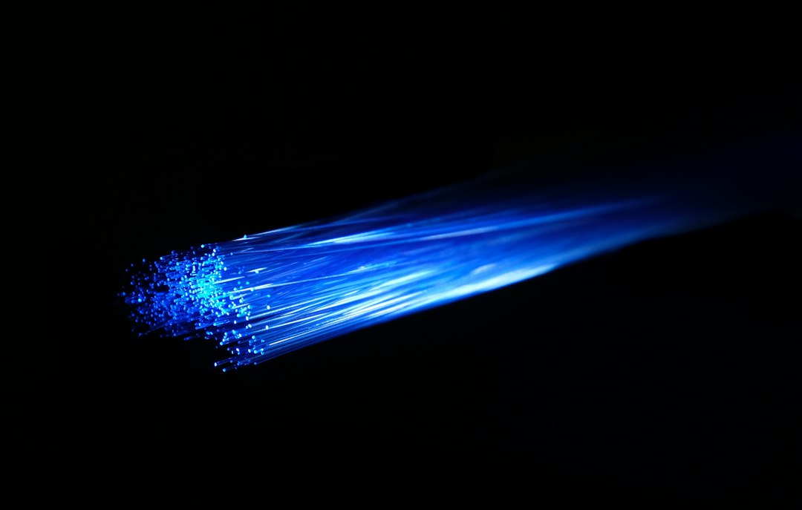
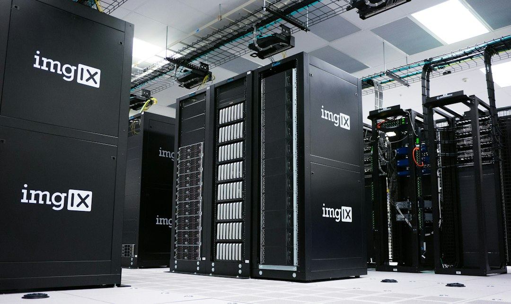

> 11月2日这天，美国芯片股单日又蒸发超过3000亿美元市值，自10月6日以来累计跌掉约3.5万亿；同一天，Marvell宣布以1150亿美元的企业估值、溢价约24%收购激光器厂Lumentum，2026年迄今最大一笔并购。同一批机柜的两段，被报了两个价：装进机柜里的算力在打折，连在机柜之间的光在涨价。

## 一、抛售与收购，是同一句话的上下半句

先把这天的账摊开看。10月30日，Intel单日暴跌近29%，这是它1974年以来最差的一个交易日，一天之内抹掉1460亿美元市值。Yahoo Finance统计，自10月6日以来，芯片和存储板块累计蒸发约3.5万亿美元：英伟达跌掉约8490亿，台积电约4200亿，AMD约2890亿，Intel约2760亿。看起来像一场溃败，但有个细节很扎眼：11月2日当天，标普500里七成股票在涨，跌的几乎只有芯片。钱没有离开市场，它只是离开了"算力"这个仓位。

就在这个板块失血的下午，Marvell交出了收购条款：4.5股Marvell换1股Lumentum，折合每股约1132美元，较10月28日"未受扰动"收盘价溢价23.9%，股票对价约1025亿美元，预计2028年上半年交割，合并后两家公司把总可服务市场看到5500亿美元。这场交易上周被彭博提前泄露时，市场已经预演过一遍报价结构：Lumentum盘后涨9%，Marvell跌7%——买方挨罚、标的领赏，这是典型的"被收购方握着稀缺资产"时的市场反应。抛售和收购发生在同一个板块、同一天，它们不是矛盾，是同一句话的上下半句：上半句说"算力本身不值钱了"，下半句说"算力之间的连接值钱多了"。

## 二、1150亿美元买的不是光模块，是过路权

看懂这笔交易的关键，是Marvell和Lumentum的旧关系：Marvell本来就是Lumentum的客户，高性能激光器一直向外采购。更值得玩味的是英伟达——今年早些时候它已经先给Lumentum投了20亿美元。先参股试探，再整体收编，这是教科书式的咽喉资产操作路径。再看Marvell自己的并购史：2021年100亿美元买Inphi，做的是互连；2026年2月35亿买Celestial AI，做的是光子；加上这次的Lumentum，三笔交易指向同一个词——interconnect。一家公司连续三次、跨越五年、越买越贵地押同一个方向，这不是跟风，是战略。

那么"连"凭什么比"算"值钱？AI集群的规模越铺越大，GPU之间、机柜之间、园区之间的数据搬运量的增速，已经超过了算力本身的增速。而光模块、光路交换（OCS）和高性能激光器恰恰是重资产慢工艺：激光器用的是化合物半导体，产线扩产以年为单位计。算力可以一年迭代一代，血管不行——你没办法在十二个月内凭空多出一条激光器产线。谁卡住良率和产能，谁就有资格向全行业收租。1150亿买的不是一堆光模块成品，是未来十年AI数据搬运的过路权。

## 三、水的行情也开张了：1600万美元，买了一位海洋学家

同一天还有一笔小到几乎没人注意的收购：Omen AI以1600万美元现金加股票，收了Aquatic Labs。前者做AI数据中心冷却液的实时监测传感器，后者的创始人Allan Adams是MIT物理教授、Woods Hole海洋研究所的海洋学家，半辈子都在设计海洋传感器。1600万对1150亿，数字上像个玩笑，但结构一模一样：把瓶颈资产上的知识密度整体买下来。

背景板是这组数字：美国数据中心每年为冷却芯片用掉170亿到190亿加仑水，Water Foundation预计五年内翻三倍。冷却液检测的传统流程是把样品寄去实验室、等一份多天后的报告；而液体一旦出问题，运营商通常宁可整池倒掉、全站停机，也不拿几亿美元的训练任务去赌一套水冷系统——所以水的生意，本质上是uptime的生意。Omen今年6月刚融完3100万美元A轮，到年底要监测的芯片负荷约250到300MW，对应的设备价值50亿到70亿美元。光和水在同一个星期先后被定价，说明瓶颈迁徙已经不再是论文里的话题，它变成了并购合同上的标的。

## 四、旧王的死因，写在新王的价签上

回头看Intel为什么跌。不是AI直接打的——这轮AI热潮几乎用不到Intel的产品。AI数据中心把全世界的内存产能吸走，内存涨价，PC成本抬升、需求萎缩。Intel预计PC出货今年下滑约12%，明年再跌10%；四季度营收指引150亿到160亿美元，比市场预期的170.7亿低了超过10亿，公司还明说今年现金流转正无望。它死于一场跟自己无关的盛宴的溅射伤害：AI的胃口顺手绞杀了Intel的客户。

瓶颈迁徙历来如此，每个时代换一批卡脖子的东西。PC时代卡CPU，移动时代卡屏幕和SoC，云计算时代卡机房，AI时代先卡GPU——现在，轮到卡光、卡水、卡电了。钱已经在新瓶颈上排队：同一天，Oracle递交文件发售100亿美元股票加100亿美元高级债，给AI基建输血，股价当日跌7%，其信用违约互换的报价已经被评论者形容为"高级垃圾级"；Meta则在洽谈至少200亿美元的新债券。电这一环，OpenAI干脆做成了公关工程——新发布的Grid Protectors计划里，佐治亚州Effingham县的3.2GW园区作为试点，承诺在电网紧张时最多让出1000MW，按他们的算法约等于70万户家庭的平均用电。当一家AI公司开始认真起草"给居民让电"的合同细节，还专门写一句"家庭和小企业不应为算力园区的电价买单"时，说明电已经贵到需要公关部门出面安抚的程度了。

## 结语：别问泡沫破没破，问血管涨到哪了

这一天市场的定价行为，泄露了一个重要秘密：资本不再为"谁能算"付溢价，开始为"谁能把算力连起来、凉下来、供下去"付溢价。3.5万亿美元的抛售不是AI的退潮，而是"肌肉"部分的出清；1150亿的收购和1600万的收购是同一封信的两份副本，收件人写的都是"瓶颈"两个字。下一个被写进合同的瓶颈，大概率是电——当70万个家庭的空调需要一座算力园区"让一让"，电就是下一个光。所以"AI泡沫破了吗"是个问错了的问题：泡沫是肌肉的事，会破，也会重新练出来；血管不参与泡沫，它只在每次迁徙的时候，安静地涨一次价。

📷 <a href="https://unsplash.com/photos/blue-and-white-light-in-dark-room-INNsF0Zz_kQ?utm_source=toby-blog&utm_medium=referral" target="_blank" rel="noopener">Photo by Compare Fibre</a> on <a href="https://unsplash.com?utm_source=toby-blog&utm_medium=referral" target="_blank" rel="noopener">Unsplash</a>

📷 <a href="https://unsplash.com/photos/server-racks-in-data-center-klWUhr-wPJ8?utm_source=toby-blog&utm_medium=referral" target="_blank" rel="noopener">Photo by imgix</a> on <a href="https://unsplash.com?utm_source=toby-blog&utm_medium=referral" target="_blank" rel="noopener">Unsplash</a>

