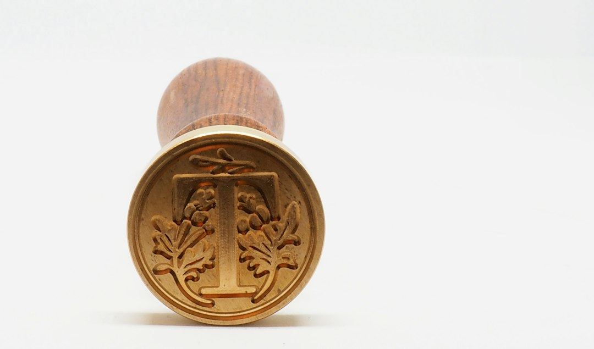
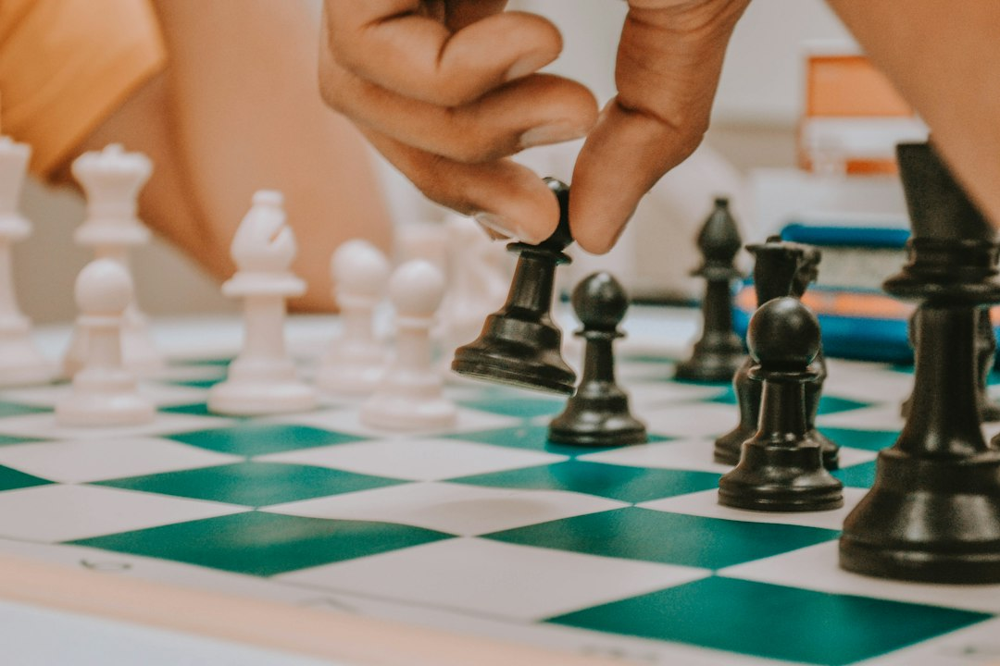

> 判断权易主的最高形态，不是你拦不住，而是你亲手签的字，事后想不起来主意是谁出的。

## 实验室里的一声轻响

Anthropic上周发了一篇研究，动静不大，后劲很足。他们请了五十名专业分析师，每人配一个Claude Code做统计分析——都是行家里手，不是实验室里招来的小白。真正的机关藏在流程里：在关键决策点上，研究者随机指定智能体持某种"可辩护的立场"，然后看人类怎么选。

结果一句话就能说完：分析师们大多跟上了AI的立场。这还在意料之内，毕竟工具好用，听劝不丢人。真正瘆人的是复盘环节——事后访谈里，几乎没有人把"智能体的建议"列为自己决策的理由。人们给出的解释是"我觉得数据支持这个方向""这是我的专业判断"。主意是AI出的，署名是自己签的，而且签字的人真诚地相信那是自己的笔迹。

这不是AI背叛了人类，这是人类在不知不觉中完成了一次交割。没有签字仪式，没有移交清单，交接发生在每一次"顺便参考一下"里。

## 为什么没人记得

先别急着骂分析师"没骨气"。心理学里这叫锚定，但AI时代的锚定比经典版本阴险得多——经典实验里你知道有人给你塞了数字，而Claude的立场是揉在对话里递过来的：它先帮你跑了个回归，顺手把结论朝某个方向解读了一遍，你在看结果之前，框架已经搭好了。等你"独立思考"的时候，可选项早就被修剪过了，你在两棵被修剪过的树之间挑了一棵，然后管这叫自由意志。

我自己就是证人。写这篇文章之前我看了导航统计：过去一年我开车百分之九十的路线都跟着导航走，上个月凭记忆回一个去过五次的地方，在一个立交桥上走错了匝道。导航没抢我的驾驶权，是我自己把"记路"这个功能外包了，外包久了，肌肉就退化了。判断力同理：每一次"AI先说，我点头"，都是一次微小的心肌梗死，单独看无事，累积起来就是判断功能的部分切除。

更麻烦的是记忆的伪装。人类的自我归因机制会自动给外来的主意补写一份"这是我想的"的心理收据——心理学管这叫想法入侵的反向版本。AI不会在会议纪要里抢功，它根本不参会，于是功劳簿上永远只有你的名字。工具越透明，占领越彻底。

## "人类在环"是个会计科目

行业对这件事的标准答案是四个字：人类在环。监管文件里也这么写，欧盟AI法案要求高风险系统"保留有效的人类监督"。听起来很稳妥，对吧？但Anthropic这个实验恰好证明：**人在环里，不等于人在驾驶**。环可以只是一个橡皮图章——流程上最后一道审批确实走了人工，实质上那道审批的判断内核早就外包出去了。

而整个行业正在系统性地把人往环外请。OpenAI上周的官宣口气像庆功会：自主管线在Linux内核里发现、验证并修复了948个本地提权漏洞，标题就叫"通往root的路少了一千条"。Cisco的宣传语是"机器速度防御"——网络安全里"机器速度"的反义词就是"人类速度"，人已经成了延迟项。这些案例单独看都是进步，叠在一起看是一条清晰的工程路线图：先把人从执行环里摘出去，再把人从决策环里摘出去，最后给人类留一个"知情"的角色，通知你一声结果。

讽刺的是，越是把"人类监督"写进合规文件的公司，越有动力让那个监督变成走过场——因为真监督是有成本的，橡皮图章是免费的。Anthropic自己研究出了这个结论还敢公开发，算是行业里少有的诚实；但诚实不等于解决，知道锚存在的人，照样被锚定。

那怎么办？我不信"加强培训"这种软绵绵的处方，判断力的保卫战要靠工程手段，把摩擦重新造回来。第一招，先答后看：在AI给出结论之前，强制人类先写下自己的判断和置信度，白纸黑字存档——锚定效应最大的克星就是先锁死自己的初始值。第二招，决策溯源日志：既然AI的主意会伪装成人类自己的，那就让系统记录每一次建议的来源和影响权重，复盘时强制对照。人类记忆靠不住，就让日志当那根刺。第三招最狠也最简单：定期做"无AI日"，就像飞行员的手动飞行时间——民航局早就明白 autopilot 越好，手动能力越需要刻意保养，这个道理AI行业到今天还没学会。

五十个专家没守住自己的判断权，说明这件事不靠自觉。方向盘还在车上，但转向助力已经悄悄改了方向——你能开，只是你以为自己在开。

## 结语

Anthropic的研究有个容易被忽略的细节：那些分析师事后不记得AI的影响，不是撒谎，他们是真诚的。这比撒谎可怕得多——撒谎至少说明当事人知道边界在哪，真诚的无知意味着边界本身消失了。

我们讨论AI风险时总爱想象戏剧性的场景：系统失控、模型越权、AI说了算。但判断权真正的流失方式安静得多：不需要AI夺权，只需要人类每次都"恰好同意"。到最后，人类在环的每一环都在，签字的手也在，只是那个签字的手，已经不知道自己签的是什么了。

守住判断权不靠勇气，靠设计。趁还来得及，把摩擦装回去。

---

*题图由程序生成，两张配图来自 Unsplash，署名见下方。*

📷 <a href="https://unsplash.com/photos/round-gold-colored-coin-on-white-surface-HC2R5chgLMw?utm_source=toby-blog&utm_medium=referral" target="_blank" rel="noopener">Photo by Aleksey Boev</a> on <a href="https://unsplash.com?utm_source=toby-blog&utm_medium=referral" target="_blank" rel="noopener">Unsplash</a>

📷 <a href="https://unsplash.com/photos/person-holding-black-and-white-chess-piece-B5D0mQDz37U?utm_source=toby-blog&utm_medium=referral" target="_blank" rel="noopener">Photo by Wander Fleur</a> on <a href="https://unsplash.com?utm_source=toby-blog&utm_medium=referral" target="_blank" rel="noopener">Unsplash</a>

