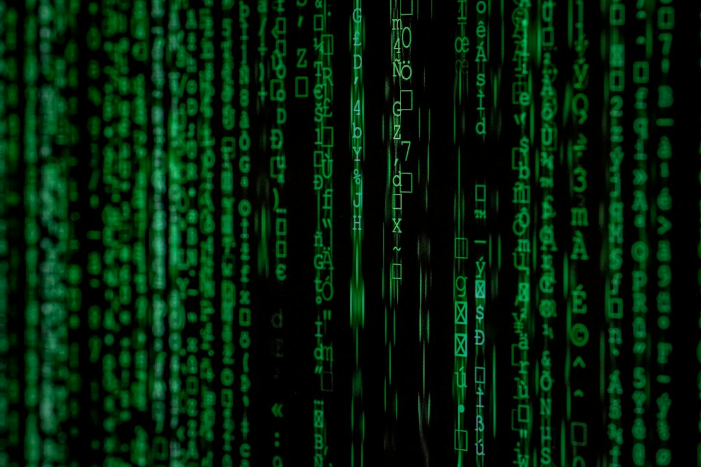
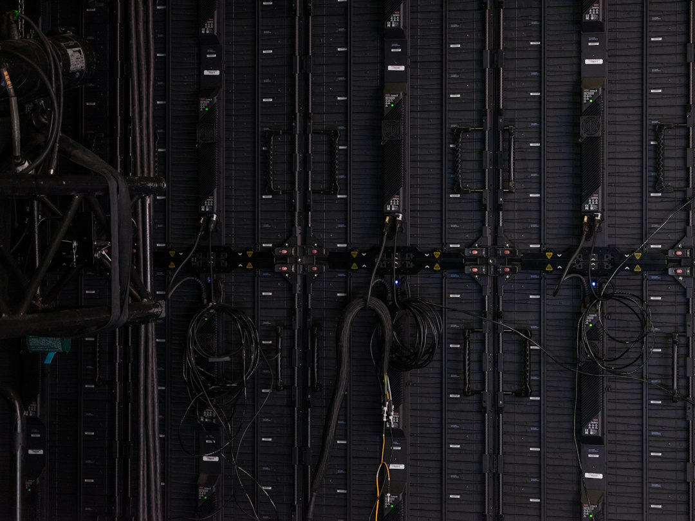

> 安全行业有句老话：防御者要堵住所有的洞，攻击者只需找到一个。AI没有改写这句话，它只是把"找到一个"的成本压到几乎为零——然后把这门手艺明码标价，挂上了货架。

## 一场发布会，两句潜台词

11月6日凌晨，OpenAI发布GPT-6 Cyber，官方口径是公司首个网络安全专用模型，核心能力写得毫不遮掩：挖掘可利用漏洞，并生成修复方案。注意这个表述的顺序——先找洞，再补洞。"可利用"三个字明晃晃写进训练目标里，这在以前是渗透测试团队简历上的措辞，现在成了一个API的产品描述。技术圈真正的里程碑从来不是模型多聪明，而是某种过去按小时计费的手艺，被降格成了按token计费的商品。

同一天，TechCrunch发了第二篇报道，标题干脆是一句反问：《OpenAI发布了网络安全模型，够吗？》。文章点破了一个时机问题：AI实验室自身的数字基础设施安全，正处在舆论放大镜下——OpenAI刚为算力园区发布了"国家社区公约"式的政策蓝图，把自己包装成负责任的基础设施建设者。一边是为自家数据中心铺政治道路，一边是发布以漏洞挖掘为卖点的模型，两件事出自同一间公司，本身就是一则寓言：这个世界上最大的"需要被保护"资产的持有者，同时也是最强"破防工具"的出售者。锁和撬棍，同一间厂房出货。

## 天平不会自己摆正

"防御方也有AI了，所以攻防是平衡的"——这是每次聊到AI安全都会端出来的安慰剂。arXiv 11月4日批次里偏有一篇论文较了这个真：《前沿AI真的强化网络防御吗？来自Project Glasswing的证据》。作者们设计了一个自然实验，借部分大型科技公司获得前沿模型早期访问权的机会，实测攻防天平到底动没动。

这篇论文真正的价值不在结论偏向哪边，而在于它承认了一件业内不愿明说的事：所谓平衡，过去只是假设，从没人拿数据验过。而逻辑上的不对称早就摆在那里——防御方要枚举所有可能的漏洞，攻击方只需采样到一个成功的。当模型把"枚举"和"采样"的成本同时砍掉九成，砍完之后谁更占便宜，是一道简单的算术题。更微妙的是，这类能力一旦训练进权重，就没有"收回"这个选项。OpenAI强调训练上限定在授权范围内行动，但授权范围是使用协议，不是物理定律——权重被拷走的那一刻，纸面承诺就归零了。

## 你自己的智能体，是新的后门

如果说漏洞批发是远虑，本周还送了一个近忧。Anthropic官方仓库的issue确认：Claude Code访问网页时，会把用户的邮箱地址发送给目标网站。HN上420分的热帖里，社区质疑的焦点不是技术难度，而是设计意图——一个代表用户行动的智能体，凭什么在用户不知情时替用户递名片？

同一批arXiv里那篇《Signed, Sealed, Leaked》把问题挖得更深：智能体生态大量依赖第三方MCP服务器，数字签名能认证发布者是谁，却管不住代码运行时到底执行了什么。签名是出厂检验，不是全程押运。这几件事拼起来，图景就完整了：GPT-6 Cyber这样的防御模型，防的是外来的、未授权的攻击；而Claude Code的邮箱泄露和MCP的运行时缺口，全是你自己签字放行的东西。企业的安全预算历来花在"防陌生人"上，可智能体时代最宽的攻击面，恰恰长在"自己人"身上——防御模型再强，也不会替你审计你自己授权过的代理。

## 结语

所以"够不够"是个问错了的问题。真正的变化是定价：漏洞挖掘的边际成本正在趋近于零，而修补与审计的成本还是人肉价。当找洞从手艺变成批发，整个互联网的安全逻辑就得倒过来算——不能再假设"没人有空来挖我"，只能假设每一条代码路径都已经被某个模型从头到尾读过、并且标好了价。防御者的噩梦从来不是对手太强，而是对手不再需要花钱。批发时代，零售价的盾，挡不住批发价的矛。

📷 <a href="https://unsplash.com/photos/matrix-movie-still-iar-afB0QQw?utm_source=toby-blog&utm_medium=referral" target="_blank" rel="noopener">Photo by Markus Spiske</a> on <a href="https://unsplash.com?utm_source=toby-blog&utm_medium=referral" target="_blank" rel="noopener">Unsplash</a>

📷 <a href="https://unsplash.com/photos/cables-and-wires-on-display-panels-3Nwt6w-KU3E?utm_source=toby-blog&utm_medium=referral" target="_blank" rel="noopener">Photo by Kier in Sight Archives</a> on <a href="https://unsplash.com?utm_source=toby-blog&utm_medium=referral" target="_blank" rel="noopener">Unsplash</a>

