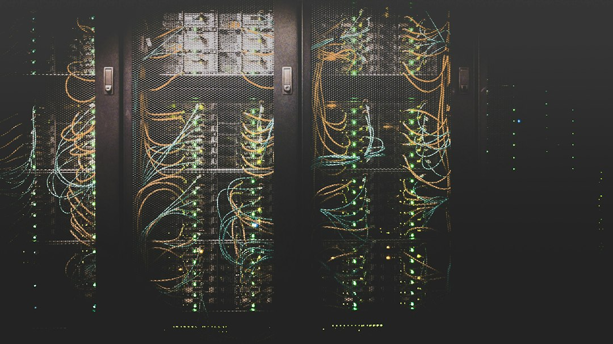

> 今年七月，高盛首席信息官Marco Argenti还在对媒体夸赞自家交易员的"vibe coding"：不懂编程的前台员工用AI把工具搭出来，再交给全行一万两千名工程师打磨，"让离问题最近的人先动手"。到了十月，一纸内部指引更新，Claude Code和GitHub的编码权限被收回到工程师手里，交易员和银行家全员出局。从全员推广到集体收回，中间隔了不到一个季度。

很多人看到这条新闻的第一反应是"大公司又反复横跳了"，笑一笑就划过去。但我觉得这件事值得多看两眼，因为它把一个被"全民AI"叙事掩盖了太久的东西，第一次摆到了台面上：企业对AI的接纳，从来不是一条均匀铺开的路，而是一场按部门分层的圈地运动——有的楼层在疯狂装电梯，有的楼层正在封楼梯。

## 三个月，从"人人动手"到"只留一万二千人"

先把时间线摆出来。四月，高盛把Claude从香港银行家的内部AI平台上摘掉了，据报道理由是把合同条款读得很严格，Anthropic方面则说Claude在香港"从未获得官方支持"——同一个平台上，ChatGPT和Gemini安然无恙。七月，Argenti还在讲那个动人的故事：交易员用AI监控客户资金流、建市场模型、做路演材料，工程师负责把这些"民间智慧"接手优化。十月，Bloomberg报道，内部指引更新后，编码类AI工具只对约四万七千名员工中的约一万两千名工程师开放，前台员工用惯的那些用途，一夜之间没有了官方出口。

有意思的是，Argenti自己几周前还在都灵的一个会议上讲高盛的AI采纳"分三波"：第一波是开发者，后面几波会扩散到全员。现在，第三波被行政命令砍回了第一波。这不是技术路线的调整——三个月里模型没有变笨，Claude Code也没有变难用。变的只有一件事：有人重新算了账。

## 被没收的不是工具，是需求

账算的是什么？七月那套安排有个致命的软肋：成千上万名没受过工程训练的员工，在存放着客户信息的机器上，运行着会自己写代码、还会执行代码的软件。这些代码没人审过、没人能解释它为什么这么跑、出了事没人能回答"这是谁的责任"。对一家每一行接触客户数据的代码都要能回答"谁写的、谁批的、为什么这么写"的银行来说，AI生成的代码在三个问题面前一个都答不上来。金融机构的命根子从来不是效率，是可审计性——效率决定你赚多少，可审计性决定你能不能继续开张。

但这里有个所有人都装作没看见的事实：需求没有被消灭。交易员明天还是要监控客户资金流，还是要给头寸建模，这些活不会因为工具被收回就退回Excel时代。需求只会改道：要么排队等一万两千名工程师的排期——把"离问题最近的人自己动手"变回"提需求、走流程、等三周"；要么流向水面之下——个人设备、私人账号、下班后的那台笔记本电脑。企业每一次没收工具，都在给影子IT播种，而影子IT恰恰是合规部门最不愿意在审计报告里看到的物种。高盛收回了明面上的Claude Code，未必收得回暗地里的那个。

同一周，Hacker News上还有一篇热帖，标题直白得很——《为什么我不会在编程中使用大型语言模型》，开发者社区里"对抗AI脑力透支"的反思声量也在涨。把这两件事放在一起看，会发现收权潮不只发生在合规部门：最先用出味道来的人，也开始重新掂量这笔账了。

## 万亿估值，翻不过合规那道墙

现在说这件事最锋利的部分。高盛是Anthropic IPO的主承销商之一，而Anthropic的估值已经被推到1.2万亿至1.3万亿美元区间，和OpenAI的1.25万亿几乎并肩。也就是说，这家最了解产品真实成色的客户，一边用承销业务给公司投"看多"票，一边用内部指引给产品投"看空"票——两件事同时成立，一点都不矛盾，这才是企业级AI市场的真相。

看高盛留下的那部分就明白了：今年早些时候，Anthropic的工程师驻场六个月，帮高盛搭建了交易记账和客户开户的Claude agent——它们被保留了下来，因为它们待在后台，由工程团队运营，有边界、有审计、有责任人。被清场的是前厅那些散装的vibe coding。翻译一下：机构愿意买单的AI形态，是"受控的器官"，不是"人手一把的瑞士军刀"。越是合规重的行业——银行、律所、医院、航空——AI渗透越不会从效率最高的地方开始，而是从最不怕出事的地方开始。

万亿估值定价的假设是"每个人都在用"，而真实世界正在长出的形状是"每个组织都在用，但只有组织免疫系统批准的那部分"。这两种形状之间的差价，就是未来几年最大的生意缝隙：谁能把"谁来担责"这件事产品化——审计日志、权限分级、行为回放——谁才配得上前厅与后厨之间的那道传菜口。下一代企业级agent平台的竞争，比的不是谁的模型更聪明，而是谁的失败可以被打上听证会。

## 结语

工具被收回，不代表倒退。高盛没有回到没有AI的日子，只是把AI从"员工的玩具"降级成了"组织的器官"。vibe coding那种自由散漫的快乐，在一个每行代码都可能被监管者翻出来重读的行业里，本来就活不过一个季度。真正值得记下的教训是：用户爱不爱你，和机构敢不敢用你，是两个完全不同的市场——前者的估值已经标到万亿，后者的门槛，才刚刚开始计价。

📷 <a href="https://unsplash.com/photos/new-york-stock-exchange-building-with-american-flags-HpYTYo_jF2Y?utm_source=toby-blog&utm_medium=referral" target="_blank" rel="noopener">Photo by Maxim Klimashin</a> on <a href="https://unsplash.com?utm_source=toby-blog&utm_medium=referral" target="_blank" rel="noopener">Unsplash</a>

📷 <a href="https://unsplash.com/photos/cable-network-M5tzZtFCOfs?utm_source=toby-blog&utm_medium=referral" target="_blank" rel="noopener">Photo by Taylor Vick</a> on <a href="https://unsplash.com?utm_source=toby-blog&utm_medium=referral" target="_blank" rel="noopener">Unsplash</a>

