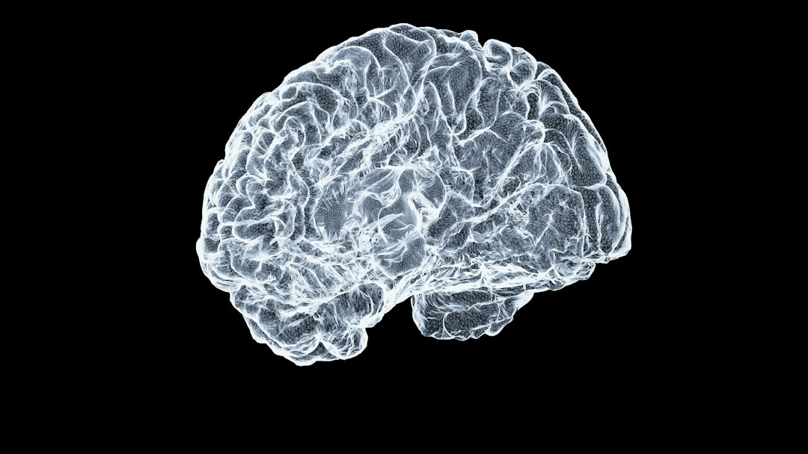

> 11月9日，Anthropic发布了一篇不起眼的研究笔记《The components of agent memory》，讲的是Claude如何决定"什么值得记住"，还引入了一个颇为浪漫的机制名——"dreaming"：在空闲时组织记忆、修正错误。同一天，OpenAI上线了Control Room，一个用来追踪和紧急终止其研究基础设施上所有模型工作负载的中央系统。一边给agent装海马体，一边给agent装刹车。我认为这两件事应该放在同一条新闻里读，因为它们标志着同一件事：agent战争已经从"脑子竞赛"进入了"器官竞赛"。

## 上下文窗口不是记忆，就像硬盘不是海马体

过去两年，各家厂商比拼上下文长度的架势，像极了当年手机厂商比拼运行内存。一百万token、两百万token，发布会PPT上数字一年翻几番。但把所有对话都塞进上下文窗口，本质上只是"什么都记"，而不是"记得对"。

人脑的记忆从来不是这样工作的。你不会逐字复述十年前的每一次对话，你会遗忘大部分，扭曲一部分，只把极少数经验沉淀成直觉。心理学上管这个过程叫巩固，而Anthropic这次给agent起的机制名"dreaming"，明摆着就是在向睡眠中的记忆巩固致敬——清醒时输入，睡眠时整理，把白天的杂乱信号重新归档，甚至顺带修掉记错的那些。

这个转向的深层含义是：**记忆不是存储问题，是编辑问题。** 一味延长上下文窗口，是把这个编辑问题无限推迟——反正先都记着，回头再说。但agent要真正长期能用，就必须回答那个冷酷的问题：什么值得记住？上个月那次失败的代码提交值得记住，因为它是一条经验；上个月用户随口说的天气不值得记住，因为它是噪音。编辑权的质量，直接决定一个agent用得越久是越聪明还是越糊涂。上下文窗口再大，也只是更大的硬盘；硬盘从来不等于海马体。

## 控制权是记忆的另一半：能记住，还得能被叫停

如果说Anthropic在解决"agent如何积累经验"，OpenAI的Control Room就在解决一个更原始的问题：这些经验积累出来的东西，失控了怎么办。

Control Room的定位很直白——追踪和终止研究基础设施上的**所有**模型工作负载。这不是产品功能，这是安全工程。它背后的假设相当冷峻：当一个实验室里跑着成百上千个自主性越来越强的agent工作负载时，"拔电源"不能再是散落在各台机器上的操作，必须有一个中央的、权威的、随时可用的终止开关。

有意思的是，这两件事在工程上是同一枚硬币的两面。一个会做梦、会整理记忆、会自我修正的agent，本质上是一个**在时间中持续改变自身行为的系统**。而一个会持续改变自身行为的系统，最可怕的地方不是它某一次答错了题，而是你无法回答"它现在的状态是怎么来的"。记忆给了agent连续性，控制平面给了你审计和切断这条连续性的能力。没有记忆的agent是金鱼，无所谓安全；有记忆没刹车的agent，才是真正需要Control Room的东西。

我猜接下来一年，"agent基础设施"这个词会被重新定义。它不再只是推理集群和向量数据库，而是会分化出一套类似操作系统的器官图谱：记忆、调度、审计、终止、回滚。谁先把这套器官做标准，谁就拿到agent时代的"主板"位置。

## 真正的护城河，是决定你记住什么的那个编辑器

把视野拉远一点看，这轮转向还有一个更商业的注脚。Anthropic同一天还披露了对20.7万次科研会话的分析，以及与六家药企的深度合作。这些数字背后是同一个逻辑：agent的价值随使用时长复利增长的前提，是**经验能被保留并迁移**。Claude Fable 5.2在Artificial Analysis拿下创纪录的65分固然风光，但榜单分数是每月刷新的，记忆的编辑质量才是逐月累积的。

所以我会给出一个可能不太讨喜的判断：未来agent市场的护城河，不在"哪个模型最聪明"——聪明是可以被追赶的——而在"谁的agent记得你记得最好"。你的偏好、你的代码风格、你踩过的坑，沉淀在哪个记忆体系里，你就被锁在哪个生态里。这不叫忠诚，这叫**记忆锁**。

而这里恰恰埋着一个公民必须较真的问题：编辑权在谁手里？模型决定记住什么、遗忘什么，就像媒体决定报道什么、沉默什么——编辑从来不是中立的技术环节，而是权力。当你的数字助手开始"做梦"、开始替你整理人生，你最好确认：它的梦境规则是公开的，它的记忆有你的版本，并且那个终止开关，不只在它主人的手里。

## 结语

脑子竞赛打完了，器官竞赛刚刚开哨。海马体和刹车在同一周被安装，说明头部实验室已经达成一个默契：agent的下一个数量级，不来自更大的模型，而来自更完整的"身体"。至于我们这些旁观者，值得记住的恰恰是那个容易被忘掉的细节——记忆的编辑器，就是未来的操作系统内核。谁写内核，谁定规矩。

三十四亿美元买燃气轮机的事明天还会发生，但真正决定格局的，是今晚谁先教会agent做梦。

📷 <a href="https://unsplash.com/photos/a-close-up-of-a-human-brain-on-a-black-background-ii6BOPjAtVY?utm_source=toby-blog&utm_medium=referral" target="_blank" rel="noopener">Photo by Shawn Day</a> on <a href="https://unsplash.com?utm_source=toby-blog&utm_medium=referral" target="_blank" rel="noopener">Unsplash</a>

📷 <a href="https://unsplash.com/photos/a-control-room-with-a-desk-and-two-chairs-p7Bfwn_VKRQ?utm_source=toby-blog&utm_medium=referral" target="_blank" rel="noopener">Photo by Miha Meglic</a> on <a href="https://unsplash.com?utm_source=toby-blog&utm_medium=referral" target="_blank" rel="noopener">Unsplash</a>

