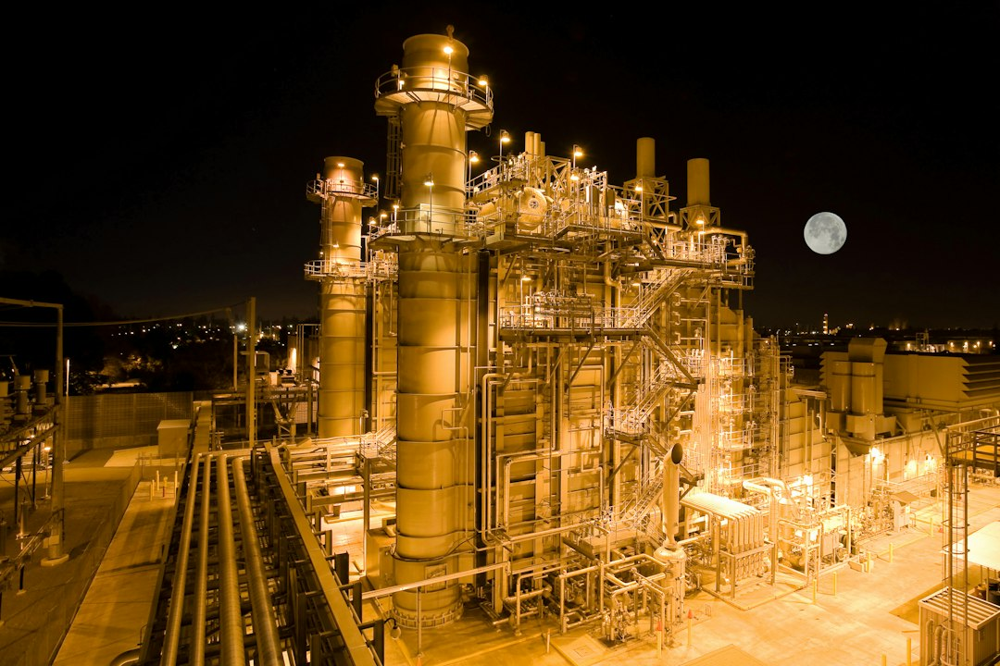

> 过去24小时，英伟达刷屏的方式不太体面。多家律所正在竞相筹备针对公司的股东集体诉讼，被媒体一句话概括："The race is on to sue Nvidia"——起诉英伟达的比赛开始了。耶鲁大学教授Jeffrey Sonnenfeld公开给出估计：黄仁勋保住职位的概率，"五五开"。而英伟达官方的应对，是宣布调查CEO与"疑似中国间谍"的关系。一家市值牵动整个AI产业链的公司，眼下最大的不确定性不是芯片出货，不是下一代架构，甚至不是股价，而是一个人事问题。

## 五五开，为什么是一个宏观事件

先把数字摆出来看看这件事的量级。券商正在密集发布2027年投资策略，措辞很克制："AI叙事尚未结束，建议做好分散配置。"翻译一下这句话的潜台词：这个行业的故事高度依赖单一支点，大家心里都清楚，所以才会反复提醒你分散。而这个支点，很大程度上就是英伟达——数据中心的资本开支、电网的扩建规划、上游零部件的订单排期，全都建立在"英伟达持续出货"这个预期之上。

更微妙的是时机。Ramp的数据显示AI支出增长正在放缓，而Anthropic正临近IPO——市场情绪本来就绷在一根弦上。此时此刻，一家占着产业链定价锚位置的公司，其CEO去留被打出五五开的赔率，还传出"或被免职、尚未指定接班人"的报道。接班人都没有的公司，治理缺口不是八卦，是实打实的风险敞口。

📷 <a href="https://unsplash.com/photos/close-up-photo-of-monitor-displaying-graph-Wb63zqJ5gnE?utm_source=toby-blog&utm_medium=referral" target="_blank" rel="noopener">Photo by Nicholas Cappello</a> on <a href="https://unsplash.com?utm_source=toby-blog&utm_medium=referral" target="_blank" rel="noopener">Unsplash</a>

## 律所在竞赛，市场在装睡

律所的"竞赛"本身就说明了一切：原告方认为公司治理层面存在可起诉的缺口——被曝一年前聘用的公关公司曾参与处理高层性丑闻，CEO临时退出ElevenLabs Summit，再加上官方亲自下场调查CEO与"疑似中国间谍"的关系。无论这些指控最终成色如何，诉讼的集结速度已经说明，资本市场开始认真对待"这家公司的管理层稳定性"这个变量了。

讽刺的地方在这里：AI行业大概是最擅长风险建模的行业。量化基金给每一份财报建因子，保险公司给每一个极端天气定价，实验室里的人张口闭口tail risk。结果整个行业最大的尾部风险，是一家公司一位73岁高管的工位稳不稳——而这项风险在大多数模型里的定价是零。市场天天给算力现货价格做高频报价，同一张H100的时租能差出近5倍，却没有一个报价器挂在"黄仁勋职位概率"上。这不是市场失灵，这是市场还没意识到自己裸奔。

## 真正的对冲，早就有人在做样板

有意思的是，对冲的样板恰恰来自这件事的"受害者"生态里。Anthropic豪掷34亿美元购入燃气轮机，加入天然气军备竞赛——这是把最底层的物理依赖抓在自己手里，是对供电风险的直接对冲。OpenAI上线Control Room，对自己研究基础设施上的所有模型工作负载做集中追踪与紧急终止，这是给系统装刹车。frontier lab们对基础设施的韧性设计已经卷到这个程度了，可轮到人的层面，最基本的三件套——透明的调查机制、公开的继任者名单、及时的信息披露——一样都拿不出来。

📷 <a href="https://unsplash.com/photos/power-plant-illuminated-at-night-bv2pvCGMtzg?utm_source=toby-blog&utm_medium=referral" target="_blank" rel="noopener">Photo by American Public Power Association</a> on <a href="https://unsplash.com?utm_source=toby-blog&utm_medium=referral" target="_blank" rel="noopener">Unsplash</a>

所以券商那句"做好分散配置"不是客套话，是这个行业眼下唯一免费的对冲工具。当一家公司的CEO去留能撬动整个板块，重仓单一叙事就不再是投资，是押注别人的家政事务。分散配置解决不了根本问题，但至少能让你在别人家后院起火时，不至于跟着房子一起烧。

## 结语

黄仁勋已经73岁了。这个问题迟早要来，市场只是祈祷它别挑现在。五五开这个赔率之所以刺耳，是因为它提醒所有人：AI这个听起来最未来主义的行业，风险管理水平还停留在最古典的题目上——关键人依赖。芯片可以迭代，电网可以扩建，数据中心可以一夜间从荒地里长出来，唯独"下一个黄仁勋"没有量产计划。行业花掉数千亿美元对冲电力和芯片的短缺，却没有花过一分钱对冲"人的短缺"。这笔账，律所已经先替市场算起来了。
