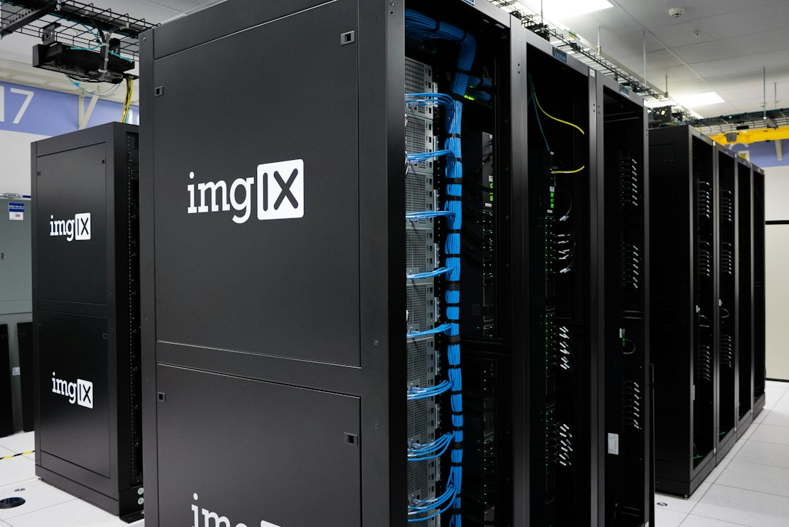

今天的主线只有一条：钱和模型在赛跑。Anthropic把IPO定价区间钉在每股70-78美元、隐含估值1.404万亿美元，认购方却被AI股回调吓得把心理价位压到1.1万亿；同一天，谷歌Gemini 4 Carbon全量开放、Meta发布最小模型Muse Ember、Anthropic自家推出Claude Meetings——三位选手在上市路演的间隙里还在疯狂上新。另一边，36氪的深氪写"一台机器2000万"的天价GPU生意，纽约州的AI安全法正式生效：这场泡沫的四面（供给、需求、监管、退出）今天全都动了。

## 研究突破

- **DeepMind发布AlphaProof Code**：谷歌DeepMind推出AlphaProof Code，宣称在复杂软件的深度验证上取得突破，用于对大型程序正确性做形式化验证。该项目登上Hacker News热榜第一梯队（571分、175条讨论），是当日社区热度最高的AI研究发布。
- **Anthropic用Claude Fable 5.2设计实体电子设备**：Anthropic让Claude Fable 5.2根据简短提示词设计了三台电子设备（免提扬声器、语音助手中枢、掌上虚拟宠物），硬件公司Diode Computers依其输出文件造出了可运行原型。
- **Anthropic发布智能体记忆研究**：新文《The components of agent memory》探讨Claude如何决定"什么值得记住"，介绍用"做梦"式离线整理组织记忆、修正错误的机制。
- **Anthropic分析20.7万个科研会话**：经济学团队分析207,000个研究会话，研究科研人员如何使用Claude、哪些任务渗透率高、AI如何加速科学发现。
- **arXiv cs.AI单日480篇**：11月10日arXiv cs.AI类目收到480条投稿。其中《Shortcuts and Boundaries: Verifiable RL Misalignment and Contextual Safety Learning》研究可验证的强化学习失准问题；《Sage-Taiyi》提出面向科学发现的元认知架构。
- **陶哲轩上线《六大数学精要》**：陶哲轩在个人网页发布Six Math Essentials，浓缩数学六大核心要点，登上Hacker News热榜（111分）。
- **HN热议"推理到底在解什么目标函数"**：alexwang.ai文章《What objective is reasoning solving?》获94分讨论；《AI usage generates a fragile codebase》（360分）与《AI is dramatically accelerating AI research》同日引发热议。

## 产品发布

- **谷歌Gemini 4 Carbon全量开放**：两周前仅向部分网络安全防御者开放的Gemini 4 Carbon现已面向所有用户开放，为谷歌迄今最强模型。发布价为每百万输入2美元/输出10美元（与GPT-6.1 Sol、Claude Sonnet 5.5同价），12月1日起将涨价至4/20美元（Opus 5.5价位）。Simon Willison实测其SVG绘制与Antigravity IDE内的Three.js动画生成；另有开发者用Antigravity的/swarm功能让Carbon协调子智能体做出开放世界3D游戏。
- **Meta发布最小模型Muse Ember**：定位复杂推理执行与智能体高频任务（工具调用、编码子任务、路由、抽取、长文档解析），定价与GPT-6 Luna、Claude Haiku 5.5对齐（0.10/0.50美元每百万token），并称其位于Artificial Analysis效率前沿——没有模型能以更低的单任务成本拿到更高分。提供minimal至max共六档推理强度。
- **Meta Muse智能体登陆手表**：Meta的AI智能体Muse上线Apple Watch与Android Wear OS。
- **Anthropic推出Claude Meetings**：把职场讨论自动转化为计划与任务的产品，同期Claude Whiteboards、Claude Sheets、Claude Data一并亮相，办公场景对垒微软谷歌。
- **OpenAI推出Businesses in ChatGPT**：ChatGPT上线企业业务档案功能，TechCrunch评价称这让它"更像Google了一点"；同日OpenAI还发布了AI对自由职业市场影响的研究报告。
- **Adobe全家桶加AI智能体**：Photoshop、Premiere、Firefly获得新AI智能体与创作工具，Adobe还发布了MCP服务。
- **Ring发布家庭安防无人机与企业安防机器人**；**Spotify AI DJ新增语音与性格**，并提供"少废话"选项。

## 融资并购

- **Anthropic IPO定价区间出炉：每股70-78美元，隐含估值1.404万亿美元**。Bloomberg报道称AI股回调后，IPO认购方对估值的预期最低已压至1.1万亿美元。TechCrunch披露七位创始人每人将在IPO中套现约2.5亿美元。Anthropic同日在澳大利亚提交招股文件，当地个人投资者可参与认购。
- **OpenAI收购旅行初创Odessia**：由Sonder创始人创办。
- **Oura以6.25亿美元收购AI原生初级诊疗初创Counsel Health**。
- **阿里拟分拆平头哥独立上市**（36氪8点1氪援引消息）。
- **脑机接口公司获亿元投资**：顺为、高瓴等投资一家做"神经蠕虫"的脑机公司；eVTOL交易与运力服务商零界航空完成千万元天使轮。
- **PSI要把AI驱动的科学发现做成生意**，获TechCrunch专题报道。

## 产业应用

- **物流AI走向一线现场**：36氪报道G7易流7700亿Token背后，物流AI正从屏幕报表走向车队一线作业场景。
- **天价GPU生意**：36氪深氪报道"一台机器2000万"的隐秘GPU交易链条，高端算力一卡难求的二手市场生态。
- **AI投研进入资管公司**：OpenAI披露Franklin Templeton用其产品支持投资研究；法律行业方面，OpenAI发布Gilbert + Tobin律所重塑业务流程的案例。
- **券商策略会看2027**：多家券商把脉2027年行业机遇，算力投资逻辑从"抢货"转向"看兑现"；华泰证券认为L3智驾落地将是产业重要里程碑。
- **SK集团本周开会定战略**：SK集团高管本周开会讨论明年商业战略，人工智能是关键议题。

## 行业动态

- **黄仁勋风波发酵**：36氪8点1氪援引外媒称黄仁勋或被英伟达免职、尚未指定接班人；另据TechCrunch梳理了英伟达CEO黄仁勋与"涉嫌中国间谍"绯闻的时间线，此前36氪报道英伟达及黄仁勋遭股东集体诉讼、市值两天蒸发2.85万亿元。相关消息均为媒体报道，英伟达官方未确认。
- **纽约州AI安全法生效**：OpenAI、Anthropic等面临新监管框架下的合规义务。
- **民主党启动国会调查**：华盛顿邮报报道民主党人正对SpaceXAI、Meta和苹果启动国会调查；Palantir则聘请前民主党参议员应对新一届国会的审查。
- **Brockman发文谈网络安全窗口期**：Greg Brockman发表长文《The Defender's Window》，以OpenAI-Hugging Face事件为切口，认为AI正让普通攻击者的能力升级，防御方必须以前所未有的速度升级安全实践。

## 市场数据

- **Anthropic IPO估值预期承压**：AI板块回调背景下，认购方预期估值下探至1.1万亿美元，低于招股区间隐含的1.404万亿。
- **碳酸锂触及年内低点**：较5月中旬高点已跌去近六成。
- **两市融资余额减少13.85亿元**。
- **英国智库预测通胀明年达4.4%峰值**，2030年才能回落至目标；中金认为通胀粘性未退，支持美联储继续加息。
- **2026年化石燃料二氧化碳排放下降0.4%**：埃克塞特大学研究，被视为全球排放可能见顶的信号，登上HN热榜。

## 技术工具

- **谷歌开源modern-web-guidance**：教编程智能体摆脱"2019年式JavaScript"、改用现代Web原语的指导库，Show HN获250分。
- **Blender 5.3发布**：正式支持高斯泼溅（Gaussian Splatting），HN 421分。
- **微软发布macOS版Process Explorer**。
- **AMD Zen 6架构深度解析**：chipsandcheese发布《Feeding the Beast》详解Zen 6家族。
- **.NET 11运行时新特性**上线。

## 安全与伦理

- **Hugging Face高管警告开源AI正被网络攻击侵蚀**：接连的攻击事件可能让开源AI"变得更不开放"。
- **Fireworks AI数据泄露波及Notion**：Notion确认第三方AI供应商Fireworks AI的安全事件波及其客户。
- **韩国金融安全监管机构发生数据泄露**。
- **Anthropic Glasswing项目七个月后遭遇差评**：VulnCheck发布11月更新称，Glasswing（Anthropic面向开源维护者的漏洞发现项目）七个月来的发现结果"令人失望"，维护者不堪其扰。
- **OpenAI加固自家安全体系**：发布Control Room系统统一追踪并可叫停研究基础设施上的模型工作负载；与Hacktron合作挖掘自身系统漏洞；上调漏洞赏金。

---

**数据来源**：OpenAI官方RSS、Google DeepMind、Anthropic、Meta、Simon Willison、TechCrunch、Hacker News、arXiv cs.AI、36氪、FT中文网、中国新闻网财经等

📷 <a href="https://unsplash.com/photos/new-york-stock-exchange-building-with-american-flags-HpYTYo_jF2Y?utm_source=toby-blog&utm_medium=referral" target="_blank" rel="noopener">Photo by Maxim Klimashin</a> on <a href="https://unsplash.com?utm_source=toby-blog&utm_medium=referral" target="_blank" rel="noopener">Unsplash</a> ｜ <a href="https://unsplash.com/photos/black-imgix-server-system-pgdaAwf6IJg?utm_source=toby-blog&utm_medium=referral" target="_blank" rel="noopener">Photo by imgix</a> on Unsplash

