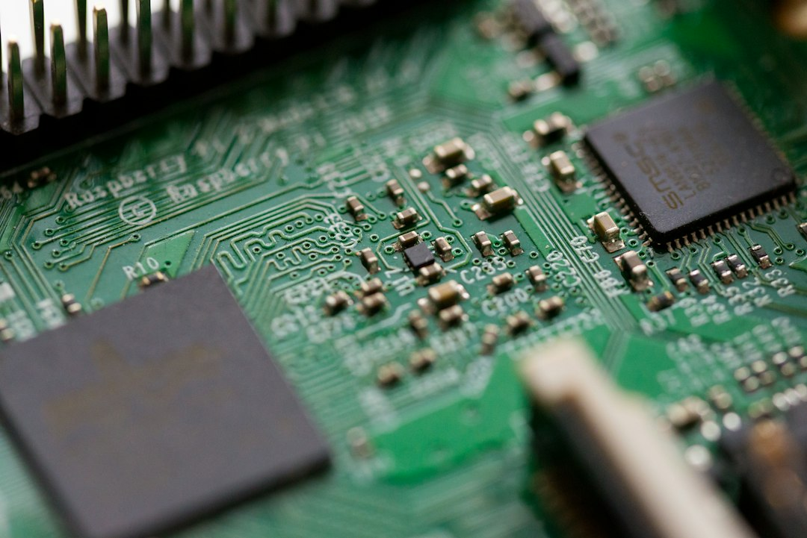
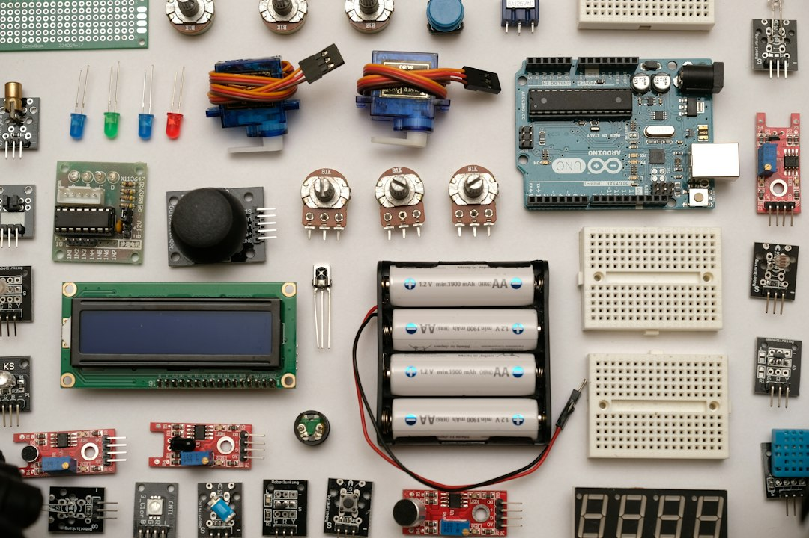

> 11月9日，Anthropic放出一篇不太起眼的研究：让Claude Fable 5.2根据简短提示词，设计了三台实体电子设备——一台免提扬声器、一个语音助手中枢、一只掌上虚拟宠物。硬件公司Diode Computers拿到模型的输出文件，直接造出了可运行的原型。演示里没有"电路工程师全程护航"的戏份。巧合的是，同一天DeepMind的AlphaProof Code冲上Hacker News热榜第一梯队，主打给大型软件做形式化验证。一边在补"从提示词到实物"的路，一边在补"从生成到证明"的路。两件事撞在同一个新闻周期里，巧合得像排练过。

## 三台都是玩具，这恰恰是重点

第一反应容易是撇嘴：扬声器、语音中枢、电子宠物，全卡在消费电子鄙视链的最底端，离"AI设计芯片"差着一万条产线。但这个评价把因果搞反了。恰恰因为造的是玩具，这件事才值得当真。

打样的逻辑和上线不一样。没有人会用一条第一次跑通的流程去设计心脏起搏器或者车载控制器，但所有人都敢拿玩具试水——试错成本最便宜、安全边界最宽松、验收标准最直白（能开机、能发声、能卖萌），玩具是整条工具链最理想的试验田。所以这三台设备真正被验证的，不是模型的设计品味，而是链路本身：提示词进来，设计文件出去，第三方工厂照单生产，实物能运行。链路每一段都有真实的人类公司在交接，不是实验室里的单机演示。

工具链跑通一次之后，玩具和量产机之间隔着的就不再是"能不能"，而是"敢不敢"和"贵不贵"。前者是决策问题，后者是工程问题——而工程问题，在AI行业的历史上从来没有不被卷平的先例。

📷 <a href="https://unsplash.com/photos/tilt-shift-photography-of-green-computer-motherboard-bN5XdU-bap4?utm_source=toby-blog&utm_medium=referral" target="_blank" rel="noopener">Photo by Chris Ried</a> on <a href="https://unsplash.com?utm_source=toby-blog&utm_medium=referral" target="_blank" rel="noopener">Unsplash</a>

## 硬件的护城河，一直修在"打样贵"上

这两年软件行业被AI掀得最狠，原因之一是软件的迭代成本近乎为零：改一行代码，按一次回车，部署一条流水线。AI的生成能力叠加零成本迭代，等于把"想法到成品"的周期压到了小时级。硬件一直没享受这个待遇——画板、打样、贴片、调试，一轮下来几周起步，烧的全是真金白银。所以硬件创业的护城河从来不只是创意，更是"谁耗得起一轮又一轮的打样"，大厂靠资金和供应链把小团队挡在门外，挡的其实就是这个周期成本。

如果"提示词到可运行原型"的周期从几个月压到几天，被压掉的那部分恰恰就是这道护城河的地基。小团队第一次有机会在大厂的立项会开完之前，把想法变成一台能开机的东西。把这件事放到同一天的另一条新闻旁边看更有意思：36氪在报道"一台机器2000万"的天价GPU二手生意，算力还在涨价的通道里狂奔，而"设计"这个环节的单价正在跳水。这可能是AI这一年里最被低估的一条剪刀差——贵的越来越贵，便宜的越来越便宜，而硬件设计恰好站在便宜的那一头。买不起算力的团队和造得起硬件的团队，很快会是同一批人。

## 先别急着把"AI工程师"的牌子挂出去

泼冷水的部分也不能省。原型是原型，产品是产品，中间隔着认证、模具、供应链谈判、量产良率——每一项都不在提示词的射程之内。Diode Computers造出来的是三台能开机的东西，不是三款能上架的产品，"可运行原型"这五个字里的每个字都很贵，也很有限。

还有一个该诚实地问的问题：设计文件里，有多少是模型自己的判断，多少是模板和元器件库的填空题？Anthropic的演示没有拆解这一层，而根据简短提示词"设计"出标准拓扑的扬声器电路，和一个团队能凭空规划一台从未存在过的设备，是两件难度差着数量级的事。今天喊"AI会设计硬件"，和2023年喊"AI会写代码"是同一句话。后者的结局我们都看到了：会写是真的，替代工程师是假的，真正被替代的是"不会用AI的工程师"。同日Hacker News上那篇《AI usage generates a fragile codebase》拿了360分，说的就是生成能力外包之后人类理解力同步外包的代价——代码如此，电路只会更狠，毕竟烧掉的板子不会给你报栈信息。

📷 <a href="https://unsplash.com/photos/flat-lay-photography-of-circuit-board-zP7X_B86xOg?utm_source=toby-blog&utm_medium=referral" target="_blank" rel="noopener">Photo by Robin Glauser</a> on <a href="https://unsplash.com?utm_source=toby-blog&utm_medium=referral" target="_blank" rel="noopener">Unsplash</a>

## 结语

所以这件事的正确读法不是"AI会造硬件了"，而是"从想法到实物"这条链路上，人的位置正在从每个环节都在场，收缩到只在开头给提示词、在末尾做验收。中间那段曾经需要十年经验才能走完的路，正在变成一段可以外包给模型和工厂的传送带。玩具只是传送带上跑通的第一批货，货不值钱，传送带值钱。硬件行业的"script kiddie时刻"还在路上，但路已经从泥地铺成了柏油——等第一批靠提示词起家的硬件小团队把产品真正送上货架那天，回头再看这三台电子宠物，大概就是行业换挡的那个吱呀声。
