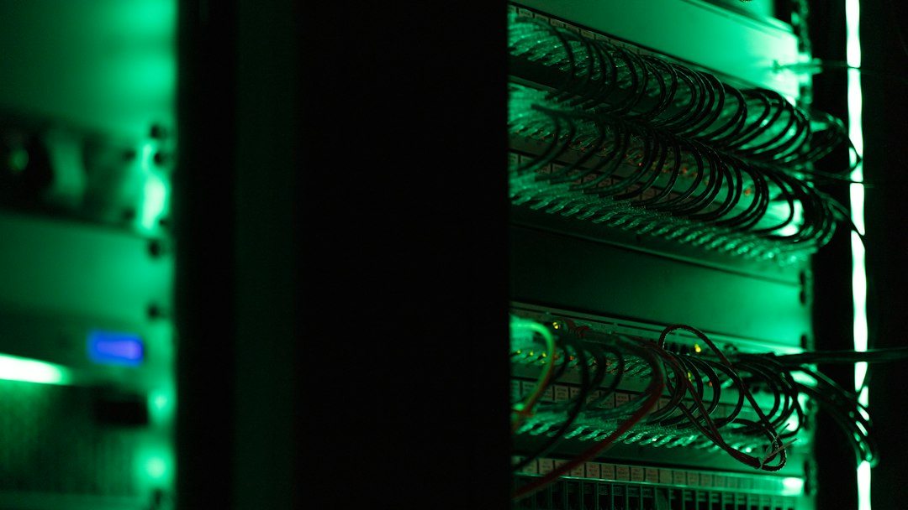

> 24小时里出现了两件互相打脸的事。一边是钱：OpenAI 第三季度营收首破 100 亿美元、环比增长近五成，Anthropic 的 IPO 被认购到"数倍超额"，承销商忙着考虑提价。另一边是人：英伟达董事会准备罢免干了 33 年的黄仁勋，国会准备传票，公司却没有接班计划。算力链的二房东 CoreWeave 则在同一天承认，它不再靠债市借钱，改向客户收预付款。AI 生意的三根支柱——需求、治理、融资——在同一天各自露出接缝。

今日主线：英伟达的治理危机从"绯闻"升级为"换人程序"，而 AI 的钱仍在加速涌入，算力二房东改向客户收预付款来支撑 1325 亿美元积压订单。

## 一、研究突破

- **DeepMind 发布 AlphaGenome 2**：新一代 DNA 序列模型从"组织平均"下沉到"单细胞类型"，采用条件模型架构，可在给定细胞类型或细胞状态的条件下预测变异效应。训练数据超过 1 亿个单细胞图谱、覆盖 68 种组织，识别出的"改变基因表达的变异"数量接近上一代的两倍，并能对模型没见过的细胞与疾病状态做预测。今日起通过 AlphaGenome API 开放非商业研究使用，商业研究走私有预览。（来源：deepmind.google，11月11日）
- **arXiv 最新批次聚焦智能体记忆与自我进化**：11月10日提交的 cs.AI 批次中，《When Should Agents Remember? Falsification-Gated Self-Evolution for LLM Agents》（2611.14326）提出用"可证伪"作为记忆写入的闸门；《Don't Just Trust Your Memory: Evidence-Linked Memory Reduces Memory-Induced Degradation in LLM Agents》（2611.14320）用证据链接缓解记忆导致的性能退化；《Contrastive Discovery: Open-Ended Scientific Discovery over Competing Explanations》（2611.14514）研究在多个竞争性解释之间做开放式科学发现。（来源：arxiv.org）
- **"AI 没变笨，是我们变挑了"**：论文《AI Isn't Getting Dumber, We're Getting Pickier: Rising Standards in Human Evaluation of Large Language Models》（2611.14333）提出，人类对大模型评测标准的抬升速度可能快于模型能力的提升速度，这会系统性放大"退步"的主观感受。（来源：arxiv.org）
- **苹果公开 RAG 检索加速研究**：Apple Machine Learning Research 发布《Faster Retrieval for Better, More Efficient RAG》，讨论在检索环节提速以提升检索增强生成的效率，登上 Hacker News 首页（146分）。（来源：machinelearning.apple.com / Hacker News）
- **HN 热议"线性规划能否做权重空间编程"**：文章《Can a Linear Program Do Weight-Space Programming?》获 237 分讨论，探讨用线性规划直接操作模型权重空间的可能性。（来源：news.ycombinator.com）

## 二、产品发布

- **谷歌推出 Gemini Decisions API**：由新模型 Gemini Decision 1（gemini-decision-1）驱动，不逐 token 生成答案，而是在单次前向传播中对候选选项打分，一次请求最多可评估 1000 个问题，共享输入支持文本、图像、音频、视频与 PDF（上限 25.6 万 token）。返回三种决策类型的概率与置信度：是非判断（noul）、多选（choice，2 至 255 个选项）、量表打分（score）。端到端延迟 150 至 250 毫秒，按每百万输入 token 0.10 美元计费、输出 token 不计费，官方称在共享基准上比 Gemini 3.5 Flash-Lite 搭配交互式 API 便宜近 5 倍。Gemini Notebook 已把它当作实时路由器，日常查询延迟降低最多 40%。（来源：blog.google，11月11日；Hacker News 245分）
- **Databricks 升级 Genie 智能体**：新版可执行需要长时间推进的多步骤任务，依靠 Databricks 自建的本体层（ontology）获取企业数据上下文，被定位为面向高管的"常开型"智能体。CEO Ali Ghodsi 演示了自己如何用它分析员工满意度调查的短板、复盘失败的销售提案、准备播客采访。（来源：TechCrunch，11月11日）
- **OpenAI 面向现役与退伍军人推出 ChatGPT Plus 优惠**，并把律所 Gilbert + Tobin 的改造案例作为新的企业叙事发布。（来源：openai.com，11月11-12日）
- **华为开源本地推理量化器 MACaQ**，面向端侧推理的量化方案登上 Hacker News（56分）。（来源：github.com/huawei-csl / Hacker News）
- **IBM 发布量子处理器 Nighthawk**，称在速度与质量上达到新水平，并公布了后续扩展计划。（来源：IBM Newsroom，11月11日）

## 三、融资并购

- **Anthropic IPO 获数倍超额认购**：招股文件显示，公司拟以每股 70 至 78 美元发行及出售合计 8.25 亿股（其中约 8.01 亿股为新发行），IPO 募资规模最高约 643.5 亿美元；另有一笔 260 亿美元的私募配售，谷歌、英伟达、微软按 IPO 价格认购。两项合计最高约 904 亿美元，将超过 SpaceX 的预期规模，成为史上最大 IPO。按每股 78 美元上限计，发行后基本市值约 1.02 万亿美元，完全稀释估值最高约 1.4 万亿美元。认购需求已达可售股份的数倍，主要由机构大额锚定订单驱动；承销商已释放信号，考虑把发行价上调至区间之上，有望把完全稀释估值推向 1.5 万亿美元甚至更高、募资总额突破 1000 亿美元。股票将在纳斯达克全球精选市场以"ANT"为代码交易，高盛与摩根士丹利联席主承销。（来源：彭博 / 财联社 / 华尔街见闻，11月11日）
- **英国芯片初创 Fractile 完成 7.2 亿美元 C 轮**：由 Thrive Capital、Founders Fund、Lightspeed、Redpoint 领投，英国主权 AI 基金与英国商业银行参投，估值"超过 50 亿英镑"，即约 70 亿美元。技术路线是把 DRAM 堆叠在芯片之上，试图绕开显存带宽与容量的传统取舍，并配套自研编译器；CEO Walter Goodwin 称新资金将用于"明年交付首批芯片与系统"。（来源：TechCrunch / FT / 路透，11月11日）
- **AI 数据中心初创 Torus 完成 5 亿美元融资**，主打集成储能系统的模块化数据中心。（来源：36氪，11月12日）
- **国产碳化硅功率模块厂利普思半导体完成近亿元 B 轮**，新投资方为上海新微资本，资金投向 AIDC 相关产品研发与全球市场推广；**原基量子获亿元级天使轮**，中网投与清华系慕华科创联合领投，走"中性原子加光子芯片"路线。（来源：36氪）
- **Meta 基础设施主管兼工程联席主管 Santosh Janardhan 将离职**：他 2009 年加入 Meta，今年负责推进 Meta Compute 的数据中心扩张，将转任 Meta Compute 顾问并于明年离开，由今年加入、在亚马逊工作 19 年的 Dave Brown 接任。（来源：TechCrunch / 彭博，11月11日）

## 四、产业应用

- **OpenAI 公布 JioStar 案例**：这家印度媒体合资公司的首席架构师讲述如何在 5 亿用户规模上做 AI 发现与推荐。（来源：openai.com，11月11日）
- **"给机器人当老师"成为新职业**：36氪报道具身智能数据采集员日薪约 180 元。行业估算，机器人要达到类人初步能力约需 1 亿小时数据，而目前全球有效数据仅几十万小时，数据缺口正被转化为低薪人力岗位。（来源：36氪）
- **Databricks 把"说真话"当卖点**：Ghodsi 用邓巴数（150 人）解释为什么 1.2 万人的公司里 CEO 听不到坏消息，并认为这是智能体在管理场景的真实需求——不是生成报告，而是把被层层过滤掉的信息捞回来。（来源：TechCrunch，11月11日）
- **百亿私募逆势加仓**：多家百亿级私募表示 AI 长期发展趋势未改，在回调中加仓。（来源：36氪，11月12日）
- **券商调研热度升温**：11月券商调研集中于电子、机械设备等行业。（来源：36氪，11月12日）

## 五、行业动态

- **英伟达董事会准备罢免黄仁勋**：《华尔街日报》称董事会最早于周三开会决定这位 33 年老将的去留；彭博称英伟达正与外部机构合作物色 CEO 候选人。触发点是治理与国家安全双重压力：黄仁勋已于 11 月 8 日致信全体员工承认婚外情，并称将配合董事会独立调查；《纽约时报》11 月 11 日又曝出他与直接向他汇报的医疗健康业务副总裁 Kimberly Powell 存在关系（公司与本人未确认）。三位共和党委员会主席（众议院中国委员会 Moolenaar、外交事务委员会 Mast、情报委员会 Crawford）要求他出席闭门简报，Moolenaar 表示若不答应"很可能被传票"。CNBC 称黄仁勋已回圣克拉拉总部上班，并在闭门会议上向员工致歉。股价周三盘后跌约 8%，五个交易日累计跌约 11%。公司没有公开的接班计划，黄仁勋以极少授权著称，直接汇报人数约 60 人。（来源：WSJ / NYT / CNBC / 彭博 / TechCrunch，11月11-12日）
- **OpenAI 单季营收首破 100 亿美元**：彭博援引知情人士称，第三季度销售额超过 100 亿美元，较第二季度的 67 亿美元增长近 50%；而一、二季度之间的增速此前仅约 18%，意味着增速重新加速。（来源：彭博 / TechCrunch，11月10-11日）
- **CoreWeave 改向客户收预付款**：第三季度营收 36.6 亿美元、同比增长 168%，但净亏损 7.09 亿美元、单季利息支出 8.46 亿美元。CEO Michael Intrator 明确表示"不会在当前收益率下用无担保债市融资，也不需要"；改为以具体客户合同做抵押借款，并预计未来三个月收到约 90 亿美元客户预付款与押金，其中逾 30 亿来自已建成产能的新签约。定价上，7 月提价约 25%、季内再提 10%，短约产能卖到每兆瓦每年 4000 万美元以上，而四五年长约的新建产能定价为 2000 万至 2500 万美元。积压订单 1325 亿美元。同业 Nebius、IREN 同样依赖微软的巨额预付款，行业正把"让大厂先付钱"变成常态。（来源：TechCrunch / CoreWeave 财报，11月11日）
- **数据中心的阻力被摆上台面**：TechCrunch 播客与视频讨论"你担心的那个数据中心可能永远不会建成"，以及中期选举后审批与社区反弹如何继续拖慢项目。（来源：TechCrunch，11月11日）
- **一次误报烟雾报警差点让 Jane Street 纽约唯一的数据中心瘫痪**：工程师复盘文章登上 Hacker News 首页（401分）。（来源：michael.bacarella.com / Hacker News）
- **Polymarket 被曝重组并裁员**，以应对 Kalshi 的竞争。（来源：36氪，11月12日）
- **光通信"砍单"传闻四起**：多家上市公司回应称"近期市场并没有不利变化"。（来源：36氪，11月12日）

## 六、市场数据

- **美联储路径偏鹰**：据财联社，12 月维持利率不变概率 0%、加息 25 个基点概率 59.6%、加息 50 个基点概率 10.4%；到明年 1 月累计加息 50 个基点概率 63.1%。美元指数 11 日涨 0.66%，收于 102.908。（来源：36氪 / 财联社）
- **LME 铝市数十年最紧**：可交割库存降至 1990 年以来最低，现货相对三个月期货一度升水 147 美元/吨，为逾 30 年最高。（来源：36氪）
- **机器人主题 ETF 规模扩张**：国证机器人产业指数近一月涨超 10%，跟踪该指数的 ETF 合计规模 303.72 亿元，一个月增长 71.74 亿元。（来源：36氪）
- **两融与指数调整**：两市融资余额增加 74.92 亿元；深交所调整港股通标的，调入传音控股；MSCI 将中际旭创 H 股纳入 MSCI 中国指数。（来源：36氪，11月12日）
- **券商把脉 2027 年 A 股**：普遍判断结构性机会增多、下半年优于上半年，配置强调"均衡与节奏"，AI 叙事未结束但进入"精挑细选"阶段。（来源：36氪）
- **产业并购基金升温**：年内上市公司披露参与设立 393 单，同比增超 30%，投向集中于 AI、具身智能、生物医药，持有周期更长。（来源：36氪）
- **美股情绪修复但通胀不给面子**：FT 称 CoreWeave 好于预期的业绩与 Anthropic 估值上调提振情绪，科技股有望延续反弹；但美国 10 月环比通胀放缓幅度不及预期。（来源：FT中文网，11月12日）
- **"双 11"竞争逻辑切换**：《互联网平台价格行为规则》落地后的首届大促，头部平台简化玩法、淡化 GMV，告别低价内卷。（来源：36氪）

## 七、技术工具

- **AWS 本地模拟器走红**：开源项目 aws-emulator 登上 Hacker News 头条（646分），Simon Willison 撰文讨论"当智能体开始写代码，工程师的工作变成了什么"。（来源：github.com/aws / simonwillison.net）
- **Atuin Threads 发布**：把所有机器上的智能体会话汇总到一处，Hacker News 189分。（来源：blog.atuin.sh / Hacker News）
- **llm-gemini 0.36 发布**，跟进 Gemini 新接口。（来源：simonwillison.net，11月10日）
- **Chrome 发布 Modern Web Guidance 1.0**，为编码智能体提供 Web 平台知识库。（来源：developer.chrome.com，Hacker News 14分）
- **工具导航按标签检索**：Simon Willison 把自己的 tools.simonwillison.net 按标签重新组织，便于智能体与人类检索。（来源：simonwillison.net，11月11日）

## 八、安全与伦理

- **美联航禁止第三方 AI 代理代订机票**：美联航周三宣布，禁止未经授权的第三方个人 AI 智能体在其数字平台及经旅行社、聚合商的渠道上代为订票。理由有两条：一是凭证风险——"把账户凭证交给第三方个人 AI 助手，可能泄露敏感信息，工具采取的行动可能造成非预期购买、账户变更或里程被使用"；二是合规风险，例如 AI 代为值机可能违反要求旅客本人现场确认行李中无违禁品的联邦规定。分析师认为，美联航也不想再多一个比价搜索更强势的中介，且 AI 爬虫的航班搜索本身在增加成本。与之相反，西南航空已把航班库存开放给 ChatGPT 用户。（来源：CBS News，11月11日）
- **英伟达案的国家安全维度**：美方认为与黄仁勋有私人关系的 Megaspeed 高管 Alice Huang 为中国情报人员。Megaspeed 两年间采购约 48 亿美元英伟达芯片；《The Information》称 Alice Huang 家族在中国与新加坡搭建公司网络获取芯片，其参与创办的上海世纪利通 2023 年起成为英伟达优先云合作伙伴，累计撮合约 75 亿美元的英伟达芯片交易（含被禁型号）。司法部已接手对 Megaspeed 的联邦调查；彭博称英伟达首席律师 Tim Teter 曾就美商务部羁押 Alice Huang 一事致信商务部副部长 Kessler。（来源：NYT / The Information / 彭博 / BBC / TechCrunch）
- **退休储蓄正在助长 AI 泡沫**：Hacker News 热帖讨论被动型退休账户资金如何持续流入，成为高估值 AI 资产的稳定买盘。（来源：Hacker News）
- **评测标准的伦理副作用**：前述 arXiv 论文指出，人类评测标准抬升会让"能力停滞"与"要求提高"混为一谈，从而扭曲公众对模型进步速度的判断——这本身是 AI 治理的信息质量问题。（来源：arxiv.org）

---
数据来源：openai.com、deepmind.google、blog.google、anthropic.com、TechCrunch、Hacker News、arXiv、simonwillison.net、彭博、WSJ、NYT、CBS、36氪、FT中文网、中国新闻网财经
生成时间：2026-11-12 09:00 CST

---

Photo by <a href="https://unsplash.com/photos/modern-conference-room-with-long-table-and-chairs-HRsi-QzS3zw?utm_source=toby-blog&utm_medium=referral" target="_blank" rel="noopener">Aakriti Raina</a> / <a href="https://unsplash.com/photos/a-rack-of-electronic-equipment-in-a-dark-room-OnI_TNcIv9U?utm_source=toby-blog&utm_medium=referral" target="_blank" rel="noopener">Tyler</a> on <a href="https://unsplash.com?utm_source=toby-blog&utm_medium=referral" target="_blank" rel="noopener">Unsplash</a>

