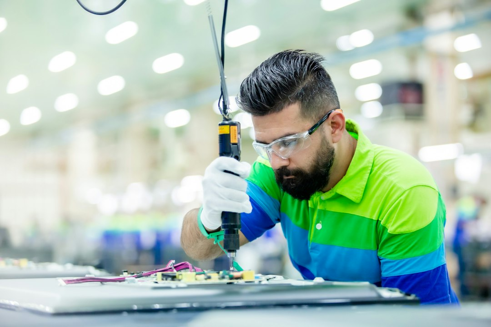

> 吉林白城，62岁的王小华戴上采集头环，在自家厨房炒菜、擦桌子、叠衣服。平台把这些画面叫"数据"，月底给她结钱，她跟老姐妹开玩笑说自己"带薪做家务"。同一个星期，机器人主题ETF规模涨到303.72亿元，一个月净增71.74亿元，理由是特斯拉的Optimus启动了早期量产。这两条消息之间隔着一整条产业链：一头是资本在给"机器人会干活"定价，另一头是活人按小时把自己的家务卖给机器人当教材。教材的标价，是70块钱一小时。

## 一、两万倍的缺口，压在手腕上

先把缺口摆出来。北京日报9月采访具身智能数据企业基元智航时，CEO高少龙给出了行业内部的共识数字：训练一台通用型具身智能机器人，需要100亿小时多场景真实交互数据；而国内合规可用的真实物理交互数据，业内测算只有50万小时。

除一下：两万倍。

这个量级不是媒体修辞。arXiv上本月的一篇综述性论文（2606.20521）把全球公开的机器人数据全部汇总起来，最慷慨的口径也只有约2万小时——单个实验室的私有数据就可能比它多。也就是说，真正被人类记录下来的"机器人经验"，连缺口的一个零头都算不上。行业不是缺数据，是几乎还没有开始采。

采集的方法，比想象中原始。今年6月入行的小远拿到的是头戴摄像头加模拟抓握的机械夹爪：头部不能大幅晃动，否则整条数据作废；手臂要长时间悬空保持姿势；同一个动作重复几十遍到上百遍，胳膊酸胀发麻。他自己总结："体力消耗大过进厂打螺丝。"这不是算法问题，这是劳动强度问题。

而这份劳动的价格，乱得很有信息量。企业直营口径给到70元一个"有效采集小时"；外包直招岗位日薪200到300元；走中介的单子按15元一小时结，扣掉保险后一天到手147元；36氪今天的报道里，另一个抽样给出的日薪是一百八十元。同一种工作，单价能从15元横跨到70元，差价近五倍。

一个缺口两万倍的原材料，价格本该往上飞。它反而连一把统一的尺子都没有。原因不难猜：卖方是东北、新疆、贵州、安徽三四线城市的宝妈、退休老人、淡季的酒店与果园零工，买方是平台和企业。她在这个镇上找不到第二个买家。所谓"行业早期缺乏标准"，翻译过来就是议价权全在买方手里——标准缺失不是行业不成熟的表现，是压价的工具。

📷 <a href="https://unsplash.com/photos/a-man-in-a-factory-working-on-a-piece-of-equipment-zekShM5_K64?utm_source=toby-blog&utm_medium=referral" target="_blank" rel="noopener">Photo by Alireza Hatami</a> on <a href="https://unsplash.com?utm_source=toby-blog&utm_medium=referral" target="_blank" rel="noopener">Unsplash</a>

## 二、七千亿的学费，没有一张折旧表

现在替这个行业算一笔它自己很少算的账。100亿小时，按企业报价70元一小时，是7000亿元人民币。

7000亿是什么概念？Anthropic的IPO正在冲刺史上最大规模：招股文件里募资上限约904亿美元，折人民币约6460亿。**也就是说，教会机器人做家务这件事的账单，比人类历史上最大的一次IPO还要贵8%。**

再横向看一眼市场给的定价：截至11月10日，跟踪国证机器人产业指数的ETF合计规模303.72亿元，近一个月增长71.74亿元，近一周增长24.50亿元；国证机器人产业指数近一月涨12.38%。指数涨得漂亮，资金进得凶猛。但7000亿的学费是303亿的23倍——就算按最便宜的中介价15元算，1500亿也是ETF总规模的五倍。

人时账更直白。100亿小时，等于500万人年。现有的兼职数据采集员据称已接近百万规模，按每人每年有效采集2000小时算，这一百万人要一刻不停地干满五年，才能把缺口填平。而这五年里，人的手腕、颈椎和耐心都不会跟着融资进度一起扩容。

这才是问题的核心：资本开支有折旧表，人类小时没有。GPU买回来记在固定资产里，分三年摊销，财报上体面得很；可7000亿的人时支出，被拆成无数笔几十块几百块的日结，藏在"数据服务"科目里，或者干脆不进任何一家上市公司的报表——它发生在县城的微信群里，发生在中介抽成之后的现金里。于是所有人都在讨论机器人的成本和毛利，却没有人给"教它的人"建一张资产负债表。这笔钱不是不存在，是它被记在了别人的账上。

## 三、人比GPU便宜八倍，所以数据工厂开在县城

有人会说：何必用人？仿真不就行了。

本月另一篇论文把这条路线的价格也标出来了。arXiv 2611.06908的HALO系统，用程序化生成的一千个"家庭"合成视觉-语言-动作数据，产出300小时训练语料，用了250张H100跑48小时。论文里还有一句更要紧的话：遥操作和穿戴设备，"产出1小时数据，至少需要1小时人类时间"。

把数字代进去。250×48是12000个GPU小时，摊到300小时数据上，是40个GPU小时换1小时数据。H100按每小时2美元租，一小时合成数据的成本约80美元，折人民币572元——这还没算训练生成器的那64张B200。

572元对70元。**在最需要"智能"的这一环，人类重复劳动比GPU便宜八倍。**

这就解释了一个看起来矛盾的现象：全世界最先进的机器人公司，数据工厂不在硅谷，在县城。算力贵的地方长不出数据，人力便宜的地方才长得出。具身智能的经济学因此变得非常朴素——大脑在加州训练，教材在吉林采集，中间的汇率是70块。

但这条价格线不会一直这么站得住。GPU的性价比按18到24个月翻一倍往前走，人力工资是刚性的，甚至因为地方补贴和同行挖人往上走。从572元降到70元，需要大约三次翻倍——四到六年。

所以那个70元时薪，其实是一个窗口期的价格。它高于当地平均收入，所以招得到人；它低于仿真成本，所以企业还乐意付。窗口关上的条件写得很清楚：仿真质量过线，或者第一视角视频够用。

这个判断可以证伪，不妨记下来：如果四年后采集单价还在往上走，说明仿真路线没跑通；如果单价开始往下掉，说明窗口关了，而那批靠"带薪做家务"月入四千的人，合同期也到期了。

📷 <a href="https://unsplash.com/photos/a-black-and-white-photo-of-a-model-of-a-building-e7YMprBV6yY?utm_source=toby-blog&utm_medium=referral" target="_blank" rel="noopener">Photo by Mike Hindle</a> on <a href="https://unsplash.com?utm_source=toby-blog&utm_medium=referral" target="_blank" rel="noopener">Unsplash</a>

## 四、把人降级成摄像头架子

比仿真更便宜的一条路，是干脆不需要"会干活的人"，只需要"戴着摄像头活着的人"。

同样是那篇论文的数据：HumanNet策展了100万小时人类活动视频，其中80多万小时是第一视角；Egocentric-100K用14228名工人戴着眼镜采了10万小时——单次发布就超过全球公开机器人数据总和的好几倍。这条路线的逻辑是：机器不需要你教它，只需要你活着、干活、并且头上有个镜头。

效果也不是空谈。arXiv 2611.06817用5万小时第一视角人类视频做预训练，再落地到机器人上，在RoboTwin 2.0的Clean2Clean任务上做到92.08%的成功率；论文还给出了预训练小时数与下游成功率之间的对数线性关系——数据越多，成功率越高，规律稳定得近乎无聊。

这意味着"该采什么数据"的争论正在被消解：什么都要，越多越好，最好不用付钱。遥操作一小时要一个人一小时，第一视角视频一小时只要一个人一小时里顺便做的那件事。当采集成本趋近于零，70元的时薪就不再是市场价，而是历史遗留价。

而被采集的人不会因此受益。她们把一生的家务经验按小时卖给模型，一次性套现；模型学会之后，这份技能在市场上就归零了——虽然她们的这部分劳动，本来也从来没被付过钱。

## 结语

三条路，一个结局：机器人的能力越接近人，教它的人时就越不值钱。遥操作把人的动作变成权重；第一视角视频把人的日常变成权重；仿真把人的经验蒸馏成程序化场景。数据采集员是这份工作的最后一代——她们一边把最熟悉的手艺按70元一小时卖掉，一边亲手把自己唯一被市场承认的技能变成免费。

王小华说自己是"带薪做家务"。这句话准确得有点残忍：她做了一辈子家务，第一次有人为这件事付钱，恰恰是因为它马上就要不需要人做了。

市场给这个板块的定价是303亿，行业自己算出的学费是7000亿，其中99%不在任何一份财报里。所以真正的问题不是机器人什么时候能擦桌子，而是——当它学会擦桌子的那天，那7000亿的人时，会被记成研发费用，还是遣散费？

学费总会交完的。只是交学费的人，从来不在估值表上。