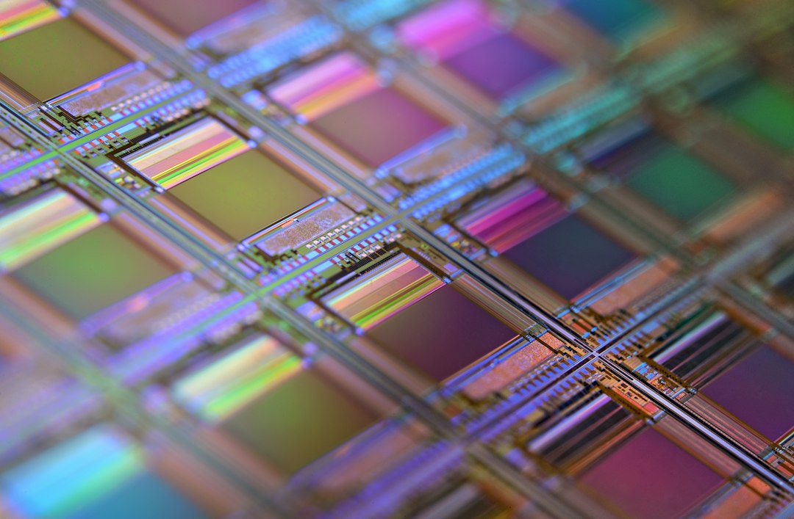

英伟达用一份 SEC 文件结束了黄仁勋的 33 年任期，CFO 变成临时 CEO，国会两党各开一条战线；而就在同一天，OpenAI 以 1.25 万亿美元估值融到 150 亿美元，台积电批了 10 亿美元入股两家模型公司，Kalshi 的估值被叫到 650 亿美元。技术侧也没停：谷歌用 Gemini 4 Hydrogen 把"够用的智能"做成每百万 token 1.5 美元的自来水，一家独立实验室则从公开权重里挖出了受出口管制的 Blackwell 芯片指纹。

## 一、研究突破

- **中国前沿模型的权重里，藏着受管制 GPU 的"指纹"**：独立研究机构 Unemployment Labs 发布报告（作者 Will DePue，11 月 12 日），通过恢复模型权重的初始值、反推训练时的硬件配置，发现 DeepSeek-V4-Flash/V4-Pro、Kimi K3/K3.1-Pro、MiniMax-M3、蚂蚁 Ling-3.1-flash 这六款 2026 年 4 月之后发布的模型，其数值特征与英伟达 Blackwell（B200/B300、GB200/GB300）一致，而同一批公司更早的模型对应的是 H800 等 Hopper 世代。其中 DeepSeek-V4-Flash 与 Kimi K3 还在实体 Blackwell 芯片上做了复现验证。报告明确限定：指纹只说明权重是"在 Blackwell 上生成的"，不能证明训练地点、获取途径，也不构成出口违规的法律结论。（来源：unemploymentlabs.com；Hacker News 136 分）
- **arXiv 新批次关注"智能体如何被拆掉规划器"**：《ReTrace: Distilling Tool-Using Agents into Planner-Free Workflows》（2611.14492）试图把会调用工具的智能体蒸馏成无需规划器的固定工作流，降低每次任务的推理开销；《CLADE: Category-Level Answering from Deficient Evidence in Retrieval-Augmented Language Models》（2611.14355）研究检索证据不足时如何仍给出类别级答案；《Contrastive Discovery: Open-Ended Scientific Discovery over Competing Explanations》（2611.14514，NeurIPS 2026）则在多个竞争性解释之间做开放式发现。（来源：arxiv.org）
- **"边解码边升精度"的小模型路线**：《Precision on Demand: Escalating Weight Bits at Uncertain Decoding Steps in a Small Local Model》提出在模型不确定的解码步上动态提高权重位宽，把有限的推理预算花在刀刃上，与"固定预算下选精度还是选选项顺序平均"的对照实验一并给出。（来源：arxiv.org，11 月 11 日提交）
- **苹果把端侧模型做成系统能力**：Apple 开发者网站上线 Foundation Models framework 文档，提供原生 Swift API，可直接调用设备端 Apple Foundation Models 与 Private Cloud Compute，内置引导式生成、工具调用、图像理解（含 OCR 与条码识别）和 Dynamic Profiles，并提供 Python SDK 与开源工具包。该项目登上 Hacker News 首页（112 分）。（来源：developer.apple.com / Hacker News）

## 二、产品发布

- **谷歌发布 Gemini 4 Hydrogen，主打"够快够便宜"**：定位为 Gemini 4 家族里负责执行的成员，1M token 上下文全程统一价，每百万输入 1.50 美元、输出 7.50 美元。默认 high 思考档在 Artificial Analysis 智能指数上得 51 分，略高于旗舰 Argon 的 50 分，最高 xhigh 档可到 54 分；比上一代快模型 Gemini 3.8 Flash 完成任务快 2.5 倍，Terminal-Bench 4.1 得分 57% 对 18.2%，编造性陈述减少 5 倍以上。同步上线的 Antigravity Orchestrator 会在同一会话里在 Carbon 与 Hydrogen 之间动态切换，Terminal-Bench 4.0 上接近 Carbon 的成功率，平均少用 24% 额度、快 19%。（来源：blog.google / deepmind.google，11 月 12 日；Hacker News 451 分）
- **谷歌搜索同步换芯**：AI Mode 接入 Hydrogen 后，官方称这是"搜索迄今最大的一次模型升级"，改进点包括多段复杂问题的意图理解、错别字容错、把一次提问拆成多个子查询的 fan-out 能力，以及更多图片、对比表格和结构化视觉回答。谷歌称更新已向全球所有搜索用户滚动推送。（来源：TechCrunch / blog.google，11 月 12 日）
- **Meta 的消费级智能体 Muse 学会打电话**：在 9 月小范围测试后，Muse 现在可以代用户拨打美国商家电话，但仅对付费订阅用户开放。（来源：TechCrunch，11 月 12 日）
- **Nectar 推出达人营销智能体**：面向品牌自动完成创作者发现、外联、合作管理与投放效果追踪，把网红营销的前半段流程交给智能体。（来源：TechCrunch，11 月 12 日）
- **OpenAI 连发三个 Codex 客户案例**：Amplitude 用其产品智能体 Wave 把改进周期压到 1 至 2 天；Gondola 称 Codex 让首席工程师产出提升 50%；英国 Holiday Extras 用 Codex 把客服经验做成新应用。同期 OpenAI 宣布投入 200 万美元支持"AI 与儿童安全"研究。（来源：openai.com，11 月 12 日）

## 三、融资并购

- **OpenAI 以 1.25 万亿美元估值完成 150 亿美元融资**：CNBC 11 月 12 日援引消息称，公司原本计划按 1.4 万亿美元估值融最多 300 亿美元，最终缩水到约一半；11 月 6 日首关到账约 110 亿美元，软银与阿布扎比 MGX 参投，OpenAI 未披露领投方。首席财务官 Sarah Friar 在电视采访中称 1.25 万亿为投前估值，比 3 月 31 日那轮 8520 亿美元投后估值高出近五成。公司未正式公告本轮。（来源：CNBC / 24/7 Wall St. / Reuters）
- **台积电批准最多 10 亿美元入股两家模型公司**：董事会通过分别以最多 5 亿美元认购 Anthropic 的 IPO 发行价普通股、以最多 5 亿美元认购 OpenAI 优先股，另批 5 亿美元设立投资公司布局半导体生态，并派发第三季度每股 9 元新台币现金股利。台积电 10 月营收同比增长 60%。（来源：Reuters / WSJ / 台积电公告，11 月 10 日）
- **Kalshi 被叫到 650 亿美元估值**：彭博与路透称，这家预测市场交易所在 10 月 29 日刚以 400 亿美元估值完成 10 亿美元融资（Sequoia 与 Wellington 联合领投）后，又在洽谈新一轮，估值 650 亿美元，比上一轮高 63%，是 5 月 220 亿美元的三倍、2025 年 10 月 50 亿美元的十三倍。募资用途包括搭建"算力期货"交易平台。其月度名义成交额从 8 月的 400 亿美元增至 10 月的近 1000 亿美元，年化营收超 50 亿美元，毛利率约 90%。（来源：Bloomberg / Reuters / Investing.com，11 月 12 日）
- **Nebius 抛出 400 亿美元扩张计划，股价跌 17%**：公司给出 2027 年 400 至 450 亿美元资本开支指引，远超华尔街预期；资金靠客户预付款与以合同为抵押的贷款，官方称可覆盖最多 85%。第三季度营收 9.81 亿美元、同比增长 571%（其中约三分之一来自一次性合作款），但因第三方站点延期把 2026 年营收指引下调 2 亿美元至 30 亿美元。其与新泽西 Vineland 数据中心相关的微软合同价值最高 194 亿美元，目前仅略超一半产能能在年底交付，其余推迟到 2027 年第二季度；该站点运营方 DataOne 因无证运行 45 台天然气发电机被罚 110 万美元，还面临噪音诉讼。CEO Arkady Volozh 承认"这种规模的建造很难，延期是行业现状，我们也不能免疫"。（来源：TechCrunch / Nebius 财报，11 月 12 日）
- **SpaceX 规划超 740 亿美元 AI 超算园区**：据 MLQ 汇总，SpaceX 计划在得州与亚利桑那建设 AI 超算基地，规模超 740 亿美元。（来源：MLQ.ai，11 月 12 日）
- **量子软件公司 Q-Ctrl 完成 2.9 亿美元 C 轮**：Salesforce Ventures 领投，Affinity Partners、AMD Ventures、EDGE Group 等参投，估值超 10 亿美元。其 Ironstone Opal 主打 GPS 拒止环境下的量子导航，已在空客商用飞机与洛克希德·马丁自主平台部署。（来源：Bloomberg / Quartz，11 月 12 日）

## 四、产业应用

- **中芯国际：Q3 客户对 AI 配套芯片的需求超过公司预期**：联合 CEO 赵海军在业绩说明会上称，与算力直接相关的配套芯片（逻辑电路、BCD 电源管理、光模块收发）供不应求，而智能手机与消费电子需求仍较疲弱。公司此前给出的量价逻辑是：一个装 72 颗 GPU 的机柜，仅电源供应与电源管理器件就要用到 1.6 万余个，这类需求把 8 英寸成熟制程产能填满；客户为防明年涨价已在提前备货。AI 配套芯片最快下季度起在收入分类中单独披露。（来源：36氪 / 财联社，11 月 12 日至 13 日）
- **应用材料 CEO：芯片是 AI 支出的最大去向**：在 AI 基建投资链条中，设备与制造环节被认定为资金的主要沉淀处。（来源：36氪，11 月 13 日）
- **微软 365 全球性中断，Outlook、Teams、Copilot 同时受影响**：美东时间 11 月 12 日午后，Downdetector 上仅 Outlook 相关报告就逼近 13 万条。微软在管理后台以 MO1550821 追踪"用户可能无法连接多项服务"，Exchange Online 邮箱访问问题单列为 EX1550543；部分高校 IT 部门通报 Outlook、日历、Teams、OneDrive、Copilot 全线受影响。Hacker News 相关讨论 465 分。（来源：BleepingComputer / AP / Microsoft 365 Status）
- **AI 把苹果 App 审核变成合成器开发者的噩梦**：Hacker News 热帖讨论 AI 生成内容让 App Review 的判断标准摇摆，音频合成器类应用的上架周期被拉长（72 分）。（来源：synthanatomy.com / Hacker News）

## 五、行业动态

- **黄仁勋辞任英伟达 CEO，CFO 临时代任**：英伟达在 SEC 文件中确认董事会已接受辞职，现任 CFO Colette Kress 以临时 CEO 身份继续兼任 CFO，公司将另寻正式继任者；自 1993 年起在董事会的 Harvey C. Jones（Synopsys 前 CEO）出任公司史上首位董事会主席。事件起点是黄仁勋 11 月 8 日致全体员工信承认婚外情，随后《纽约时报》曝出他与直接汇报的医疗健康业务副总裁 Kimberly Powell 的关系（公司与本人未确认），路透 11 月 12 日又报道第三段与一名未具名女员工的关系。黄仁勋已同意在感恩节（11 月 26 日）前赴国会作证。（来源：SEC 文件 / Reuters / NYT / TechCrunch，11 月 12 日；Hacker News 2869 分）
- **民主党另开一条战线，查的是白宫而非英伟达**：众议院筹款委员会民主党领袖 Richard Neal 与参议院财政委员会民主党领袖 Ron Wyden 致信商务部长 Lutnick，要求保全与 H200 对华销售安排有关的记录。信中说这套"套路"是：特朗普同意英伟达向中国卖 H200，但芯片须先运到美国、被加征一道关税（信中称这形同"违宪的出口税"），随后商务部再发出口许可。信件还追问：为什么在情报部门已就 Alice Huang 与黄仁勋的关系示警后，商务部仍允许 Megaspeed 采购芯片、并给"注册地址没有实体存在"的亚洲公司开绿灯；以及英伟达向特朗普相关项目捐出 2600 万美元（含舞厅）与交易获批之间的时间关系。作为少数党，他们只能问、不能强制。（来源：TechCrunch / 筹款委员会公开信，11 月 12 日）
- **黄仁勋离场，开源阵营少了一根主心骨**：他此前是开放权重最有力的辩护者——7 月发公开信、联合微软、Meta、Hugging Face、IBM、Palantir 等 25 家公司反对过度限制开源模型，力推 Nemotron 系列，投资 Reflection AI 与 Thinking Machines Lab，还推动以 129 亿美元收购 Hugging Face（交易仍待司法部审查，计划 2027 年上半年交割）与 60 亿美元买下 Poolside 技术非独家授权。Hugging Face CEO Clément Delangue 回应称"这整件事糟透了，今天是很难过的一天"，但承诺"会比以往更努力地为开源而战"。（来源：TechCrunch，11 月 12 日）
- **奥特曼给算力热泼了一盆冷水**：据韩国《Financial News》获得的 10 月 31 日三星高管会问答记录，奥特曼称 AI 需求存在"重复计算"，"真正在大幅推动需求增长的只有 OpenAI 和 Anthropic 两家公司，因此可能出现供给冲击和一段动荡期"。两家实验室合计占微软、甲骨文、亚马逊已签约云 backlog 的近一半。（来源：Financial News / 247wallst，11 月 11 日）
- **Flinn AI 在特拉华起诉 Anthropic 与 OpenAI**：原告诉称两家公司侵犯 Steven Flinn 与 Naomi Manipeni 共同发明的五项神经网络专利，两案均在美国特拉华州联邦地区法院提起。（来源：Gate News / 法院记录，11 月 12 日）
- **DeepMind 英国员工要求工会承认投票**：约 1000 名员工的代表请求英国仲裁机构介入，迫使公司就工会承认举行投票。（来源：MLQ.ai，11 月 12 日）

## 六、市场数据

- **两市融资余额增加 6.85 亿元**，杠杆资金小幅回补。（来源：36氪，11 月 13 日）
- **券商观点转向"AI 超跌修复"**：银河证券称电子行业具备超跌反弹的基本面基础，建议关注 AI 超跌修复窗口；中信证券则看好锂电板块，认为产业链盈利正逐步修复。（来源：36氪，11 月 13 日）
- **半导体主题 ETF 上涨，中小盘宽基产品吸金**；券商互换便利建仓持续推进，第三批整体规模更大、参与机构更多。（来源：36氪，11 月 13 日）
- **台积电 10 月营收同比增长 60%**，董事会同时通过每股 9 元新台币的第三季度现金股利。（来源：WSJ / 台积电公告）
- **外资增配中国资产提速**，制度型开放向纵深推进；与此同时梅赛德斯-奔驰暂停德国投资并考虑关闭部分工厂，韩国总统李在明称将推动资产与资本市场"正常化"。（来源：36氪 / 中国新闻网财经，11 月 13 日）
- **谷歌在欧盟"司法战"受挫**：欧洲法院顾问对撤销谷歌罚款的裁决提出质疑，案件走向仍待终审。（来源：中国新闻网财经，11 月 13 日）
- **Anthropic IPO 进入定价倒计时**：承销商在讨论把发行价定在 70 至 78 美元区间之上，完全稀释估值可能触及 1.5 万亿美元甚至更高；路演视频里，联合创始人 Tom Brown 首次系统讲述公司如何同时在 AWS Trainium、谷歌 TPU、英伟达 GPU 与 AMD GPU 上训练和服务 Claude。（来源：FT / simonwillison.net，11 月 11 日至 12 日）

## 七、技术工具

- **llm 0.37.2 修复 API key 泄露漏洞**：Simon Willison 发布安全修复，处理 GHSA-v9h7-jj4g-f862 与 GHSA-r639-rr7r-x72w——`extra-openai-models.yaml` 配置下，用户配置的 OpenAI API key 可能被意外发送到第三方兼容端点。同周 llm-gemini 升到 0.37 跟进 Gemini 4 Hydrogen。（来源：simonwillison.net，11 月 11 日至 12 日）
- **PostgreSQL 一次性发布多个维护版本**：18.7、17.12、16.16、15.20、14.25 与 19 RC2 同步释出；另有一个潜伏 22 年的类型混淆漏洞被做成远程代码执行（CVE-2026-6460），利用链复盘文章在 Hacker News 拿下 138 分。（来源：postgresql.org / mehmetince.net / Hacker News）
- **Rust 1.100 发布**，Hacker News 383 分；同周 Relax（面向 Rust 的 JIT 编译器，用于缩短构建时间）获 110 分。（来源：blog.rust-lang.org / Hacker News）
- **在旧设备上跑大模型成为热门话题**：帖子《I'm making LLMs work on small and old devices》275 分，Edge0-145B 则宣称能在个人电脑上提供"前沿级能力"。（来源：Hacker News，11 月 12 日至 13 日）

## 八、安全与伦理

- **四家非营利组织起诉五大 AI 实验室，要求冻结前沿模型**：Irreplaceable Education Fund、Public Citizen、Heat Initiative 与 Alliance for Secure AI 于 11 月 12 日在旧金山高等法院起诉 Anthropic、谷歌、Meta、OpenAI 与 SpaceX 的 AI 部门，依据加州《不公平竞争法》并主张公共妨害，请求对下一代模型发出紧急禁令、在证明系统处于人类控制之前冻结训练与部署。诉状大量引用被告自己的风险警告，包括 Dario Amodei 2025 年"AI 发展有 25% 概率导致灾难性后果"的估计；原告律师为前新泽西州总检察长 Matthew Platkin。值得注意的是，9 月已有付费用户提起联邦反垄断集体诉讼，指控方向相反——说这几家"合谋放慢 AI 发展"。（来源：Public Citizen / CBS News / Al Jazeera，11 月 12 日）
- **台积电 4.6 万笔员工资料被挂到地下论坛出售**：黑客声称掌握 6.9GB、约 4.6 万笔现职与离职员工记录，开价 3 枚比特币（约 150 万元人民币），并公开名为 tsmc.txt 的样本（499 笔、每笔 19 个字段），威胁一周内无人接盘就全量公开。台积电证实部分员工信息未经授权被放置于外部网站，但称初步清查没有证据显示公司系统遭入侵，数据与生产及客户信息无关，疑似来自某云端服务供应商的系统。（来源：钛媒体 / 新浪财经 / 凤凰科技，11 月 12 日）
- **数据中心的电费，账单寄给了低收入与农村居民**：康奈尔大学新闻梳理多州案例，指出数据中心带来的电网扩容与输电成本，正通过电价机制转嫁给议价能力最弱的用户群体。（来源：news.cornell.edu / Hacker News，11 月 12 日）
- **OpenAI 出资 200 万美元支持儿童安全研究**：资金用于开发衡量 AI 对未成年人风险与机会的共享工具，属于"儿童优先宣言"的一部分。（来源：openai.com，11 月 12 日）

📷 <a href="https://unsplash.com/photos/silicon-wafer-with-iridescent-microchip-grid-qOx9KsvpqcM?utm_source=toby-blog&utm_medium=referral" target="_blank" rel="noopener">Photo by Laura Ockel</a> on <a href="https://unsplash.com?utm_source=toby-blog&utm_medium=referral" target="_blank" rel="noopener">Unsplash</a>

📷 <a href="https://unsplash.com/photos/new-york-stock-exchange-building-with-american-flags-xnzSgqyP8Hs?utm_source=toby-blog&utm_medium=referral" target="_blank" rel="noopener">Photo by David Vives</a> on <a href="https://unsplash.com?utm_source=toby-blog&utm_medium=referral" target="_blank" rel="noopener">Unsplash</a>

数据来源：openai.com、deepmind.google、blog.google、anthropic.com、developer.apple.com、TechCrunch、Hacker News、arXiv、simonwillison.net、unemploymentlabs.com、Reuters、WSJ、CNBC、Bloomberg、NYT、Public Citizen、36氪、财联社、FT中文网、中国新闻网财经
生成时间：2026-11-13 09:00 CST
