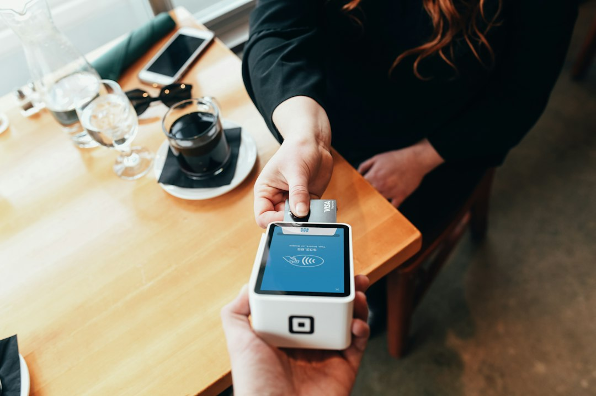
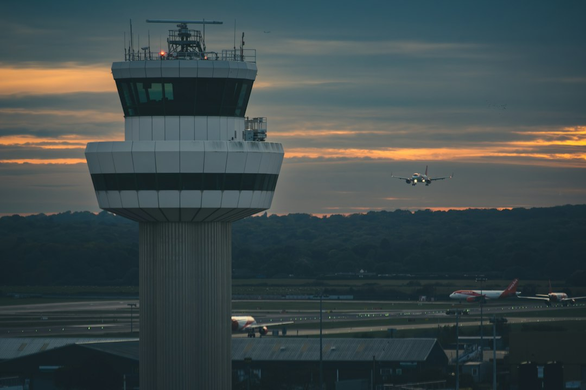

智能体终于拿到了钱包，而且是不带卡号的那种——OpenAI 与运通、万事达、Visa 联合发布的 ChatGPT Wallet，把"每一笔都过一次人脸"写进了支付流程。同一天的另一面是：一条航路管制中心之间的通信链路，就能让整个美国的航班停在跑道上；微软则刚从一个持续十八小时的全球故障里爬出来。技术跑得越快，越能看清托着它的那层旧地基。

## 一、研究突破

- **MIT CSAIL：大模型可以像读代码一样读写神经网络权重**：Rikiya Takehi、Jayden Teoh、Alex Zhang、Omar Khattab 四人的博文《Sparks of Weight-Space Programming》（11 月 2 日发布，本周在 Hacker News 冲上首页，103 分）给出三组实验结果：仅凭原始权重矩阵，GPT-6 Astra 就能判断一个网络当初被训练来玩哪个游戏；在不给任何环境反馈、也不允许写训练循环的条件下，它能从零写出小型游戏网络，表现超过用 PPO 训练 1 亿步的对手；让它把 Qwen3.5-0.8B 的数学能力提上去，它先指出权重里导致"推理死循环"的那部分（Qwen 自己的模型卡也警告过这个问题），然后原生编辑了 0.016% 的权重，在相同采样设置下把 MATH-500 从 7.9% 拉到 48.1%，还顺带把 IFEval 提高到 3 倍。作者的判断很直接：过去我们把归纳偏置塞进 Adam、Muon 这类微型符号优化器，接下来权重会被"会思考权重的 LLM"直接改写。（来源：rikiyat.github.io，11 月 2 日；Hacker News）
- **同一篇论文在社区里被读成了安全问题**：Hacker News 上相关讨论帖的标题是《Models can now transmit viruses in weight-space》——如果权重可以被模型直接读懂和改写，那么"恶意代码"就不必藏在文本或工具调用里，它可以藏在一份模型文件的小数点后第 n 位。这一点尚未有人给出攻击实证，但它把模型分发环节的信任问题从"供应链"推到了"字节本身"。（来源：Hacker News / alphaxiv.org，11 月 13 日）
- **arXiv 11 月 13 日批次（cs.AI 单日 321 条，近五日累计 1467 条）的几个方向**：《AgentSSL: Can MLE Agents Leverage Unlabeled Data?》（2611.17323，NeurIPS 2026）问机器学习工程智能体能否用上无标注数据；《Classical Energies Learn to Reason 1,000x Faster than Looped Models》（2611.17309，Benjamin Hoover、Hugh Blayney、James Whittington）用经典能量模型对标循环（looped）模型的推理效率；《CoReMem: Cost-Internalizing Memory for Successive Coding Tasks with Prospective Valuation》（2611.17316，耶鲁 Rex Ying 组）研究连续编码任务里"记忆要付租金"的调度问题；《LiveGeo》（2611.17267）把地理智能体放进持续变化的世界里做基准；《Rational Alignments of Superintelligences via Debates》（2611.16455）则把超智能对齐押在辩论机制上。（来源：arxiv.org）

## 二、产品发布

- **ChatGPT Wallet：让智能体付钱，但不让它看见卡号**：OpenAI 11 月 13 日发布 ChatGPT Wallet，与美国运通、万事达、Visa 联合开发。流程是：用户加一次卡，之后每笔购买都要在应用里复核商品、金额与所选卡，并用 Face ID 或指纹确认；确认后由卡组织下发 payment token（带卡号、安全码、有效期的替身），商户和智能体都拿不到真实卡信息。官方强调三件事：每笔购买都要过一次安全校验、保留原卡的返现与符合条件的争议保护、用户仍直接与商户交易（商户保留定价、履约、退货与客服）。首发在 OpenAI 自家的 dots 应用内，仅限美国 18 岁以上 ChatGPT Pro 订阅者、使用美国发行卡。官方给出的规模数字是每周 12 亿人使用 ChatGPT。后续路线图是"参数化委托"——用户设定额度、品类、时段，之后的购买可以完全交给智能体。（来源：openai.com，11 月 13 日；TechCrunch，11 月 13 日）
- **配套的是一份"商户接入手册"，而不是新协议**：OpenAI 同步发布 Commerce Partner Playbook（developers.openai.com/commerce），要求商户做三件事：在 ChatGPT 内认领企业身份并上传含实时价格与库存的商品 feed；配置 CDN/防火墙识别 Web Bot Auth 签名请求，别把 ChatGPT 的智能体当爬虫拦掉；与风控服务商对齐"哪些 agent 交易是合法的"。合作名单里既有 Forter、Riskified、Sardine、Signifyd 这类反欺诈公司，也有 Adyen、Checkout.com、Stripe 这类支付服务商。这等于承认了一件事：智能体电商的第一道门槛不是模型能力，是"别被当成盗刷"。（来源：openai.com）
- **ElevenLabs 推出 ElevenAI，语音公司开始抢会议记录**：这款实验性应用把会议记录、听写与智能体集成做在一起，面向团队与企业。该赛道近几个月已经很挤：Fireflies 9 月底加听写、Wispr Flow 8 月筹备会议记录、Granola 10 月底上线听写功能。（来源：TechCrunch，11 月 13 日）

## 三、融资并购

- **LangChain 以 30 亿美元估值完成 3 亿美元 C 轮**：CapitalG 领投，新加坡 GIC、DFJ Growth、IVP、Sapphire Ventures 参投。一年前那轮 1.25 亿美元融资时估值 12.5 亿美元，如今翻了一倍多。公司 2022 年以开源项目起步，做的是早期大模型不擅长的联网搜索、调 API、连数据库；当各家前沿实验室把"脚手架"（harness）做进自家产品后，LangChain 转向智能体管理，主打"让企业拥有自己的智能"——LangSmith 不绑定特定模型、云或生态，并强调能把智能体行为关进笼子。目前称有 7000 家 LangSmith 客户，包括 Harvey、Rippling、Clay，以及英伟达、丰田、Salesforce。（来源：TechCrunch，11 月 13 日）
- **黄仁勋离场，AI 创业公司的钱袋子先破了个洞**：TechCrunch 采访的投资人与创始人说，英伟达过去几年是 AI 领域最活跃的出资方，据 PitchBook 今年参与了 105 轮融资，且常常是最大出资人。Relational Capital 创始人 Maria Davidson 说："如果这个方向变了，对很多年轻公司是重大打击。"Dawn Capital 的 Shamillah Bankiya 的形容更狠："英伟达几乎托着从应用到 neocloud 的每一家 AI 原生公司。"多位受访者认为，多数投资决定原本出自黄仁勋本人；临时 CEO Colette Kress 被形容为"保守得多"，短期内不太可能维持同等规模的开支票节奏。英伟达今年以 130 亿美元收购 Hugging Face（预计 2027 年交割），并投过 CoreWeave、Crusoe、Mistral AI、Lambda、Black Forest Labs，还曾向 Reflection AI 的 20 亿美元 B 轮开出 8 亿美元。（来源：TechCrunch，11 月 13 日）
- **北航博士做 AI4S，拿到亿元级融资**：36氪首发报道，一支由北航博士创立的团队要以"自驱动实验室"切入 AI for Science，融资金额过亿元。（来源：36氪，11 月 13 日）
- **拓荆科技拟以子公司出资不超 3 亿元参与设立私募基金**：半导体设备厂商把一部分现金挪到产业基金里，属于今年设备公司常见的资产负债表外延动作。（来源：36氪，11 月 13 日）

## 四、产业应用

- **OpenAI 六年来第二次解散独立机器人团队**：Fortune 11 月 13 日独家报道，OpenAI 已撤销独立机器人团队，研究人员分两条线并入：基础研究归首席研究官 Mark Chen，应用与硬件归总裁 Greg Brockman。公司对 Fortune 的说法是"为了加速，不是放弃"——年初团队认为机器人要建立在 Sora 这类模型之上，但此后包括 GPT-6 Astra 在内的通用前沿模型表明可以直接用于机器人，于是不再需要一支专门造机器人模型的队伍。这是 OpenAI 第二次解散该团队：2020 年首次关闭时，联合创始人 Wojciech Zaremba 的理由是"机器人数据有限"；2024 年重建并与 Figure 合作，2025 年 2 月合作结束。时间点也很微妙：消息出来时正值 CoRL 机器人会议在奥斯汀举行，OpenAI 注册的 208 号展位被 Fortune 发现是空的，连 logo 都没有。（来源：Fortune，11 月 13 日）
- **学界不买账"通用模型已解决具身智能"这个说法**：卡内基梅隆大学机器人研究所的 Guanya Shi 认为这一动作说明 OpenAI 把机器人看成通用智能的一个应用、而非特殊问题，通用模型的空间与推理能力确实有助于应对物体位置、光照变化；但他同时指出大模型慢且跑在云端，机器人用它就得一直联网，端侧仍需要更小的专用模型。MIT 教授、Walden Robotics CEO Russ Tedrake 认为机器人公司仍握有优势：已在工厂里干活的机器人、积累的现场数据，能让基础模型更快适配具体工位。Generalist 联创 Pete Florence 说，现在无法判断最终会是哪个模型主导机器人。（来源：Fortune / AI Weekly 汇总，11 月 13 日）
- **宇树机器狗用上了国产嵌入式存储**：江波龙在投资者互动中称，根据第三方公开的智能产品拆机信息，宇树机器狗等产品已采用公司的嵌入式存储。（来源：36氪，11 月 13 日）
- **美联航禁止第三方 AI 智能体订票，理由里有一条是航空法规**：美联航 11 月 11 日发布公告，将限制"未经授权的第三方个人 AI 智能体"访问其 App、网站，以及通过旅行社与聚合商间接接入，并同步修改订票、出票与分销政策。给出的理由包括：把账号凭证交给第三方助手会泄露敏感信息；智能体的自动操作可能造成非预期购买、账户变更或里程被使用；更关键的是，这些自动行为可能违反 FAA 与 DOT 规定——例如值机需要本人确认行李内没有爆炸物等违禁品。美联航还援引"银行与零售业同行已采取类似措施"来站台，包括美国银行上周劝客户不要把密码交给 AI 助手、达美 10 月 6 日声明没有允许第三方智能体订票的集成、沃尔玛 10 月 21 日推出 Agent Profiles 与 Agent Gateway 并配上含消费限额的条款。有意思的是执行细节很模糊：公告和帮助页都没说怎么识别"是人还是智能体"，而帮助页把"未经许可搜索 united.com"也算未授权，与合同条款对"搜索"的表述存在出入。（来源：united.com 公告 / TechCrunch / CNBC，11 月 11 日至 13 日）

## 五、行业动态

- **FAA 下令全国航班停飞，起因是管制中心之间的通信故障**：美国联邦航空管理局 11 月 13 日下午（美东时间 4 点前）发布全国停飞令，措辞是"due to extraordinary circumstances and for reasons of safety"，所有机场一律停止起飞，国际航班按个案处理。交通部长 Sean Duffy 称原因是"影响所有航路管制中心的通信问题"，FAA 技术人员正在排查。这是 2023 年 1 月飞行员通告系统宕机之后的首次全国停飞，再往前要追溯到 2001 年 9 月 11 日。据《纽约时报》，停飞时已有超过 1000 架在飞航班的目的地是美国机场，Flighty 统计当日剩余时间原计划有 3 万多架次起降。国土安全部长 Markwayne Mullin 称"目前没有恶意攻击的迹象，只是电信中断"。PBS 采访的航空记者提醒，全美 22 个航路管制中心之间靠老式专线互联，这次很可能是这条链路出了问题——"这套系统底层是软盘、纸质进程单和上世纪 40 年代的旋转雷达"。（来源：FAA 通告 / CNN / NYT / Guardian / PBS，11 月 13 日至 14 日）
- **微软从邮件故障演变成 18 小时的全球云服务危机**：故障从 11 月 12 日开始，最初只报美国与美洲区服务异常，随后扩散到全球：Outlook 邮件、Teams 会议、消费者与企业邮箱、文件与文档逐步沦陷，Copilot 与 Defender 也一起倒下，管理员甚至进不了 Intune 后台，部分用户无法访问云端 Windows。微软的说法是"大量服务器意外不可用"，且"没有发现与本次事件相关的恶意活动"，后来又补了一句"与网络攻击或 AI/智能体无关"——这句澄清本身说明外界第一反应是往这两个方向猜。网络监测公司 Kentik 的 Doug Madory 称，约 18 小时后流量才回到微软服务。Copilot 与智能体平台执行副总裁 Charles Lamanna 表示恢复"令人鼓舞"，团队正在复盘。（来源：TechCrunch，11 月 13 日）
- **Hacker News 当日热榜被两件事占满**：FAA 停飞（1249 分、751 条评论）与"反云"类帖子（逆向自家空气净化器以摆脱云端，670 分）并列前排；一条 1960 年《科学》杂志的旧文《Doomsday: Friday, 13 November, A.D. 2026》以 442 分上榜——它当年推算人类人口增长会在 2026 年 11 月 13 日撞上天花板，恰好撞上这个黑色星期五，社区把它当成了一个不太严肃的注脚。（来源：Hacker News，11 月 13 日至 14 日）

## 六、市场数据

- **美股三大指数收盘涨跌不一，闪迪跌超 5%**；热门中概股盘前集体走弱，理想汽车跌超 2%；大型科技股盘前涨跌不一，英伟达涨超 1%。（来源：36氪，11 月 13 日至 14 日）
- **英伟达风波引发出口限制担忧，中国 AI 企业股价大跌**：FT 中文网同日刊出两篇分析，一篇讲股价，一篇题为《"黄仁勋危机"将扰乱人工智能行业》，核心担忧是芯片出口政策的可预测性下降。（来源：FT 中文网，11 月 13 日）
- **央行缩量开展 2000 亿元 6 个月期买断式逆回购操作**：中期流动性投放延续"缩量"节奏。（来源：中国新闻网财经，11 月 13 日）
- **香港把 2026 年经济增长预测上调至 4.8%**。（来源：36氪，11 月 13 日）
- **钧达海外扩产遇阻，叫停阿曼 2.8 亿美元项目**：光伏厂商的出海节奏出现收缩信号。（来源：FT 中文网，11 月 13 日）

## 七、技术工具

- **Perplexity 开源 Decider v1.3：不生成文字，只输出概率**：pplx-decider-v1.3 基于 Qwen3.8-27B，Flash 版基于 Qwen3.5-4B 蒸馏而来，两者均为 Apache 2.0，权重约 49 GiB 与 8.5 GiB（BF16），支持文本与图像。与聊天模型的区别在于它输出的是"状态 + 一组问题 + 选项"上的概率分布，可做是非题、最多 255 个选项的多选题、有序评分。v1.3 新增 locate 类型，能从原文里抽出逐字片段并给出字符偏移与置信度，用于命名实体识别、个人信息识别与抽取式问答。官方数据：63 个分类任务平均准确率 91.6%，比其线上生产分类器高 6.54 个百分点，也高于 TypeSafe 的 Jev 1.14；8 种语言多语言分类 88.16% 对 Jev 的 85.41%；17 个域外抽取任务平均 69.0 分，Liquid d1 为 43.3、GLiNER large v2.5 为 33.6；Artificial Analysis 决策指数约 70，成本约每百万任务 68 美元。工程细节也值得一提：为了让分类头看到全局信息，Perplexity 把骨干的完全注意力层改成了双向，所以必须用他们自己的 pplx_decider 包前向，标准因果推理复现不出结果。（来源：perplexity.ai 博客 / Hugging Face / Reddit r/LocalLLaMA，11 月 13 日）
- **Gemini 4 的定价表藏着一次集体涨价**：Simon Willison 在更新 llm-gemini 0.37 时把三档价格列了出来——Gemini 4 Carbon 与 Argon 现在同价（输入 2 美元、缓存 0.10、输出 10 美元每百万 token），但 12 月 1 日起双双翻倍到 4 / 0.20 / 20 美元；Hydrogen 是 1.50 / 0.075 / 7.50 美元。也就是说眼下这个"便宜款"只比旗舰便宜 25%，要到 12 月 1 日才真的便宜 75%。他还补了一刀：即便如此，Hydrogen 仍是 Claude Haiku 5.5 与 GPT-6 Luna（均 0.10 / 0.50 美元）的 15 倍价。（来源：simonwillison.net，11 月 12 日至 13 日）
- **Datasette 两个插件小版本更新**：datasette-cluster-map 0.19 兼容 Datasette 1.0a42，并依赖新的 datasette-leaflet；后者 0.3 针对 OpenStreetMap 的瓦片政策，在瓦片请求上单独设置 strict-origin-when-cross-origin 的 referrer 策略——因为 Datasette 表页原先发的是 no-referrer，会让所有加载 OSM 瓦片的插件违反对方政策。这种"因为别人的合理政策而必须改自己默认值"的小修，是开放地图生态里最常见的摩擦。（来源：simonwillison.net，11 月 13 日）

## 八、安全与伦理

- **Fireworks AI 被黑，Notion 的 AI 聊天记录被牵出**：推理服务商 Fireworks AI 在 10 月连遭两次入侵（一次通过泄露的内部凭证，一次通过托管其研发机器的第三方云服务商），攻击者获取了部分客户的资源元数据、账单信息、模型权重与数据集。Notion 11 月 2 日收到 Fireworks 的警报，起初被告知"只是一个合成测试数据集"；Notion 当天切断流量、删除供应商侧数据、停止训练任务。11 月 8 日 Fireworks 确认真实客户数据被访问，Notion 分析后发现被拿走的是其 Insights 功能所用的 Notion AI 聊天记录——对绝大多数受影响工作区而言无法归属到具体用户或公司，受影响面不到 1%。Notion 的建议很务实：把这段数据当作已泄露处理，凡是在该期间往 Notion AI 里粘贴过敏感信息、密码或 API key 的，立刻轮换凭证。事件的讽刺点在于 Fireworks 文档写着"默认零数据留存"，但零留存指的是推理时只存在于易失内存，而批量推理、训练、存储响应这几类功能会把内容落盘——攻击者正好打在了落盘那一侧。（来源：BleepingComputer / TechCrunch / Notion 安全公告 / VentureBeat，11 月 13 日）
- **AI 硬件成了货运盗窃的头号目标**：FreightWaves 11 月 13 日援引 Overhaul 的《AI Infrastructure Intel Report》（10 月 21 日发布），2025 年 6 月至 2026 年 6 月，美国被盗的 AI 设备价值超过 1.5 亿美元；2023 年至 2026 年 6 月共记录 111 起，比 2024 年增加 34%，其中 92% 涉及欺诈或欺骗——伪造承运人身份、篡改提单、冒名提货。加州与得州是重灾区。报告还估算，每 1 美元走保险理赔的被盗硬件，背后还有约 3 美元未申报的间接损失（部署延期、失去合同资格、合规敞口、追加安保），这个 3:1 的比例取自 RAND 的研究。最具象的案例是 8 月 29 日从奥克兰发往沃斯堡的 6 托盘英伟达硬件，价值 1140 万美元，卡车挂着食品运输公司的标识按时提货，随后在圣贝纳迪诺县失去踪迹，9 月 13 日才立案，至今无人被捕；2025 年弗里蒙特与尤宁市还查过 750 万美元以上的英伟达货物盗窃案。（来源：FreightWaves / East Bay Times / ABC7，11 月 13 日）
- **一份《No AI Slop》宣言在 Hacker News 拿到 114 分**：宣言的诉求不是"少用 AI"，而是要求内容生产者标注哪些部分是机器生成的、不要把生成量当成绩。它出现在一个微妙的时间点：本周 Hacker News 上另一条高热度讨论是"科技巨头注定让我们失望"，两条帖子放在一起看，社区情绪指向同一个东西——对"规模换质量"这套逻辑的疲劳。（来源：slopmanifesto.com / Hacker News，11 月 13 日）
- **把权重当代码，也把风险搬进了权重**：回到 MIT 那篇论文，最值得记下来的不是 48.1% 这个数字，而是它改变了"模型文件"的属性。过去我们审计一个模型，看的是训练数据、对齐报告、系统卡；如果模型能读懂并改写权重，那么一次权重编辑就可以同时是性能补丁和后门，而二者的形态完全一样——都是小数点后第 n 位的一串数。这一轮 agentic commerce 正在把"授权"做成可验证的凭证（token、生物识别、逐笔确认），而模型分发这一侧还停留在"你信任提供方"的阶段。（来源：综合 rikiyat.github.io / Hacker News 讨论）

---
数据来源：openai.com、deepmind.google、anthropic.com、karpathy.ai、blog.samaltman.com、blog.gregbrockman.com、fchollet.com、lilianweng.github.io、darioamodei.com、mustafa-suleyman.ai、hy.tencent.com、hn.buzzing.cc、news.ycombinator.com、techcrunch.com、arxiv.org、openaiblog.xyz、simonwillison.net、steipete.me、Fortune、BleepingComputer、FreightWaves、CNN、NYT、PBS、Perplexity、36氪、FT中文网、中国新闻网财经
说明：karpathy.ai、blog.samaltman.com、blog.gregbrockman.com、fchollet.com、lilianweng.github.io、darioamodei.com、mustafa-suleyman.ai、hy.tencent.com 八个个人/机构页面逐页核验后，无 24 小时内可确证的新内容（Sam Altman 最新一篇仍是 10 月家宅遇袭的回应，Lilian Weng 最新一篇为 7 月 4 日，腾讯混元研究页返回空内容，Greg Brockman 的《The Defender's Window》未标发布日期故未计入）。
生成时间：2026-11-14 09:00 CST

📷 <a href="https://unsplash.com/photos/person-holding-credit-card-swipe-machine--JJg90OAnWI?utm_source=toby-blog&utm_medium=referral" target="_blank" rel="noopener">Photo by Blake Wisz</a> on <a href="https://unsplash.com?utm_source=toby-blog&utm_medium=referral" target="_blank" rel="noopener">Unsplash</a> ｜ <a href="https://unsplash.com/photos/a-large-air-plane-flying-over-a-runway-XmLULwMRxcU?utm_source=toby-blog&utm_medium=referral" target="_blank" rel="noopener">Photo by Johannes Heel</a> on <a href="https://unsplash.com?utm_source=toby-blog&utm_medium=referral" target="_blank" rel="noopener">Unsplash</a>

