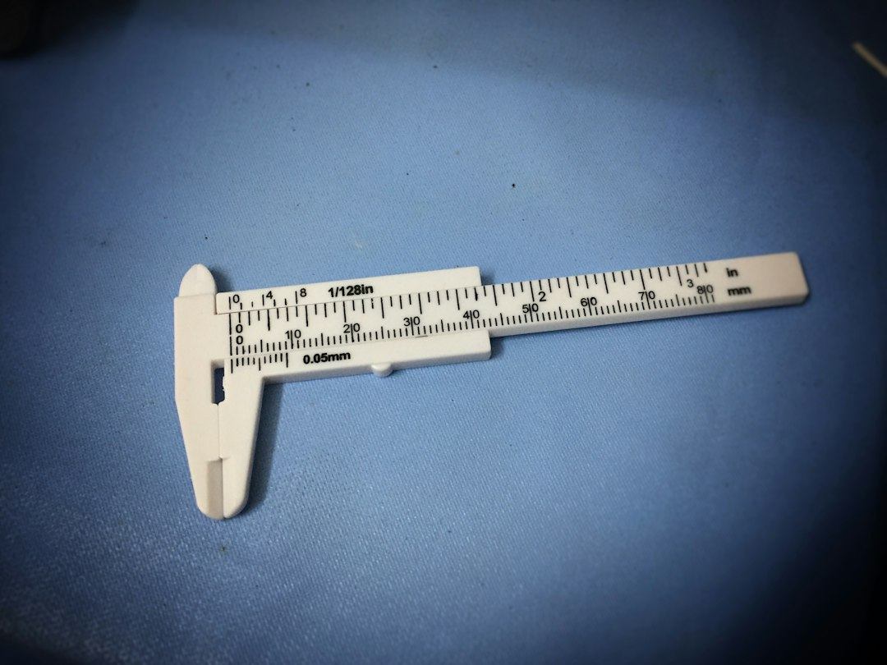

> 一个 8 亿参数的模型被改动了 13 万个权重——占 0.016%——数学分数从 7.9% 跳到 48.1%。这是本周最像科幻的实验，也是最容易被读错的一条新闻：真正被改写的东西不是模型，而是"分数"这两个字的意思。

## 先说清楚 48.1% 是怎么来的

MIT CSAIL 的四位研究者（Rikiya Takehi、Jayden Teoh、Alex Zhang、Omar Khattab）11 月 2 日发了一篇博文《Sparks of Weight-Space Programming》，标题里的 "sparks" 用得很克制，内容一点不克制。三组实验：只给原始权重矩阵，GPT-6 Astra 能判断一个网络当初被训练来玩哪个游戏；不给任何环境反馈、也不许写训练循环，它从零手写出小游戏网络，打赢了用 PPO 训了 1 亿步的对手；第三个最有画面感——它先指出 Qwen3.5-0.8B 权重里那块导致"推理死循环"的部分（Qwen 自己的模型卡都警告过这个问题），然后原生改写了 13 万个权重。

0.016%。接着是 MATH-500 从 7.9% 到 48.1%，GSM8K 从 13.8% 到 67.1%，IFEval 从 21.0% 到 62.3%，撞上 token 上限的比例从 93.0% 掉到 33.1%。没有梯度，没有训练循环，一个 Python 内核里改了几个数就完事。

如果只记住 48.1%，你会把它读成"模型变聪明了"。两份独立复现给了另一种读法。

一份逐句审计（takzen 的 weight-space-audit）指出：原模型 93% 的答案根本撞在 token 上限——也就是说 7.9% 不是"数学能力"的分数，是"陷进死循环"的分数。关掉思考模式（这个 0.8B 模型的默认模式），不做任何编辑，MATH-500 就有 46.0%，95% 区间 42.5 到 49.5。而"编辑 + 关思考"是 43.0%，比不编辑还低。另一份复现（mani-aiml）做了更狠的一刀：把同一份被编辑的模型拿去做智能体任务——一个小型文件世界、四个工具、每种子 150 个任务——它比未编辑版本低 11 到 14 分。

两边都确认了两件事：编辑是真的（同尺寸的随机编辑毫无作用，说明确实定位到了东西），提升也是真的（GSM8K 上编辑明确赢，13.8% 到 67.1% 不是噪声）。但同时确认了第三条，而这条最重要：这次手术修的是一个具体故障，不是一项抽象能力。

作者自己在博文里写了一句很老实的判词，我认为值得刻在每个做模型评估的人桌上：「编辑权重可以移除一个掩盖了能力的障碍，但它无法增加模型原本没有的能力。」

这句话既是技术判断，也是审计判据。

## 一次编辑，两种身份

看看那次编辑到底长什么样。开源复现项目 openwsp 的记录很具体：整个改动落在模型的一个张量上——`layers.23.mlp.down_proj.weight`。BF16 下 13 万个权重，大约 256KB。一次"能力升级"，体积比一张缩略图还小。

这才是真正的分水岭。不是"模型能读懂权重"——那还在演示阶段；而是权重从一个只能整体重训的数据块，变成了可以被单独寻址、单独提交、单独 review 的产物。它开始拥有软件的一切属性，包括软件的一切麻烦。

Hacker News 上有人把这层意思写成了段子：《Models can now transmit viruses in weight-space》。段子归段子，机制是成立的：一次权重编辑可以同时是性能补丁和后门，两者形态完全一致，都是小数点后第 n 位的一串数。而我们目前审计模型的三层入口——训练数据、对齐报告、系统卡——全都在权重的上一层。攻击现在发生在下面那一层。

好消息是，那句判词顺手给了审计一条极省力的规则：权重补丁只能声称"修复"，不能声称"新增"。任何声称靠改权重让模型获得全新能力的补丁，要么是没测出副作用（参见那个 -11 到 -14 分），要么就是在撒谎。

坏消息是它的能力边界还很窄。Astra 手写权重的规模上限是 150 万参数——一个 243→512×6→82 的 Go 网络，再大就塞不进上下文，得靠工具拆。前沿模型是几千亿参数。也就是说，这条路目前的形状是"能对小模型做精密手术"，而不是"能重写大模型"。openwsp 的独立复现只拿到 12.9%，作者是 48.1%——这种复现落差本身就是它还没到工业化阶段的证据。

## 分发口已经被人买走了

如果权重将成为可寻址、可提交的产物，下一个问题就是谁来当那个"应用商店"。

9 月 3 日，英伟达宣布以 129.3 亿美元收购 Hugging Face：11.9 亿给股东，最多 10 亿留给加入英伟达的员工，预计 2027 年上半年交割。Hugging Face 现在有 1800 万开发者、300 万个模型、50 万个数据集，20 万家公司靠它发现、评估、定制和部署模型。它的上一轮估值是 45 亿美元（2023 年），据 FT 报道，去年它还拒过英伟达一笔 5 亿美元的投资，因为不想让单一投资者占比过大。

黄仁勋的公开承诺很完整：平台保持开放、不要求用英伟达的芯片、继续支持多云多加速器、继续托管各家开放权重。我倾向相信这些话——至少在监管不介入之前。英伟达自己交给 SEC 的 8-K 里就写着：政府可能施加新的要求，限制平台上可用的模型或数据集。这句不需要任何恶意，它只是陈述了一个位置：审稿台的所有权变了，而审稿标准写在别人的法条里。

对照本周另一条不那么显眼的新闻，你就知道"承诺"这两个字现在有多软。推理服务商 Fireworks AI 十月连遭两次入侵——一次通过泄露的内部凭证，一次通过托管其研发机器的第三方云服务商。Notion 11 月 2 日收到警报，起初被告知"只是一个合成测试数据集"，当天就切流量、删供应商侧数据、停训练任务；11 月 8 日 Fireworks 才确认真实客户数据被访问，被拿走的正是 Notion Insights 用的 AI 聊天记录。而 Fireworks 的文档上写着"默认零数据留存"——零留存指的是推理时只存在于易失内存，至于批量推理、训练、把响应存下来这几类功能，内容是会落盘的。攻击者恰好打在了落盘的那一侧。

从"被告知是合成数据"到"确认真实数据泄露"，用了六天。这六天里客户能做的最正确的事只有一件：把这段数据当已泄露处理，凡是那段时间往 Notion AI 里贴过密码或 API key 的，立刻轮换。

## 结语：一个比"会不会骗人"更土的问题

三年前我们在争"模型会不会骗人"。现在有一批人开始研究"模型的权重里能不能藏东西"。后者的麻烦在于，它连"骗"这个动作都不需要——一串数字没有动机。

所以我押三个可证伪的预测，一年后可以回来打我的脸。一，会出现"权重 diff 审查"这个工具品类，形态接近代码 review：逐张量对比、附带行为回归测试集，而不是现在这种整包签名。二，模型卡里会多出"本次权重编辑的字节范围"这一栏，因为采购方迟早会问。三，第一个被公开证实的权重后门会出现在某个可下载的开源模型上，而不是闭源 API——理由很朴素，闭源你连下载都下载不到。

到那时候，评估一个模型会用一套很土的问题开场：这 0.016% 是谁改的？改之前它会什么？改之后它还会什么？

我们现在还没有任何环节能回答这三个问题。48.1% 只是让这三个问题变得不能再拖了。

📷 <a href="https://unsplash.com/photos/white-caliper-Te2zcvp3X1g?utm_source=toby-blog&utm_medium=referral" target="_blank" rel="noopener">Photo by Ag PIC</a> on <a href="https://unsplash.com?utm_source=toby-blog&utm_medium=referral" target="_blank" rel="noopener">Unsplash</a>

📷 <a href="https://unsplash.com/photos/person-using-soldering-iron-MCKz5KGAmdQ?utm_source=toby-blog&utm_medium=referral" target="_blank" rel="noopener">Photo by Mariana B.</a> on <a href="https://unsplash.com?utm_source=toby-blog&utm_medium=referral" target="_blank" rel="noopener">Unsplash</a>
