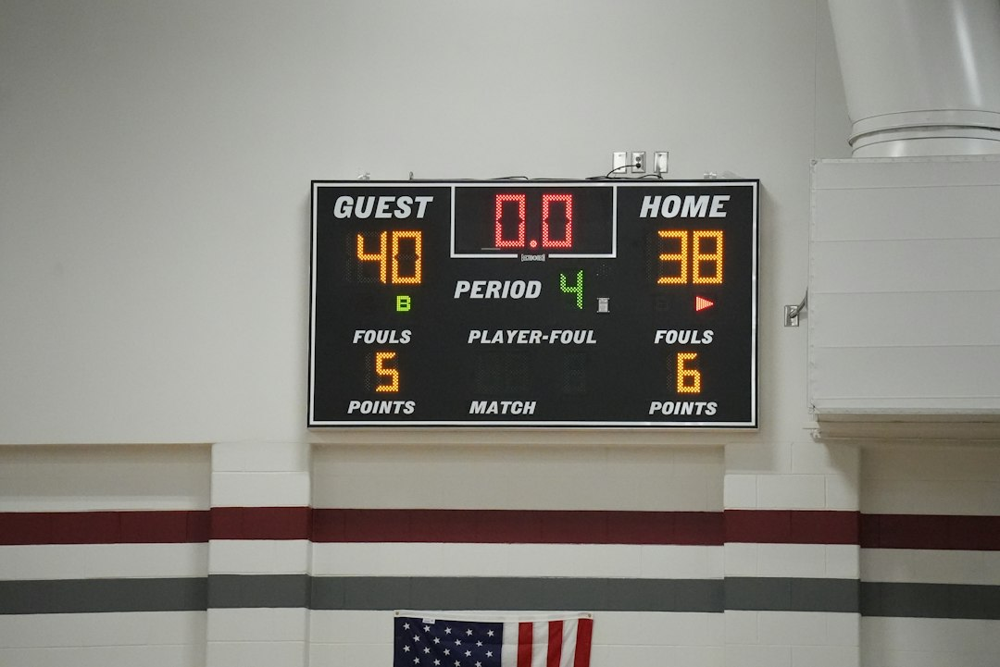

十一万五千个签名，要求把一个人请回他创办了三十三年的公司；同一周，《华尔街日报》把这家公司"自己给自己的客户放贷、以消化囤下的晶圆"的账本摊开在报摊上。这两件事拼在一起，是一个很少被同时说出口的结论：在AI这门生意里，"需求"这个词已经不只是买家的意愿，它还是卖家的一项财务安排。今天的研究侧也不安分——新论文直接拆了排行榜、拆了验证器、也拆了智能体"擦历史"的小动作。定价权正在从叙事回到账本。

## 研究突破

1. **排行榜可以被"投"上去：偏好型评测存在系统性操纵面**
   arXiv 2611.14769（11-14）把竞技场式排行榜的布拉德利-特里聚合方式当作攻击面，给出三种供应商可用的操纵策略：策略性投票（包括对无关模型投票以改变全局尺度）、策略性提示（挑选对自己有利的题目）、策略性提名（塞入无关模型抬高目标模型名次）。结论很直接：当排名同时是营销素材和采购依据时，"匿名对战"并不等于"无偏对战"。
   https://arxiv.org/abs/2611.14769

2. **验证器值不值这个价：认证换来的精度，是拿覆盖率买的**
   arXiv 2611.14794（11-14）在 GPQA、AIME-2025 与 MATH-500 子集上评测"认证或拒答"流水线：强配置下答案精度提升31个百分点（GPQA）、46个百分点（AIME），但只回答了35%和21%的题目；在接近饱和的 MATH-500 上，收益最多5个点，却要付出13至27个点的覆盖率。对照组是同输出预算的自一致性选择器：35%覆盖率下精度82.9%，验证器合并后87.6%，配对差异+4.8个点、95%区间跨零。论文还报告了52/88道完成题以无效结论收尾的失败模式——"验"和"答"是两种不同的能力。
   https://arxiv.org/abs/2611.14794

3. **替智能体"擦干净历史"，世界却还留着错误**
   arXiv 2611.14654（11-14）指出上下文压缩、修复、交接这类操作有个被忽略的前提：它们默认世界状态会随历史一起被修正。作者把智能体连世界状态一起冻结在中途，再分别编辑历史与世界，让接收方模型继续任务。在 AgentCE-Bench 上，当错误值已经写进世界，仅在历史里加一条"正确值"的真话注解与直接修正历史，效果并不相同——记录层干净了，后果层还在。
   https://arxiv.org/abs/2611.14654

4. **把算法写成证明，让假设本身成为搜索空间**
   arXiv 2611.14844（11-14）提出 AutoAssumption：把89个 ML 系统算法（KV 缓存淘汰、权重剪枝、投机解码等）形式化为带显式假设的证明图，让大模型在"假设空间"里搜索、由证明检查器审计。动机是这类进步大多来自打破某个从未被写下来的假设，而直接搜程序时一次编辑会同时改动多个设计选择，收益无法归因。
   https://arxiv.org/abs/2611.14844

5. **Anthropic 谈"强安全评估"该长什么样**
   Anthropic 研究博客 11-13 发布《Building strong safety evaluations》，属于工程类方法论文章，讨论如何把评估做得足以支撑部署决策（而非只做能力展示）。
   https://www.anthropic.com/research/building-strong-safety-evaluations

## 产品发布

1. **ChatGPT Wallet：智能体付钱，但拿不到你的卡号**
   OpenAI 11-13 上线 ChatGPT Wallet，与 American Express、Mastercard、Visa 合作，先在 dots 内面向美国 ChatGPT Pro 订阅者开放。机制是：卡只绑一次，每笔购买都要用户过一遍生物识别（Face ID/指纹）确认，支付网络发一次性支付令牌代替真实卡号，商户与智能体都看不到卡信息；卡本身的返现与争议保护保留。官方称每周有12亿人使用 ChatGPT。同批发布面向商家的 Commerce Partner Playbook，提示网站需用 Web Bot Auth 识别签名请求，否则可能误拦智能体下单。
   https://openai.com/index/introducing-chatgpt-wallet

2. **Gemini 4 Hydrogen：把"日常主力"定义成智能体工作流**
   Google DeepMind 11-12 发布 Gemini 4 Hydrogen，官方定位是"面向智能体工作流的日常主力"（our daily driver for agentic workflows），署名 Koray Kavukcuoglu。上一代 Carbon 在11-10 才刚开放，两代间隔两天，迭代节奏本身是本次发布最重要的信息。
   https://deepmind.google/blog/introducing-gemini-4-hydrogen/

3. **200行纯 JAX 复刻 DeepSeek V3**
   Hacker News 11-14 的 Show HN 项目用约200行 JAX 代码实现 DeepSeek V3 前向，社区把它当作"读懂 MoE + MLA 的最小可运行读物"。
   https://github.com/Vaibhaav-Tiwari/deepseek-v3-jax

## 融资并购

1. **LangChain 3亿美元 C 轮，估值30亿美元**
   LangChain 11-13 宣布完成3亿美元 C 轮，估值30亿美元，CapitalG 领投，GIC、DFJ Growth、IVP、Sapphire Ventures 参投；一年前那轮1.25亿美元融资的估值是12.5亿，即一年翻倍多。公司称 LangSmith 已有7000家客户，包括 Harvey、Rippling、Clay，以及 NVIDIA、丰田、Salesforce 这类大企业。定位话术是"让企业拥有自己的智能"，不绑定模型、云或生态。
   https://techcrunch.com/2026/11/13/ai-agent-startup-langchain-hits-3b-valuation/

2. **北航博士做 AI4S，亿元级融资造"自驱动实验室"**
   36氪 11-13 首发：团队以 AI for Science 为方向，融资额达亿元级，目标是把实验设计、执行、分析串成自驱动闭环。
   https://36kr.com/p/4067548192576389

3. **前迪士尼亚太成员做"交互智能基座"，拿到数百万种子轮**
   36氪 11-12 报道，团队方向是交互智能基座（面向智能体与硬件的交互层），融资规模为数百万元种子轮。
   https://36kr.com/p/4066337448907656

4. **英伟达的钱袋子换了主人，创业公司先感到冷**
   TechCrunch 11-13 统计：英伟达今年参与105轮融资（PitchBook 数据），常任最大出资方；今年的代表作包括130亿美元收购 Hugging Face（预计2027年交割）、Crusoe 14亿美元 E 轮中的两轮、以及 Reflection AI 20亿美元 B 轮中8亿美元。多位投资人判断，接任的临时 CEO Colette Kress 风格更保守，"不会用同样的钱把早期生态托住"。
   https://techcrunch.com/2026/11/13/jensen-huangs-departure-blasts-big-hole-in-ai-startup-funding-vcs-and-founders-say/

## 产业应用

1. **Google 把 Antigravity 的 /teamwork 推到科研与工程场景**
   Google Research 11-14 发文介绍用 Antigravity 的 /teamwork 能力推进科学与工程任务，属于"智能体当协作者"的落地样例。
   https://research.google/blog/advancing-science-engineering-with-antigravitys-teamwork-feature/

2. **新疆低空空域智能管控重点实验室揭牌**
   中国新闻网 11-14 20:55：低空经济的基础设施侧继续补课，实验室内核是空域智能管控与安全保障技术。
   https://www.chinanews.com.cn/cj/2026/11-14/10732175.shtml

3. **2026企业科技创新发展论坛：竞争焦点转向"转化效率"**
   中国新闻网 11-14 20:34，论坛在天津举行，与会者把未来产业竞争的关键从"谁先做出来"改成"谁能更快转化"。
   https://www.chinanews.com.cn/cj/2026/11-14/10732167.shtml

4. **北汽极狐贝塔与宁德时代合作换电版车型上市**
   36氪 11-14 17:10：换电从运营车向乘用车产品线继续铺开。
   https://36kr.com/newsflashes/4069258718385284?f=rss

## 行业动态

1. **请愿书破11.5万签名：要求董事会让黄仁勋回来**
   TechCrunch 11-14 报道，standwithjensen.com 的请愿截至周六下午已获超11.5万签名，其中英伟达在职员工5,965人、前员工1,108人、股东63,063人；署名支持者包括马斯克、Replit CEO Amjad Masad、Epic Games CEO Tim Sweeney。请愿措辞是"黄仁勋被免职缺乏有意义的正当程序"、"他要的是正当程序，不是私刑"。36氪 11-14 09:15 亦记录马斯克在 X 上公开表示将参与该请愿。英伟达已任命 CFO Colette Kress 为临时 CEO，股价周五跌2%。
   https://techcrunch.com/2026/11/14/elon-musk-other-tech-execs-sign-petition-calling-on-nvidia-to-reinstate-jensen-huang/

2. **安全团队当时在哪：CISO 八月已离任**
   TechCrunch 11-14 长文追问英伟达安全体系：任职四年的 CSO 兼产品安全负责人 David Reber 于8月以健康理由离职（他披露两年前确诊早发型帕金森），接任者 Saša Zdjelar 此前在埃克森美孚17年、Salesforce 一年、ReversingLabs 数年。报道不认为人事变动与 Megaspeed 案有公开关联，但指出关键问题：与一名正被联邦调查的公司高管的关系，属于安全团队该管的"人员风险"，而不仅归 HR 与法务。前情报官员 Nicholas Eftimiades 的说法是，情报搜集多靠日常对话而非入侵，这类暴露极难被常规安全流程捕捉。
   https://techcrunch.com/2026/11/14/where-was-nvidias-security-team/

3. **亚洲各国政府开始为"后黄仁勋时代"的供货做预案**
   TechCrunch 11-14：部分政府着手确认芯片供应承诺，另一些在评估本地项目受影响程度，并跟进正在进行的调查。
   https://techcrunch.com/2026/11/14/asian-governments-react-to-nvidia-ceo-jensen-huangs-exit/

4. **微软称服务已全面恢复**
   36氪 11-14 17:34：本轮云服务中断收尾，官方口径为全面恢复。
   https://36kr.com/newsflashes/4069263558694023?f=rss

5. **中美经贸磋商机制项下贸易理事会首次会议举行**
   36氪 11-14 14:54：机制化沟通渠道重启，芯片与出口管制的议题背景不变。
   https://36kr.com/newsflashes/4069249481725064?f=rss

6. **吴清：加强科技企业发行上市的制度适配性研究**
   36氪 11-14 11:56：监管层表态在"科学把握节奏"的同时，研究让发行上市制度更适配科技企业特征。
   https://36kr.com/newsflashes/4069074198303622?f=rss

7. **币安称下周全面恢复提现**
   36氪 11-14 16:52：交易所侧流动性事件的收尾节点，提现功能是用户信心的第一指标。
   https://36kr.com/newsflashes/4069155924530308?f=rss

## 市场数据

1. **英伟达被指"自己制造需求"：循环融资、囤晶圆、守价格**
   TechSpot 11-14 转述《华尔街日报》对临时 CEO Colette Kress 的侧写：2026年中后期，英伟达为消化向台积电下的"雪崩式"订单，继续推进与云厂商和大客户的交易以维持 GPU 价格；Kress 内部对交易规模表达过担忧，黄仁勋曾斥其"像被车灯照住的鹿"。此前一度包含为全球最大数据中心提供2,500亿美元兜底的 OpenAI 交易被放缓、缩减或暂停。消费端后果已有数据：GeForce 显卡价格常超过建议零售价的160%，RTX 5090 因显存与芯片被优先分配给数据中心而一卡难求。黄仁勋还在柏林向大客户讲过"日本拉面摊汤不够就不给第二碗"的故事，用来说明维持客户多样性与价格。
   https://www.techspot.com/news/114558-nvidia-deliberately-kept-gpu-prices-high-through-circular.html

2. **"AI坟场"清单：42%的AI项目最终被母公司放弃**
   TechCrunch 11-14 汇总：S&P Global Market Intelligence 数据显示约42%的AI举措最终被放弃；Character.ai 在成立五年后于10月申请破产，隐私型助手 Ollie 数周前宣布关停；OpenAI 自身的"超级应用"改版被回滚，ChatGPT Atlas 浏览器上线不到一年于8月9日停用，Operator 与 DALL·E 的独立入口被并入 ChatGPT，Sora 因成本与留存问题于2026年3月关停。
   https://techcrunch.com/2026/11/14/the-ai-graveyard-a-running-list-of-projects-and-startups-that-didnt-make-it/

3. **上市公司治理指数升幅扩大**
   中国新闻网 11-14 19:49：2026年中国上市公司治理指数升幅较上年扩大，治理质量继续改善。
   https://www.chinanews.com.cn/cj/2026/11-14/10732127.shtml

4. **英国央行首席经济学家：需进一步加息**
   36氪 11-14 15:55：英国货币政策仍在偏紧一侧，通胀回落速度不足以支持转向。
   https://36kr.com/newsflashes/4069148906787968?f=rss

5. **数说APEC：双向投资的账本**
   中国新闻网 11-14 19:53：以数据方式梳理 APEC 框架下的双向投资流向。
   https://www.chinanews.com.cn/cj/2026/11-14/10732140.shtml

## 技术工具

1. **Datasette 插件三连更新**
   Simon Willison 11-14 发布 datasette-llm 0.1a11，新增对 OpenAI 兼容端点的支持，可让其他插件调用自建/第三方推理服务；同日 datasette-vega 0.7 发布——这是该项目自2018年7月以来第一次发版，为兼容新版本做升级；11-13 的 datasette-cluster-map 0.19 与 datasette-leaflet 0.3 则围绕 Datasette 1.0a42 与 OpenStreetMap 的 referrer 政策做了适配。
   https://simonwillison.net/2026/Nov/14/datasette-llm/

2. **Together Compiler：为频繁变化的推理负载做持续编译**
   arXiv 2611.14681（11-14，来自 Together AI 的工程论文）针对"模型发布更频繁、架构更多样、流量分布常变"的现实，提出持续编译方案，目标是把编译开销从一次性动作变成随负载滚动的过程。
   https://arxiv.org/abs/2611.14681

3. **PyPI 项目页改版，把安全信号前置**
   PyPI 11-06 上线新版项目页（HN 11-14 讨论），把安全相关的元信息放到更显眼的位置，降低"装之前先判断"的成本。
   https://blog.pypi.org/posts/2026-11-06-ui-updates-complete/

## 安全与伦理

1. **15.9万个 Lovable 项目里，大量数据不登录就能读**
   安全研究团队 Crissyfield 与《商报》（Handelsblatt）联合调查（11-02 报道，报告近日更新数据）：用 Common Crawl 识别2025年12月至2026年9月间15.9万个 Lovable 项目，其中34,545个使用 Supabase；24,664个网站在加载时即从 Supabase 返回数据库记录，无需登录；追加只读请求后，在7,403个网站的10,560张表中取到含邮箱的记录（占被细查网站的30%）。具体泄露案例包括：某德国生活论坛8万余份用户资料（姓名、邮箱、生日、性别）与超20万条聊天消息；多家活动主办方与餐厅的票务、餐饮销售记录（含电话、地址、支付信息、票码）；某服务商超1,000条身份证件记录，含护照号、有效期、国籍；还有数万份合同、发票、私人相册、内部 WhatsApp 通信，以及某服务商28万封已发客户邮件。研究者强调30%不能直接当"泄露率"读，但结论明确：易用不等于安全，权限审查不能外包给自动化检查。
   https://www.crissyfield.de/research/lovable-en/

2. **Project Zero 改披露政策：漏洞太多，谈判谈不动了**
   Google Project Zero 11-13 发布《Policy and Disclosure: 2026 Edition》（Natalie Silvanovich 署名）。核心变化动因是 LLM 让漏洞发现量级变了——"过去一年只找到几个漏洞的目标，现在每周都能找到几个"；而旧政策中依赖与厂商协商的部分（是否已修复、是否适用宽限期）已经"迅速变得无法管理"。新政策据称与基金会共同制定，同时继续强调缩短补丁间隙（patch gap）。
   https://projectzero.google/2026/11/disclosure-policy.html

3. **EFF：科技公司又在试图改写"隐私"的定义**
   EFF 11-14 文章批评行业新一轮话术，把"隐私"从"不被收集"迁移为"被收集后如何被使用"。
   https://www.eff.org/deeplinks/2026/11/tech-companies-are-trying-shift-entire-concept-privacy-again

---

## 今日观察

三条线其实是一件事：**定价权正在从"叙事"回到"账本"**。英伟达的循环融资被摊开在报纸上，意味着"需求"要按现金回收来重新计算；LangChain 一年估值翻倍多，说明智能体管理层的钱还在进，但投资人开始只给"能管住行为"的那一层付溢价；而 arXiv 那篇排行榜论文与 Lovable 的数据暴露，则从两个方向提醒同一件事——评分和数据都需要有人负责审计，自动化本身不构成审计。

---

*数据来源：OpenAI RSS、Google DeepMind Blog、Anthropic Research、TechCrunch、Hacker News、TechSpot、Project Zero、arXiv cs.AI、Simon Willison、Crissyfield、EFF、36氪、中国新闻网财经、FT中文网*
*生成时间：2026-11-15 09:00 CST*

---

📷 <a href="https://unsplash.com/photos/tilt-shift-photography-of-green-computer-motherboard-bN5XdU-bap4?utm_source=toby-blog&utm_medium=referral" target="_blank" rel="noopener">Photo by Chris Ried</a> on <a href="https://unsplash.com?utm_source=toby-blog&utm_medium=referral" target="_blank" rel="noopener">Unsplash</a> ｜ <a href="https://unsplash.com/photos/a-scoreboard-in-a-gym-with-a-flag-on-the-floor-ANL5HIubReg?utm_source=toby-blog&utm_medium=referral" target="_blank" rel="noopener">Photo by Anthony McKissic</a> on <a href="https://unsplash.com?utm_source=toby-blog&utm_medium=referral" target="_blank" rel="noopener">Unsplash</a>

