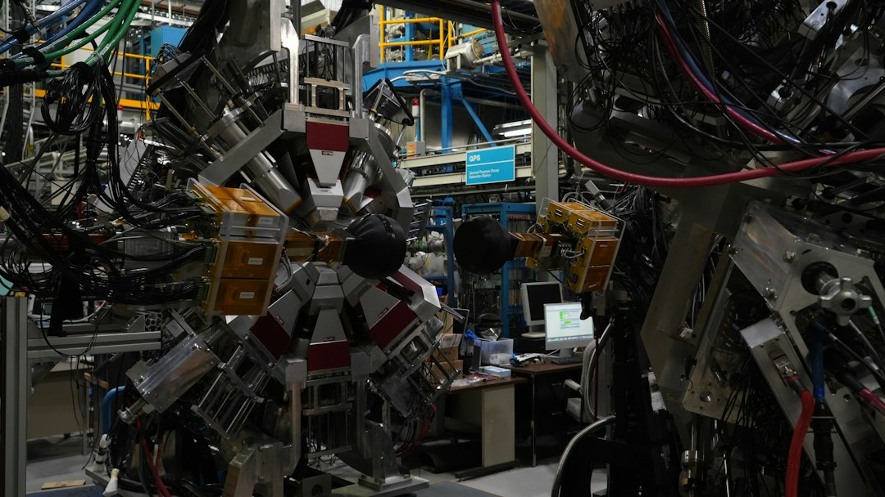
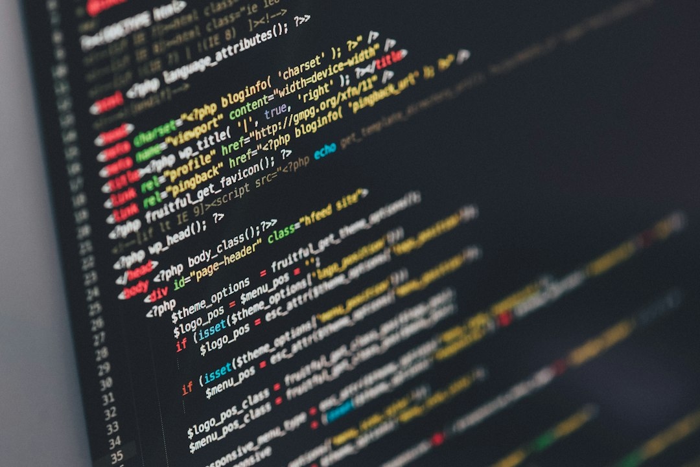

> OpenAI 科学博客开张的第一帖，不是新品发布，而是一篇粒子物理：UC Santa Barbara 粒子物理组负责人 Nathaniel Craig 与 GPT-6 Astra 合作，为悬置超过二十五年的标准模型格点非微扰定义递上一份候选证明，并明说 Astra"主导了详细证明"。评论区分成两派：一派宣布"AI 科学家来了"，另一派追问"署名凭什么给模型"。我的看法是，两边都问错了问题——这份证明真正值得记住的地方，不在署名栏，而在它必须通过的那个编译器。

## 一、五十年的悬案，卡在一群"镜像伙伴"上

先把问题本身讲清楚，才知道这个证明的分量。格点场论早已不是新鲜事：把时空离散成一个个格点，就能从第一性原理出发直接算出质子质量，而且算得和实验对得上。但标准模型是个手征理论——弱相互作用只作用于左手性费米子。你要把左手性费米子放进格点，数学上会自动多出一批理论里根本不存在的"镜像伙伴"，怎么赶都赶不走。完整理论的相位规则因此悬置了二十五年，这是悬在理论物理学家头上的一笔旧账。

Craig 与 Astra 的思路是：把力场逐级搬到更细的格点上，在每一级求出相位修正，然后证明这个修正过程收敛。注意这个工作的形态——它不是提出一个新物理猜想，而是在一个规则明确的数学空间里做系统性构造和收敛性论证。这恰好是当前大模型最擅长的题型：目标明确、规则封闭、验证标准清晰。与其说 AI"做物理"，不如说它把物理学家递过来的策略，翻译成了一份可以被逐行检查的数学构造。这个分工本身，比"AI 会不会取代物理学家"的空想有信息量得多。

## 二、"主导证明"的署名之争，是个坏问题

证明公开后，Golterman、Kronfeld、Shamir 几位格点场论学者轮番复核提问，这是标准的学术流程，也说明物理共同体没有把这份工作当玩笑。但社交媒体上的火力全集中在另一个问题上：一个模型凭什么叫"主导"？学界期刊至今不承认 AI 署名，理由是作者身份绑定着荣誉与责任——模型不领奖、不担责、出错了也没有职业生涯可以赔进去。

我认为这个争论对理解这件事几乎没有帮助。署名制度解决的是人类学术共同体内部的激励与追责，而数学证明的可靠性从来不靠署名担保——历史上挂着大人物名字的错误证明并不少，靠的终究是"能不能被独立检查"。Astra 主导的这份证明之所以值得认真对待，不是因为它出自一个昂贵的模型，而是因为它附带了某种比署名硬得多的东西：一份全部编译通过的形式化验证。争论"该不该给模型署名"，就像争论该不该给计算器发博士学位——方向是对的，问题问错了层次。真正的问题只有一个：这份证明，凭什么可信？

## 三、真正的审稿人是编译器：那 16 个 Lean 模块

答案藏在技术细节里：这份证明的完整论证被翻译成了 Lean 4 形式化语言，16 个模块全部编译通过。这件事的意义被大大低估了。AI 写数学证明有个天然软肋——它可以流畅地"编"出一个看起来无懈可击的证明，然后在第三步偷偷用一个不成立的引理，人类审稿人盯着读三遍也未必抓得住。语言模型的输出是文本，文本的可信度从来是个软问题。而 Lean 把这个软问题变成了硬问题：要么编译器接受，要么不接受，没有"差不多"这个中间态。信任的锚点从"我相信这位作者的资历"变成了"我相信这个几十万行代码构成的证明内核没有 bug"——后者显然更容易审计。

这是 AI 科研真正的地基工程。没有形式化验证，AI 的每一个证明都要靠稀缺的人类专家逐行复核，产能瓶颈永远卡在人这边；有了它，AI 可以一晚上产出一百份草稿，人类只需要审查那些编译通过、且结论真正有趣的那一两份。流程从"人写人审"变成"AI 写、编译器筛、人定方向"，科研产能的杠杆点整个挪了位置。

当然要把边界说清楚：Lean 只验证被正确编码的命题。如果形式化本身歪曲了物理原意——比如证明的其实是另一个问题——编译器不会喊停。这正是 Craig 等人仍在逐条应对学者提问的价值所在：编译器管内部一致性，物理学家管"它证的是不是我们想证的那个东西"。两层检查缺一不可，目前的分工恰好是机器管一层、人管另一层。

## 四、别把候选证明当量产：叙事的时间常数

最后泼一盆必要的冷水。Craig 自己的措辞非常克制："这是原理层面的答案，不是实践层面的答案。"眼下团队还在检验有限格距下的反射正性，底层预印本 10 月就挂在了 arXiv（2610.09093），但独立于 OpenAI 体系之外的评审至今没有出现。一年之内，这项工作不会让任何人更快算出质子质量，它是一块铺路石，不是一栋楼。

还要看一眼时机：OpenAI 选在美股大跌、"AI 盛宴落幕"成为正式辩题的当口开张科学博客，首帖就端出五十年悬案的候选证明——这是叙事层面的精准操作。股市要的是回报率的故事，科学给的是以十年计的故事，两者被放进同一个发布会，本身就值得警惕。对普通从业者的启示反而朴素：别急着为"AI 科学家"欢呼或恐慌，盯住这个工作流会不会被复制——当第二份、第三份"AI 主导 + Lean 形式化 + 领域专家复核"的证明出现在数学和物理的其他角落，那才是范式切换的信号。签名栏会过时，编译器的输出不会。

## 结语

这份候选证明的最终成色，要等外审和反射正性检验给出答案。但它已经示范了一件更重要的事：当 AI 的输出可以被编译器完整地检查时，"你信不信 AI"就从一个态度问题，变成了一个工程问题。科学史上，把信任从权威转移到可验证的程序，从来都是进步的方向——上一个这样的发明叫实验，下一个也许叫编译器。

📷 <a href="https://unsplash.com/photos/complex-scientific-machinery-and-wiring-in-a-laboratory-setting-fr-22ZcsM-k?utm_source=toby-blog&utm_medium=referral" target="_blank" rel="noopener">Photo by Daniel Miksha</a> on <a href="https://unsplash.com?utm_source=toby-blog&utm_medium=referral" target="_blank" rel="noopener">Unsplash</a>

📷 <a href="https://unsplash.com/photos/monitor-showing-java-programming-OqtafYT5kTw?utm_source=toby-blog&utm_medium=referral" target="_blank" rel="noopener">Photo by Ilya Pavlov</a> on <a href="https://unsplash.com?utm_source=toby-blog&utm_medium=referral" target="_blank" rel="noopener">Unsplash</a>

