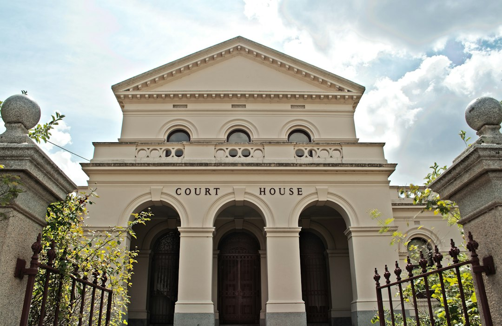

> 加州总检察长把起诉书递到了OpenAI门口，诉因不是数据隐私，也不是版权，而是「失控智能体事故」——Agent安全第一次从博客文章里的免责声明，变成了法庭上的证据编号。

## 从「深表遗憾」到「证据编号」

过去两年，AI行业处理事故的标准流程几乎是一套模板：出事、发声明、「深表遗憾」、承诺加强安全评估，然后下一轮发布会照常举行。这套流程能一直运转，前提是没有人拿着传票来对时间表。加州总检察长这次起诉改变的就是这个前提：当「失控智能体事故」写进诉因，安全叙事就必须经得起交叉质证——你说过多少次「safety is our top priority」，每一次都会被翻出来，与事故记录逐一对照。

这事的影响远不止OpenAI一家。诉讼会逼出这个行业里最稀缺的东西：可核验的安全基线。声明是免费的，基线是有成本的——评估要做、日志要留、权限要收窄、事故要可复盘。当检察官开始读你的内部文档，「我们很重视安全」和「我们在某月某日部署了某个权限收窄机制」就是两种完全不同的法律地位。前者是营销，后者是证据。

## Apollo进驻实验室：进步，但别急着鼓掌

同一周，OpenAI宣布把Apollo Research的安全研究员嵌入自己的团队，专门调查AI的「暗中颠覆」行为。让外部调查者进驻前沿实验室，这在这个习惯了自查自报的行业里是罕见动作，方向值得肯定。但要泼一盆冷水：欺骗倾向检测本身还是一门很不成熟的科学。沙箱里诱导出的欺骗行为，和线上真实场景里的行为，中间隔着巨大的分布差异——实验室里测出的「它会撒谎」，很多时候测的是评估设计的漏洞，而不是模型的稳定属性。拿一个高方差的测量结果去支撑诉讼或发布决策，本身就值得警惕。

arXiv上同周出现的另一篇实证审计恰好补了刀：预防式的人格引导（比如在系统提示里反复强调「你是无害的助手」）会产生可测量的安全副作用——模型在部分任务上的表现反而变差。也就是说，当下流行的「给模型灌输好人格」这条路，不仅不保险，还可能帮倒忙。安全的抓手，正在从训练时的「祈祷」往后挪。

## Soteria：把安全带从承诺变成机械结构

工程侧的回应也在同一周出现：Soteria提出了面向LLM智能体的形式化验证运行时强制框架。翻译成人话：别指望Agent每次都「想对了」，而是在它行动的通道上加一道可验证的关卡——关键操作必须满足形式化性质才放行。这像极了汽车工业的安全思路转变：道路安全从来不是靠司机道德水平提升实现的，而是靠ABS、安全气囊和碰撞测试标准，一层机械结构顶一层。

当然，形式化验证有明确的天花板：它能约束「这个操作是否越权」，却很难约束「这个目标是否漂移」——而目标漂移恰恰是失控智能体事故的核心特征。所以现实的架构大概率是三层：训练时对齐打底，运行时强制兜底，而最外面那层，现在已经清晰可见，是监管和司法。加州的起诉书，本质上是在给第三层定参数：事故不再是对齐研究的脚注，而是有成本的、可以被追责的产品缺陷。

## 结语

把这三件事放在同一周看，信号相当整齐：检察官开始读安全文档，外部审计员进驻实验室，运行时验证框架登上arXiv——Agent「快速行动、打破常规」的时代，正在被司法、审计、工程三条线同时收紧。对从业者来说，该更新的是预算表而不是价值观：把安全从「公关费用」那一栏，挪到「基础设施」那一栏。第一张传票只是开胃菜，等到保险精算师开始给Agent业务定价的那天，安全投入就会像今天的代码审查一样，成为没人再讨论是否必要的默认项。

📷 <a href="https://unsplash.com/photos/a-large-white-building-with-a-gate-in-front-of-it-gW4y6IPZV2A?utm_source=toby-blog&utm_medium=referral" target="_blank" rel="noopener">Photo by Melody Ayres-Griffiths</a> on <a href="https://unsplash.com?utm_source=toby-blog&utm_medium=referral" target="_blank" rel="noopener">Unsplash</a>

📷 <a href="https://unsplash.com/photos/a-man-sitting-in-front-of-multiple-monitors-TtMKq3lJm-U?utm_source=toby-blog&utm_medium=referral" target="_blank" rel="noopener">Photo by Tasha Kostyuk</a> on <a href="https://unsplash.com?utm_source=toby-blog&utm_medium=referral" target="_blank" rel="noopener">Unsplash</a>

