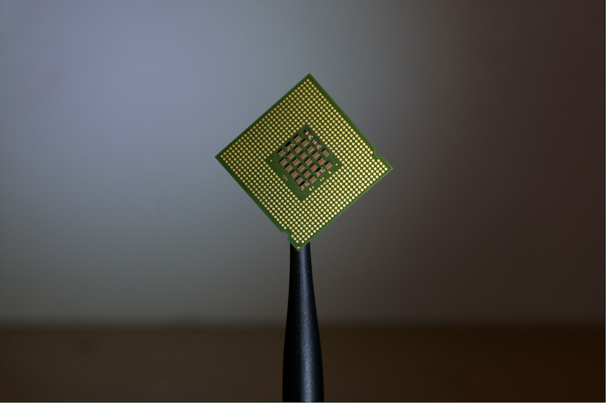

今天的AI圈可以说是"多线开花": 英伟达掌门人黄仁勋的离任风波搅动着整个AI投资市场的神经, 加州总检察长则把OpenAI推上了被告席; 另一边, OpenAI一口气发了科研、医疗、儿童安全三连更新, 国内具身智能行业标准也落地了。从算力电力到融资独角兽, 24小时内值得记住的都在下面。

## 研究突破

1. **OpenAI设立科学博客, 用格点方法逼近粒子物理标准模型的定义** — OpenAI发布全新科学博客, 首篇研究展示向在格点上定义标准模型迈出一步, AI辅助基础科学研究再进一步
   [openai.com](https://openai.com/index/our-new-blog-for-science)

2. **arXiv: AI视频生成的不可持续增长获定量测算** — 研究者从信息流实测数据出发, 系统量化AI视频生成的算力消耗与增长曲线

3. **arXiv: 多智能体、集成采样与测试时算力的贡献拆解** — "更多智能体、更多样本还是更多思考?"一文厘清多智能体系统中三种扩展路径的真实收益

4. **arXiv: Model Annealing提出数据高效的"复习-巩固"学习范式** — 借鉴退火思想, 通过回顾与巩固实现更省数据的学习

5. **arXiv: AscendGYM发布面向真实负载的NPU内核优化基准** — 为昇腾NPU上的真实工作负载提供成本感知的内核优化评测基准

## 产品发布

1. **OpenAI扩大科研人员使用AI的权限** — ChatGPT面向学术研究者开放更多能力, 降低前沿科研使用门槛

2. **OpenAI升级医疗场景: ChatGPT for Healthcare + 计算机使用智能体** — 面向医疗团队的computer-use agents同步推进, 覆盖更多诊疗流程

3. **Anthropic升级Claude Code Projects, 支持并行AI工作进程** — Claude Code可同时运行多个工作进程, 编码效率再上台阶

4. **Google Maps上线AI行程规划** — 一句话生成带实时详情的完整旅行行程

5. **Audible引入AI帮助用户发现有声书** — 亚马逊旗下有声书平台用AI推荐提升内容匹配

6. **OpenCode发布Browse产品** — AI编码工具OpenCode推出浏览能力, HN社区热议

## 融资并购

1. **网络安全AI初创Corma约3个月估值冲上10亿美元** — 增速罕见的独角兽诞生, 印证安全AI赛道热度

2. **Freshworks旧部融资5300万美元, 做AI原生CRM叫板Salesforce** — 直接对标Salesforce与HubSpot的AI-first CRM产品

3. **"华尔街之狼"贝尔福特推出AI语音销售初创Tone** — 想让AI用他的方式打电话卖货

4. **北科大院士团队创业二维半导体, 获数千万元融资** — 英诺天使、中科创星等参投

## 产业应用

1. **LVMH媒体部门与OpenAI达成战略合作** — 奢侈品巨头把AI引入媒体内容生产链路

2. **工信部批准274项行业标准, 含具身智能数据生成系统技术要求** — 具身智能产业化再获标准化支撑

3. **美国最大电网提交计划, 缩短数据中心用电等待时间** — AI算力扩张倒逼电力基础设施改革

4. **中信建投: 物理AI是人工智能下一波浪潮** — 建议聚焦优质环节, AI从虚拟走向物理世界

5. **浙江夯实算力底座; 深圳APEC周聚焦企业出海数智协作** — 全球首家机器人6S店亮相深圳, 机器人现场弹钢琴写毛笔字

## 行业动态

1. **加州总检察长起诉OpenAI, 涉"失控智能体"事故** — agent安全监管第一案, OpenAI面临州级诉讼压力

2. **OpenAI将嵌入Apollo Research安全研究员, 调查AI"暗中颠覆"行为** — 前沿实验室与安全机构深度绑定的罕见动作

3. **黄仁勋辞任英伟达CEO风波发酵** — FT分析称或触发AI投资估值调整; 特朗普表态称相关传闻不构成国家安全威胁; Sam Altman回应"没有黄仁勋的行业也会没事"; 英伟达周二财报前市场悬念拉满

4. **美国收紧AI芯片出口管制, 封堵中国企业远程调用算力** — 新加坡同日表示正在研究美国AI芯片出口许可临时新规

5. **FT社评: Anthropic将受到公开股市约束** — 上市进程进入公众视野; 欧盟再度推动AI治理全球协议

## 市场数据

1. **两市融资余额减少214.1亿元** — 杠杆资金连续收缩, A股情绪偏谨慎

2. **中国10月银行结售汇顺差550亿美元** — 跨境资金流动保持净流入格局

3. **摩根大通技术故障引发美国多家银行线上服务延迟** — Chase、Wells Fargo、Truist用户同时受影响; 同日美联航大面积系统宕机; 微软将巨型邮件故障归咎于7月修复引入的软件缺陷

4. **FT专栏: AI投资、规模"正确"与美股** — 探讨AI资本开支周期与美股估值的隐忧

5. **金价大跌** — 避险资产回调, 资金风格切换

## 技术工具

1. **Show HN: 约200行纯Jax代码实现DeepSeek V3** — 极简复现引发社区围观, 训练透明度讨论升温

2. **卡内基梅隆大学将计算机科学课程免费搬上YouTube** — CS教育头部资源全面开放

3. **Windows 11被曝收集用户使用的编程智能体与开发工具数据** — 研究者逆向分析微软遥测行为, AI编码工具隐私争议再起

4. **Unsloth发布Qwen 3.8-27B量化Dynamic v3.1更新** — 端侧部署生态持续完善

5. **Show HN: Sutra-OS自托管本体平台; PyPI项目页重新设计上线** — 开发者基础设施一日双更新

## 安全与伦理

1. **OpenAI发布新图像分类器与ChatGPT警告机制打击儿童性虐待内容** — 同步推出行业支持工具, 平台安全投入加码

2. **FBI: 开源AI黑客工具Artex AI被用于"不到3小时"入侵网络** — AI辅助攻击工具的实战威力获官方证实

3. **大型品牌网站经Optimizely供应链感染恶意软件** — Zoom、GitLab等站点中招, 供应链安全警钟再鸣

4. **韩国税务师考试"状元"承认用AI作弊, 被取消成绩并禁考5年** — AI作弊首次冲击韩国国家级职业考试

5. **arXiv: 预防式人格引导的安全副作用获实证审计** — Soteria框架把LLM智能体安全推向形式化验证工程

---

*数据来源: OpenAI官方RSS / TechCrunch / Hacker News / arXiv cs.AI / 36氪 / FT中文网 / 中国新闻网财经等18个AI源+3个金融源, 筛选最近24小时内容。*
