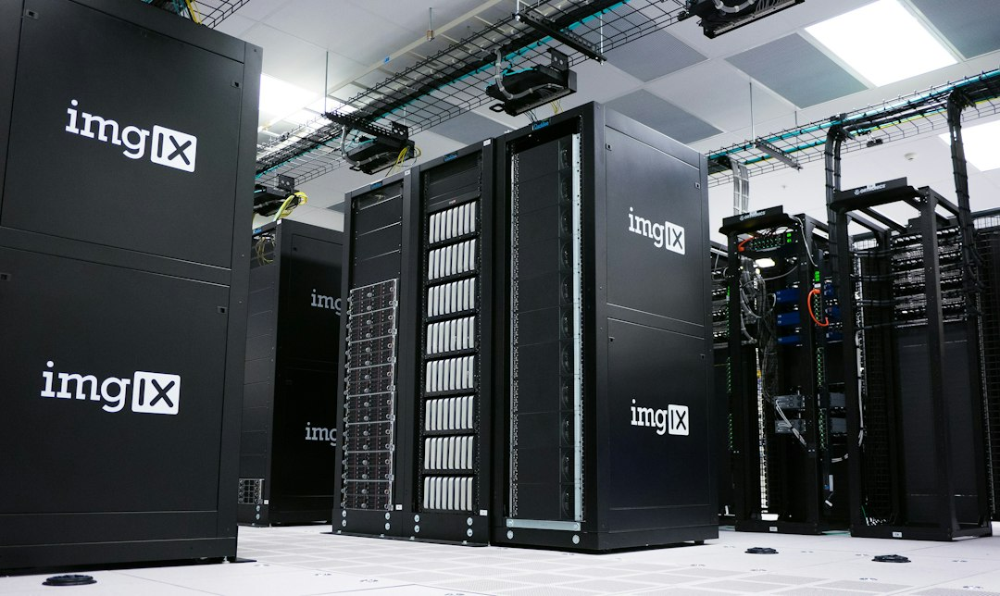

今天的AI圈堪称"资本与动荡齐飞"：Anthropic IPO正式定价83美元/股，813亿美元的募资额直接把SpaceX保持了数年的纪录掀翻，成为史上最大IPO；同一天，微软CEO纳德拉连发多弹——解释6万人的裁员决策、预言AI Agent将重排互联网经济、警告关键基础设施"不可修补"；Google则用Gemini 4 Neon和Genie 4商用双响炮应战。安全侧同样不平静：Nginx预授权RCE漏洞刷屏HN破千分，KVM虚拟机逃逸漏洞同日曝光。以下为今日完整日报。

## 研究突破

1. **arXiv: RSI-Prime提出"训练模型去训练模型"的递归自我改进路径** — 新论文把I.J. Good式的递归自我改进(RSI)落到工程层, 探讨让模型参与改进训练管线本身的可行性
   https://arxiv.org/abs/2611.23138

2. **arXiv: Agent Trust Infrastructure给跨组织智能体立"信任基建"** — 提出联邦身份+可信执行+问责架构(ATI), 直指自主Agent跨机构协作时无身份可查、无凭据可信的空白地带
   https://arxiv.org/abs/2611.23202

3. **Anthropic研究: 机器人已能干75%的物理任务, 但只有0.3%划算** — 官方发布美国岗位物理任务机器人能力指数, 结论冷峻: 能力普及与成本拐点之间存在巨大断层
   https://www.anthropic.com/research/what-work-can-robots-do

4. **DaisyRose-27B: 1200项任务的强化学习把Terminal-Bench 4.1准确率从5.6%拉到12%** — 开源27B模型在终端Agent基准上的RL实验记录, 显示工具使用能力的提升依然艰难但真实
   https://www.radixark.com

5. **Anthropic Project Swap: 让一群Claude互相交易会怎样** — 官方搭了一个微型市场让Agent自主买卖, 观察Agent进入市场后什么成立、什么崩坏
   https://www.anthropic.com/research/project-swap

## 产品发布

1. **Google发布Gemini 4 Neon** — DeepMind官网博客官宣, HN冲上391分367条评论, 社区已在对比其与Opus 5.5的竞争关系, 为今日最热产品事件
   https://deepmind.google/blog/introducing-gemini-4-neon/

2. **Genie 4正式上市** — Google的世界模型Genie 4宣布商用开放
   https://blog.google

3. **微软AI一口气发布七款"世界级"新模型** — microsoft.ai宣称以可扩展的性价比推出七款新模型, HN 439分303条评论, 纳德拉同日密集发声造势
   https://microsoft.ai

4. **Launch HN: Maritime (YC F26)推出生产级AI Agent托管云** — YC新批次公司上线, 主打给生产环境的AI Agent做托管基础设施
   https://news.ycombinator.com/

## 融资并购

1. **Anthropic IPO定价83美元/股, 募资813亿美元超越SpaceX纪录** — 定价高于此前预期区间, 创下史上最大IPO, 亚马逊+谷歌合计持股近30%的格局随之落地
   https://techcrunch.com/2026/11/18/anthropic-reportedly-prices-ipo-at-83-a-share-above-projected-range/

2. **镁伽科技完成近2亿美元融资, 建设面向真实世界的AI智能基础设施** — 36氪首发, 具身智能与物理AI基建赛道再获大额输血
   https://36kr.com/p/4075322592187524?f=rss

3. **Cassava寻求筹资10亿美元购买英伟达芯片** — 非洲算力玩家加入抢卡大战, 英伟达管理层动荡未影响下游采购热情
   https://36kr.com/newsflashes/4075940799583366?f=rss

## 产业应用

1. **审计模拟试验: AI智能体提问比毕马威会计师更切中要害** — HN 338分152条评论, 四大会计师事务所的工作流正被Agent直接挑战, 金融审计是Agent落地最锋利的一刀
   https://europeanbusinessmagazine.com

2. **OpenAI用自家模型推进芯片设计** — 官方发文展示OpenAI模型参与芯片设计流程, AI自研芯片闭环再进一步
   https://openai.com

3. **中国算力产业高速增长赋能AI发展** — 中新社报道算力规模持续扩张, 国产算力板块获券商集体看多
   https://www.chinanews.com.cn/cj/2026/11-18/10734384.shtml

4. **Temu与万事达卡扩大合作** — 跨境电商+国际卡组织的支付侧合作加深, 金融科技出海支付基建持续加密
   https://36kr.com/newsflashes/4075976561218438?f=rss

5. **AI赋能+外商直采, 杭州拱墅专业市场激活外贸新动能** — AI选品与直采模式下沉到专业批发市场
   https://www.chinanews.com.cn/cj/2026/11-18/10734311.shtml

## 行业动态

1. **纳德拉解释为何要求6万名员工离职** — 微软CEO公开回应大规模裁员决策, 强调AI转型优先级
   https://techcrunch.com/2026/11/18/microsoft-ceo-satya-nadella-explains-why-he-asked-60k-employees-to-quit/

2. **纳德拉预言AI Agent将重排互联网经济** — 同日连发观点: Agent代用户浏览与交易将改写流量与广告的分配逻辑
   https://techcrunch.com/2026/11/18/satya-nadella-predicts-ai-agents-will-reshuffle-the-economics-of-the-web/

3. **黄仁勋风波持续: 马斯克等联名请愿英伟达请回黄仁勋** — 丑闻时间线持续发酵, 纳德拉表态对英伟达及继任团队仍抱信心
   https://techcrunch.com/2026/11/14/elon-musk-other-tech-execs-sign-petition-calling-on-nvidia-to-reinstate-jensen-huang/

4. **OpenAI发表"The Silent Consensus"** — 官方博客最新一文, 罕见就行业集体沉默现象发声
   https://openai.com/index/the-silent-consensus

5. **剑桥词典2026年度词汇: "human"** — 在AI无处不在的一年, 评委把年度词汇给了"人类", HN 231分170条评论, 颇有象征意味
   https://www.cam.ac.uk

6. **腾讯混元Hy4 flash主打日常工作的极致性价比** — 11月15日上线的轻量版模型进入应用推广期, 国产大模型价格战延续
   https://hy.tencent.com/research

## 市场数据

1. **两市融资余额减少87.68亿元** — 杠杆资金小幅退潮, 市场情绪偏谨慎
   https://36kr.com/newsflashes/4075967004415107?f=rss

2. **热门基金相继解除限购, 机构资金从"候场"转"入场"** — 多只明星产品放开申购, 机构增量资金信号明确
   https://36kr.com/newsflashes/4075929328538760?f=rss

3. **中信建投: 建议关注具身智能与国产算力板块** — 券商研报点名两条主线, 与算力产业高速增长的产业面互为印证
   https://36kr.com/newsflashes/4075937197937799?f=rss

## 技术工具

1. **Cerebras发布分散式推理(Disaggregated Inference)方案** — 晶圆级引擎厂商把推理拆解为可分离的流水线架构, 挑战GPU集群的传统推理范式
   https://www.cerebras.ai

2. **Simon Willison发布编码Agent"外部沙箱"模式与三套开源实现** — Agent在沙箱外、代码在沙箱内跑, 附v86(WebAssembly)、Apple Containers、Quicksand(QEMU)三种方案与可选的HTTP白名单代理, 可直接接Pi/Claude Code/Codex
   https://simonwillison.net/

## 安全与伦理

1. **Nginx HTTP/2预授权远程代码执行漏洞曝光** — Wiz研究团队披露无需认证即可RCE, HN 1109分496条评论, 全网运维今晨的必修课
   https://www.wiz.io

2. **CVE-2026-99312: KVM虚拟机逃逸到宿主机漏洞** — 云厂商底层隔离被撕开一道口子, 多租户安全的又一次警钟
   https://www.terra.security

3. **Brockman发文"The Defender's Window": AI放大攻防两侧, 防御者窗口期有限** — OpenAI总裁以近期OpenAI-Hugging Face事件为切入点, 给出组织级防御清单, 呼吁立即升级安全实践
   https://blog.gregbrockman.com/the-defenders-window

4. **纳德拉警告: 大量关键基础设施处于"不可修补"状态** — 在AI网络攻击担忧升温背景下, 微软CEO直言很多系统根本打不上补丁
   https://techcrunch.com/2026/11/18/amidst-fears-of-ai-cyberattacks-satya-nadella-says-lots-of-critical-infrastructure-is-unpatchable/

5. **联盟公开质疑"Anthropic并非一家安全的AI公司"** — IPO定价当日遭遇安全组织挑战, 商业狂奔与安全承诺的张力公开化
   https://www.businesswire.com

6. **curl作者Stenberg回应AI重写潮: 三周里Agent们"移植"了18.5万行C, 而真curl合了300个提交修了200个bug** — Simon Willison转引, 对"用Agent整库重写"泼了一盆有数据的冷水
   https://simonwillison.net/
