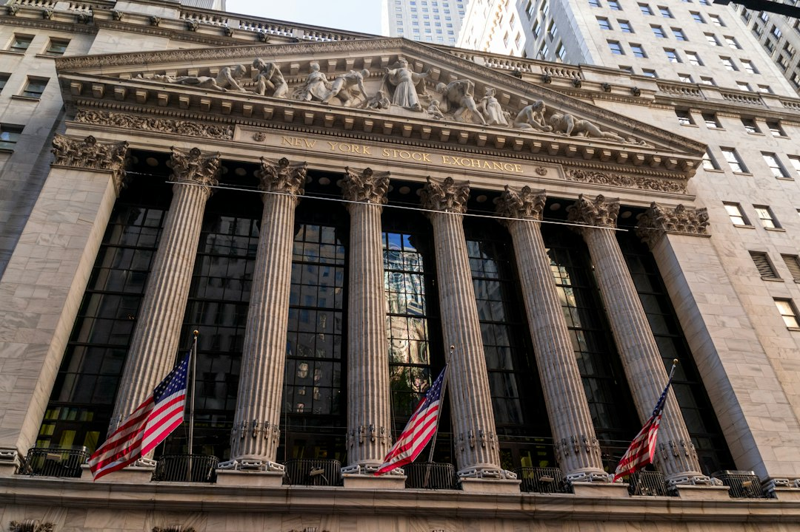

今天的市场把"AI 泡沫"四个字写在了K线上：Anthropic 935亿美元的创纪录 IPO 敲钟声还没散，股价盘前就跌超9%，纳斯达克直接抹去2026年以来全部涨幅，英伟达市值缩水扩大至约2.5万亿美元、SEC 又传出处审查其会计处理。而研究圈同样热闹：Anthropic 员工声称证明广义黎曼猜想，Terry Tao 同日发文把 GRH 和纳维-斯托克斯奇点串成一条线。以下是今日18个信息源的完整汇总。

## 一、研究突破

1. **广义黎曼猜想（GRH）风暴席卷数学界**：Anthropic 员工 Levent Alpöge 公开声明称已证明 GRH（[证明文件](https://alpo.ge/remark.pdf)），同日 Terry Tao 发文《Unforced Navier-Stokes Singularity and the Generalized Riemann Hypothesis》将 GRH 与纳维-斯托克斯方程奇点问题串联，Buckmaster 团队公开纳维-斯托克斯有限时间爆破构造仓库；Scott Aaronson 撰文《这些随机鹦鹉显然已经证明了黎曼猜想》评论 AI 在其中的角色，经济学人以"AI 或已解出数学中最重要的问题"报道，TechCrunch 总结为"AI 声称解出167年老的黎曼猜想——而人类也做到了"。（[Tao博客](https://terrytao.wordpress.com/2026/11/20/unforced-euler-singularity-unforced-navier-stokes-singularity-and-the-generalized-riemann-hypothesis/)、[Aaronson博客](https://scottaaronson.blog/?p=10344)、[HackerNews](https://news.ycombinator.com/)）
2. **arXiv 2611.21885《Language Models Can Rewrite Their Own Weights》** 登上 HN 热帖：语言模型可以重写自身权重，权重空间编程方向持续升温。（[链接](https://arxiv.org/abs/2611.21885)）
3. **arXiv 2611.26450《A CPU Inside an LLM》**：零梯度把精确电路编译进预训练权重。（[链接](https://arxiv.org/abs/2611.26450)）
4. **Frostbite CPU 架构**：由 AI 发现、设计并完成形式化验证的新型 CPU 架构。（[介绍](https://architectlabs.com/blog/frostbite)）
5. **arXiv 2611.26366《World Models Favor Learned Priors over Visual Evidence》**：世界模型更多依赖习得先验而非视觉证据。（[链接](https://arxiv.org/abs/2611.26366)）

## 二、产品发布

1. **Thinking Machines 发布 Inkling 2 Mini**。（[官方](https://thinkingmachines.ai/news/inkling-2-mini/)）
2. **OpenAI 发布 MedChemBench**：评估 AI 模型解读分子结构、从实验数据推理并挑选候选药物的能力。（[官方](https://openai.com/index/introducing-medchembench)）
3. **OpenAI 发文《Combatting adversarial distillation》**：披露对抗蒸馏的分层防御（训练、安全防护、检测）。（[官方](https://openai.com/index/combatting-adversarial-distillation)）
4. **Google 给 Gemini 开放直接替你操作 Mac 的能力**；Apple 被曝正研发自己的 Mac AI agent。（[TechCrunch](https://techcrunch.com/2026/11/19/google-gives-gemini-the-ability-to-use-your-mac-for-you/)）
5. **FFmpeg 9.1 "Gauss" 发布**；GIMP 宣布支持 UI 自动化测试；Postgres 19 正式发布（Simon Willison 收录，Snowflake 同步推出内置表膨胀清理的更快重打包版）。（[FFmpeg](https://ffmpeg.org/download.html)、[SimonWillison](https://simonwillison.net/2026/Nov/19/postgresql-19/)）

## 三、融资并购

1. **Anthropic IPO 落地**：定价每股83美元、高于区间，募资总额约935亿美元，创 AI 公司纪录；7位创始人合计套现近20亿美元；媒体测算其承诺的慈善捐赠最高可达1560亿美元。（[TechCrunch](https://techcrunch.com/2026/11/19/anthropics-7-founders-cashed-out-nearly-2b-in-record-breaking-ipo/)、[36氪](https://36kr.com/newsflashes/4078090882601862)）
2. **Daniel Ek 投资核聚变初创**：Spotify 创始人押注由 AI 研究者创办的聚变电力公司。（[TechCrunch](https://techcrunch.com/2026/11/20/daniel-ek-backs-ai-researchers-fusion-power-startup-heres-what-theyre-building/)）
3. **Everful 融资4850万美元**：前阿里巴巴高管创办，连接零售商与中国工厂。（[TechCrunch](https://techcrunch.com/2026/11/19/former-alibaba-execs-everful-raises-48-5m-to-connect-retailers-with-chinese-factories/)）
4. **易天股份拟收购艾晨数字能源37%股权**。（[36氪](https://36kr.com/newsflashes/4078020847817601)）
5. **库什纳旗下 Affinity 投资的英国银行拿到美国银行业牌照**。（[36氪](https://36kr.com/newsflashes/4078059062121347)）

## 四、产业应用

1. **金融研究公司 Hebbia 接入 GPT-6 Astra**：预发布评测显示来源覆盖率、引用相关性与呈现质量均有提升，金融研究场景落地再进一步。（[OpenAI](https://openai.com/business/customer-stories/hebbia)）
2. **OpenAI 揭秘 Performance Factory**：Codex 驱动的工作流持续寻找并修复性能回归，保住 ChatGPT 的响应速度。（[官方](https://openai.com/index/how-openai-performance-factory-keeps-chatgpt-fast)）
3. **湖南麓山科技金融大会**：推动政策、产品、资本与需求精准对接。（[中新网](https://www.chinanews.com.cn/cj/2026/11-20/10735541.shtml)）
4. **Coinbase 计划2027年上半年推出自有预测市场合约**。（[36氪](https://36kr.com/newsflashes/4078019778548608)）

## 五、行业动态

1. **英伟达 CEO 黄仁勋丑闻发酵并去职**：TechCrunch 整理事件时间线；马斯克称"赶走黄仁勋等于把乔丹踢出球队"，Palmer Luckey 公开呼吁其复职，微软 CEO 纳德拉表态对英伟达保持信心。（[TechCrunch时间线](https://techcrunch.com/2026/11/19/nvidia-ceo-jensen-huangs-affair-with-alleged-chinese-spy-a-timeline/)）
2. **AI 网络攻击担忧升温**：纳德拉称大量关键基础设施"无法打补丁"；Palmer Luckey 警告 AI 驱动的网络攻击正跑赢防御，"是时候开始跑了"。（[TechCrunch](https://techcrunch.com/2026/11/18/palmer-luckey-warns-ai-powered-cyberattacks-are-outpacing-defenses/)）
3. **Anthropic CEO 敲钟时重申"放慢 AI 发展"承诺**：在纳斯达克开市钟仪式上再次表态 pacing 立场。（[TechCrunch](https://techcrunch.com/2026/11/19/at-nasdaq-opening-bell-anthropic-ceo-recommits-to-pacing-ai-development/)）
4. **微软宣布 Windows Server 2028**：主打强化安全。（[BleepingComputer](https://www.bleepingcomputer.com/news/microsoft/microsoft-announces-windows-server-2028-with-hardened-security/)）
5. **Google 员工联署抗议**：要求公司不要惩罚不采用 AI 的学校。（[Mother Jones](https://www.motherjones.com/politics/2026/11/google-alphabet-union-school-ai-protest-gemini/)）

## 六、市场数据

1. **Anthropic 上市即破发**：美股盘前跌超9%，股价暴跌拖累纳斯达克抹去2026年以来全部涨幅，AI 股抛售潮蔓延、全球股市下挫。（[36氪](https://36kr.com/newsflashes/4078096790525063)、[卫报](https://www.theguardian.com/business/2026/nov/20/)）
2. **英伟达市值缩水扩大至约2.5万亿美元**，另据消息人士，SEC 正在审查其潜在会计问题。（[Yahoo Finance](https://finance.yahoo.com/markets/)）
3. **国际金价创一年多新低**，消费端热度反升；建设银行同步发布贵金属业务风险提示。（[中新网](https://www.chinanews.com.cn/cj/2026/11-21/10735605.shtml)）
4. **法兴银行预计2027年美联储将再加息两次、每次25个基点**。（[36氪](https://36kr.com/newsflashes/4078031808304257)）
5. **A股 PCB 概念股多只涨停**；热门中概股盘前多数下跌，网易跌超6%。（[36氪](https://36kr.com/newsflashes/4078082302481282)）

## 七、技术工具

1. **Valkey 弃用跳表改用 B+树**：sorted set 内存开销最高降43%。（[官方博客](https://valkey.io/blog/from-skiplist-to-b+tree/)）
2. **DreamCoder**：Mastering Emacs 作者推出的编码 harness 与 IDE。（[发布文](https://www.masteringemacs.org/article/announcing-dreamcoder)）
3. **OpenComputer**：开源版 Devin 替代品（Show HN）。（[GitHub](https://github.com/diggerhq/opencomputer)）
4. **Simon Willison 警告"Token fraud is here and it's BAD"**：token 欺诈已成现实问题。（[博客](https://simonwillison.net/2026/Nov/20/token-fraud-is-here-and-its-bad/)）
5. **Show HN 两则**：音频转 MIDI 模型效率提升60倍；语音词级时间戳 API（75%误差在20ms内）。（[HN](https://news.ycombinator.com/)）

## 八、安全与伦理

1. **Signal 发文阐述隐私保护立场**：在 AI 时代坚守端到端加密。（[Signal博客](https://signal.org/blog/protecting-your-privacy/)）
2. **《The Hungry Butler Effect》研究**：揭示 LLM 中隐藏的商业激励偏差。（[ResearchGate](https://www.researchgate.net/publication/418143113)）
3. **AI 与就业伦理**：Google 员工要求不惩罚"不采用 AI"的学校，AI 强制推广引伦理争议。（[Mother Jones](https://www.motherjones.com/politics/2026/11/google-alphabet-union-school-ai-protest-gemini/)）
4. **代码审查能力退化之辩**：HN 热文《如果你不再写代码，你审查代码的能力也会变差》引发 AI 依赖讨论。（[原文](https://cekrem.github.io/posts/if-you-stop-writing-code-you-also-get-worse-at-reviewing-it)）

## 金融科技补充简报（36氪/中国新闻网财经）

- 国际金价创一年多新低，黄金消费热潮背后风险需知（中新网）
- 法兴银行：2027年美联储料再加息两次（36氪）
- Anthropic IPO 募资总额约935亿美元（36氪）
- 海南自贸港"管理型项目公司+SPV"金融租赁创新落地（中新网）
- 北交所推出创新型中小企业发展公司债券（中新网）
- 长三角上市公司 ESG 披露报告发布，首考合规率100%（中新网）
- "十五五"期间河南省管企业计划总投资超7000亿元（中新网）

📷 <a href="https://unsplash.com/photos/new-york-stock-exchange-building-with-american-flags-xnzSgqyP8Hs?utm_source=toby-blog&utm_medium=referral" target="_blank" rel="noopener">Photo by David Vives</a> on <a href="https://unsplash.com?utm_source=toby-blog&utm_medium=referral" target="_blank" rel="noopener">Unsplash</a>

📷 <a href="https://unsplash.com/photos/a-blackboard-with-a-lot-of-writing-on-it-OPpCbAAKWv8?utm_source=toby-blog&utm_medium=referral" target="_blank" rel="noopener">Photo by Thomas T</a> on <a href="https://unsplash.com?utm_source=toby-blog&utm_medium=referral" target="_blank" rel="noopener">Unsplash</a>

