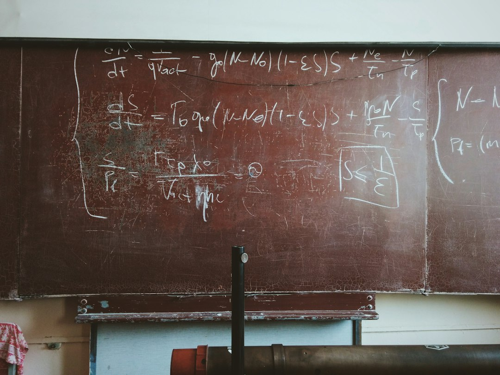
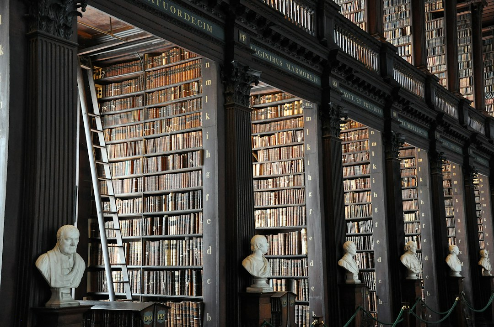

> "……极有可能所有根都在这条直线上。当然，人们会希望得到一个严格的证明；我经过一些徒劳的尝试后，暂且把寻找证明搁置一边，因为这对当前的研究目标而言并无必要。" ——黎曼，1859

167年前，黎曼本人发表这条猜想时就没有给出证明，他的理由是：证明"对当前目标可有可无"。167年后的这个星期，证明真的到了——由一位Anthropic的数学家和Claude一起交卷。而历史的幽默在于，这次被"搁置一边"的东西换成了另一个：理解。

## 一、四页纸、1740万行代码，和一个拒绝出场的作者

11月20日，Levent Alpöge在个人网站悄悄贴出一份四页声明，没有发任何社交媒体："我相信，在与Claude的合作中，我发现了黎曼猜想的证明。"黎曼猜想1859年提出，关于素数分布，被公认为纯数学最重要的未解问题；他还说这个方法"轻松推广得更远"，连带解决了更强的广义黎曼猜想（GRH）。

但真正值得记住的不是这四页纸，而是它没有出示的东西。配套的形式化证明是一份14部分、约1740万行的Lean代码档案，编译后约228MB。Alpöge说，他与Claude还生成过一份人类可读的完整证明草稿——超过25万页——他自己的评语是：那是"slop（垃圾流水）"的一场滑稽戏。所以他决定只发布Lean，一份机器可验证、人类读不动的东西。数学史上第一个作者本人拒绝以人类语言出场的证明，就这么诞生了。

回看时间线，这不像灵光一现，更像一条流水线。Claude替他们整理了一份20步的工作时间轴：10月6日出现第一个关键组件"Stepanov行列式"，10月8日至20日多块拼图落位，最后一步集中在11月15日，最后一行写着——"11/16/26: GRH"。方法上，他们接着1969年Stepanov在函数域上证明类似命题的老路：那套技巧依赖的微积分手段在整数世界行不通，Alpöge找到了一条替代的变换链，而"这条链需要多长"是Claude算出来的。Alpöge原话，在收尾阶段，Claude"远远把我甩在了后面"。

值得一提的是伏笔。今年8月，Anthropic披露过一个未发布的Claude研究版本带着60个agent冲击黎曼猜想：没解开，但把"临界线上零点占比"的下界从41.6%推到了67.2%——当时公司自己都判断这些技术通向证明的希望渺茫。三个月后，流水线跑完了最后一公里。

## 二、验证已经闭环，理解还在慢递

先说好消息：这份证明大概率是对的。MIT的Andrew Sutherland独立编译了整份档案，并通过，随后Lean的验证内核只依赖三条标准公理做了复检——Sutherland的评语是"这里任何东西有问题"的可能性"近似于零"。《科学美国人》的标题直接写"独立数学家证实：这个AI黎曼猜想证明几乎肯定为真"。

但对错只是入场券。Scott Aaronson的判断很直白：他赌这个证明站得住，但"数学家当然不会满足于1740万行Lean。他们只有在自己能够解释、提炼、重构这些想法时才会满足。而这可能需要数年——因为人类数学家只以生物速度移动"。连陶哲轩自己下场核查，也是同一姿势：他在博客评论区贴出了对解析端从头重验的结果，随后坦白，"我没有核查这些对象是否真的按那些名字所暗示的方式构造出来，也没有核查中间部分是否构造出了末端所使用的东西"。换句话说：机器保证了"这条推演链逻辑上无懈可击"，但"这条链是否真的连接了黎曼猜想那两个端点"——这个语义问题，仍然只有人能回答。1740万行代码恰恰把这个问题埋得最深。

这不是数学第一次面对机器证明，却是第一次面对这种量级的"倒挂"。1976年四色定理交给了计算机，但那份证明人类审了多年、反复简化，社区消化得动；1890年Heawood甚至从Kempe的"证明"里翻出过致命漏洞——那时候，证明的生产和理解是同步的。现在，几千条以GRH为条件前提的数论定理可以被机器批量升级为无条件定理，Pasten说的"补全数学各分支之间那本残缺的词典"在机械层面成立。可一本你读不懂的词典，图书馆不会编目。克雷研究所那100万美元奖金的领取条件是数学界的"普遍接受"——内核的退出码不在此列，因为这份奖金真正买的从来不是"真"，而是"懂"。

## 三、数学第一次有了静默期和财报季

还有一个很少被摆到台面上的细节：结果的披露时点。Alpöge自述，结果是11月16日深夜到凌晨之间到手的——而克雷问题的命名权归数学，披露时点归公司。他随即给CEO Amodei发消息请示能否公开，理由是"事实上存在一个必须尊重的约束"。三天后，11月19日，Anthropic以每股83美元定价完成约935亿美元的IPO；次日盘前股价跌超9%，纳斯达克抹去年内全部涨幅。一条数学新闻的发布窗口，第一次被一家公司的披露日程锁定。

这也不是孤例，而是9月以来这套新秩序的延续。9月8日OpenAI宣布一万个agent用88小时拿下纳维-斯托克斯问题，独立研究者估算按零售价约600万美元、内部成本约100万美元推理算力——"有趣的是，恰好等于千年奖金的数额"。围绕署名权的争吵才是真正有信息量的：Bubeck当时说，让一位Anthropic员工署名OpenAI的成果"并不合适"；对方拒绝后收到的反问是"何苦毁掉自己的职业生涯"。而OpenAI自己的博客里躺着一句更诚实的话："虽然可能性不大，但我们无法排除来自他们产品使用记录的去标识化数据帮助改进了我们的模型。"当证明的生产资料是公司的模型、算力和日志，优先权、署名、披露时点，就全部变成了公司治理问题。陶哲轩9月那句警告——别把"历史上极具生产力的重大问题"变成"病毒式传播、为基准测试进度做广告的社交媒体帖子"——两个月后看来，像是提前写好的注脚。

## 结语

1859年，黎曼把证明搁置一边，因为"对当前目标可有可无"——他要先去写完那篇论素数分布的论文。2026年，数学界又一次把某样东西搁置了一边，只是这次搁置的是理解本身：证明已经内核签收，理解按生物速度慢递，预计数年。屏幕之外，基准测试分数、IPO日历和优先权声明都在实时刷新，只有那1740万行代码安静地躺着，等一个愿意把它读懂的人。

我押一个方向：十年之内，"理解债"会成为可度量的学术概念——引用一条"内核已验证、人类未读懂"的定理会变成日常操作，而数学家最稀缺的技能将从证明转向蒸馏。届时回头看，第一个把1740万行压缩成三十页可读证明的人，才是这个时代真正的黎曼。毕竟167年前那篇论文真正改变数学史的，从来不是"极有可能所有根都在线上"这句话，而是它背后的那套想法。真，机器可以给你；懂，目前还得用生物速度慢慢挣。

📷 <a href="https://unsplash.com/photos/written-equations-on-brown-wooden-board-5mZ_M06Fc9g?utm_source=toby-blog&utm_medium=referral" target="_blank" rel="noopener">Photo by Roman Mager</a> on <a href="https://unsplash.com?utm_source=toby-blog&utm_medium=referral" target="_blank" rel="noopener">Unsplash</a>

📷 <a href="https://unsplash.com/photos/library-bookshelves-with-marble-busts-PdDBTrkGYLo?utm_source=toby-blog&utm_medium=referral" target="_blank" rel="noopener">Photo by Alex Block</a> on <a href="https://unsplash.com?utm_source=toby-blog&utm_medium=referral" target="_blank" rel="noopener">Unsplash</a>

