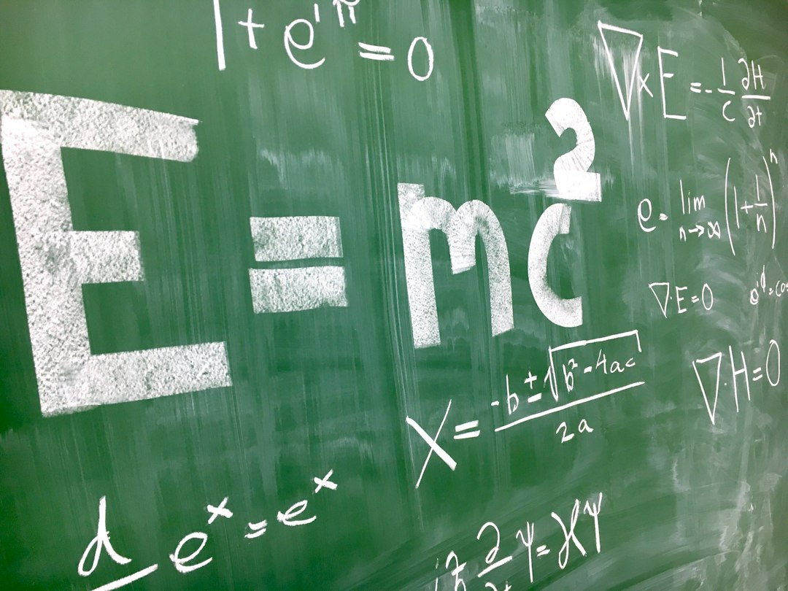
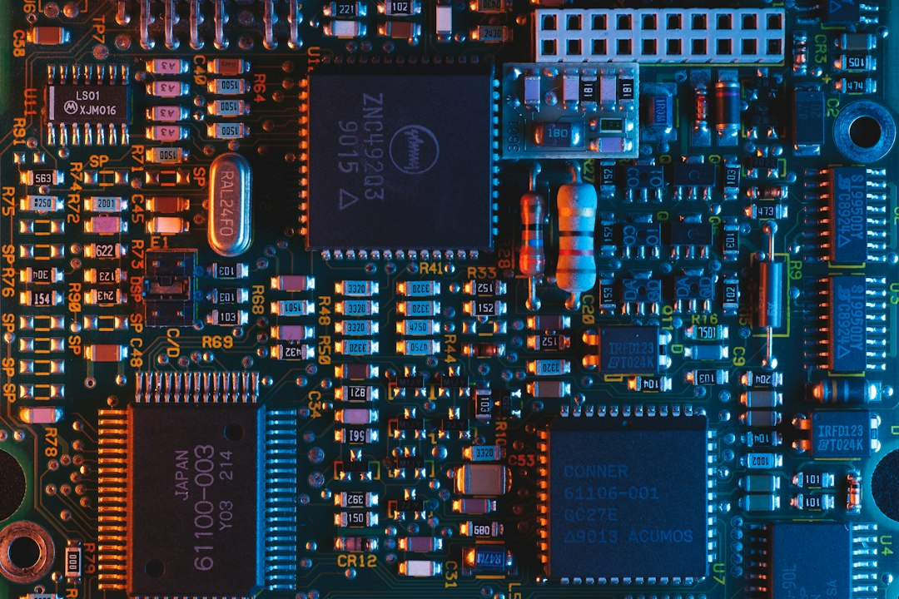

周日清晨，科技圈节奏放缓，但数学界刚刚落下惊天一槌：喧嚣一整周的黎曼猜想证明之争，被Lean社区一纸官方声明终结——Alpöge那座1700万行代码构筑的证明大厦，经受住了数十人独立编译、多个独立证明检查器的轮番检验，正式认证为真。除此之外，开源社区把Thinking Machines的新模型压进5.4GB内存、GnuPG曝出RCE漏洞、SEC把调查的矛头对准了多事之秋的英伟达。下面进入今日份的AI金融科技全景。

## 一、研究突破

1. **黎曼猜想证明获Lean社区官方认证，167年难题进入"机器验证已结案"状态**：Lean与Mathlib社区11月21日发布联合声明（获Lean FRO与Mathlib Initiative背书），确认Levent Alpöge于11月20日发布的黎曼猜想证明正确——整个证明是一座**1700万行Lean代码**的图书馆，仅直接依赖Mathlib。社区用四种方式完成核验：命题本身取自Mathlib中经数论专家审核的RiemannHypothesis定义；数十人独立编译复现相同的原始证明导出文件；用comparator与con-leche两款独立工具确认所证命题与Mathlib定义完全一致；Lean官方内核及多个第三方实现的不同证明检查器（含带集合论层面形式证明、"不可能接受错误证明"的con-leche与con-ron）在惰性导出文件上全部通过。MIT同步上线完整验证文件页。这是形式化验证历史上最大规模的社区协作验证之一，"AI证明黎曼猜想"的争议至此有了权威定论：证明为真，接下来轮到数学界解释其中的新思想。（[Lean社区声明](https://leanprover-community.github.io/blog/posts/riemann-hypothesis/)、[MIT验证文件](https://math.mit.edu/~drew/grh/)、[HackerNews 810分热帖](https://news.ycombinator.com/item?id=50589618)）
2. **arXiv cs.AI 每日精选（11月20日，252篇新提交）**：《Probing the "Conscious" Mind》在视觉-语言模型中探测选择性访问与全局工作空间机制；《The Geometry of Lies》用知识与人格方向检测大模型欺骗行为；GLiDE从推理教师模型蒸馏出快速校准的决策模型。（[arXiv列表](https://arxiv.org/list/cs.AI/recent)）

## 二、产品发布

1. **Pandex上线：把欧盟和七国官方法律装进一个API/MCP**：收录280万份欧盟及法德荷英奥瑞卢等国的立法与最高法院判例，全部来自官方机构，附3700万条引用关联图，支持任意语言检索、时间点法条与完整引用图谱，原生提供REST API与MCP server，可直接接入Claude、Cursor、Copilot等AI工具。定位是给"必须把法条搞对"的法律AI与合规智能体供地。（[官网](https://www.pandex.io)、[Show HN](https://news.ycombinator.com/item?id=50593481)）
2. **开源社区最快跟进Thinking Machines Inkling 2 Mini**：发布仅数日，社区量化编译器已给出四个Apple Silicon MLX版本，最小5.38GB即可在本地跑起来。（详见技术工具栏）

## 三、融资并购

1. **加拿大正式加入北约创新基金**：北约创新基金为主权深科技风投，重点投向人工智能、半导体、量子等军民两用技术，加拿大成为最新入伙的盟国，基金盘子进一步扩大。（[36氪](https://36kr.com/newsflashes/4080206499861377?f=rss)）
2. **重庆发布市属国企第四批"四链"融合创新项目**：投资额约14亿元，推动产业链、创新链、资金链、人才链融合。（[中新网](https://www.chinanews.com.cn/cj/2026/11-21/10735871.shtml)）

## 四、产业应用

1. **数万家智能工厂背后，AI到底改变了什么**：中新网深度报道拆解中国智能工厂的AI落地现状——从质检、排产到供应链预测，"机器换人"之外更值得关注的是数据闭环成为工厂新基建。（[中新网](https://www.chinanews.com.cn/cj/2026/11-21/10735913.shtml)）
2. **马斯克：特斯拉FSD V15下个月全面推送**：在Anthropic上市、Google发模型的这周，特斯拉也来抢戏，V15被马斯克称为接近"无人监督可用"的版本，实际成色下月见分晓。（[36氪](https://36kr.com/newsflashes/4079212995089289?f=rss)）
3. **重庆发布86项低空产业发展机会清单，总投资约289亿元**：低空经济从政策文件走向项目清单，无人机物流、eVTOL等场景向民资开放。（[中新网](https://www.chinanews.com.cn/cj/2026/11-21/10735787.shtml)）

## 五、行业动态

1. **SEC对英伟达会计问题正式展开调查**：继本周黄仁勋丑闻去职、市值缩水约2.5万亿美元之后，美国证交会正就潜在会计问题展开调查——此前英伟达被质疑通过资助AI初创采购自家显卡"制造"供不应求，并已停止披露新加坡销售额，营收口径透明度成为监管焦点。（[36氪](https://36kr.com/newsflashes/4079125046449286?f=rss)）
2. **AI时代职普融通成教育创新战略选择**：《创新职普融通》年度报告在上海发布，AI冲击就业结构正倒逼职业教育与普通教育的融通改革。（[中新网](https://www.chinanews.com.cn/cj/2026/11-21/10735892.shtml)）
3. **WISE2026"年度人物·产业攻坚者"发布**：36氪年度榜单聚焦把AI与技术推进产业深处的实干者。（[36氪](https://36kr.com/p/4079476599772038?f=rss)）

## 六、市场数据

1. **贵金属波动加剧，多家银行集中发布风险提示**：继国际金价创一年多新低后，贵金属价格波动持续放大，多家银行同日提示账户贵金属业务风险，追涨杀跌的散户被点名"理性参与"。（[36氪](https://36kr.com/newsflashes/4079229117404038?f=rss)）
2. **中信证券：全国性机制电价政策有望2027年推出**：电力市场化改革时间表进一步明确，绿电板块迎来政策预期催化。（[36氪](https://36kr.com/newsflashes/4079025427747719?f=rss)）
3. **中信建投发布食品饮料2027年投资策略**：主题为"周期底部范式重构，红利守正成长出奇"，判断消费板块处于周期底部区域。（[36氪](https://36kr.com/newsflashes/4079154734257289?f=rss)）

## 七、技术工具

1. **LookAtMyQuant开源量化编译器爆红HN（344分）**：按"每个权重块被压缩后对输出的伤害"来分配比特预算，同文件体积下KL散度比Q4_K_M低12倍。招牌战绩：Thinking Machines的Inkling-2-Mini（264亿参数MoE）从18.89GB压到5.38GB即可本地跑；Qwen3.8-27B从53.7GB压到7.2GB，数学、HumanEval、MMLU、GSM8K全面反超同体积Unsloth量化版，全套配方成本仅约34美元GPU时长。本地部署党周末有活干了。（[GitHub](https://github.com/ShinMegamiBoson/lookatmyquant)、[HackerNews](https://news.ycombinator.com/item?id=50591853)）
2. **中国通号国内首款4.9GHz无蜂窝基站获证商用**：轨交专用无线通信进入5G-A时代。（[36氪](https://36kr.com/newsflashes/4079229665236104?f=rss)）

## 八、安全与伦理

1. **GnuPG曝出远程代码执行漏洞**：官方邮件列表发布安全公告（2026q4），作为全球加密与签名基础设施的GnuPG出现RCE级漏洞，提醒用户立即升级——加密工具自身的供应链安全再敲警钟。（[官方公告](https://lists.gnupg.org/pipermail/gnupg-announce/2026q4/000517.html)、[HackerNews 228分](https://news.ycombinator.com/item?id=50587208)）
2. **Upload2Shell（CVE-2026-125396）：GhostScript"上传即RCE"**：新披露的漏洞利用链展示了攻击者如何通过上传恶意文件在服务端直接执行代码，Web应用里"以为安全的"文件处理管道再度成为突破口。（[披露页](https://pwn.ai/upload2shell)、[HackerNews](https://news.ycombinator.com/item?id=50592097)）
3. **AI产业应用的就业伦理继续发酵**：智能工厂报道中"数据闭环替代经验工人"的叙事与职普融通教育改革同日见报，AI对劳动力结构的重塑已从讨论进入制度应对阶段。（[中新网](https://www.chinanews.com.cn/cj/2026/11-21/10735913.shtml)）

---

一个黎曼猜想，让"AI能否做数学"的争论暂时休战——答案不再是嘴仗，而是1700万行可以被任何人独立复算的代码。这或许才是这条新闻最金融的注脚：可验证性，正在从数学蔓延为整个AI时代的信任基础设施。明天见。
