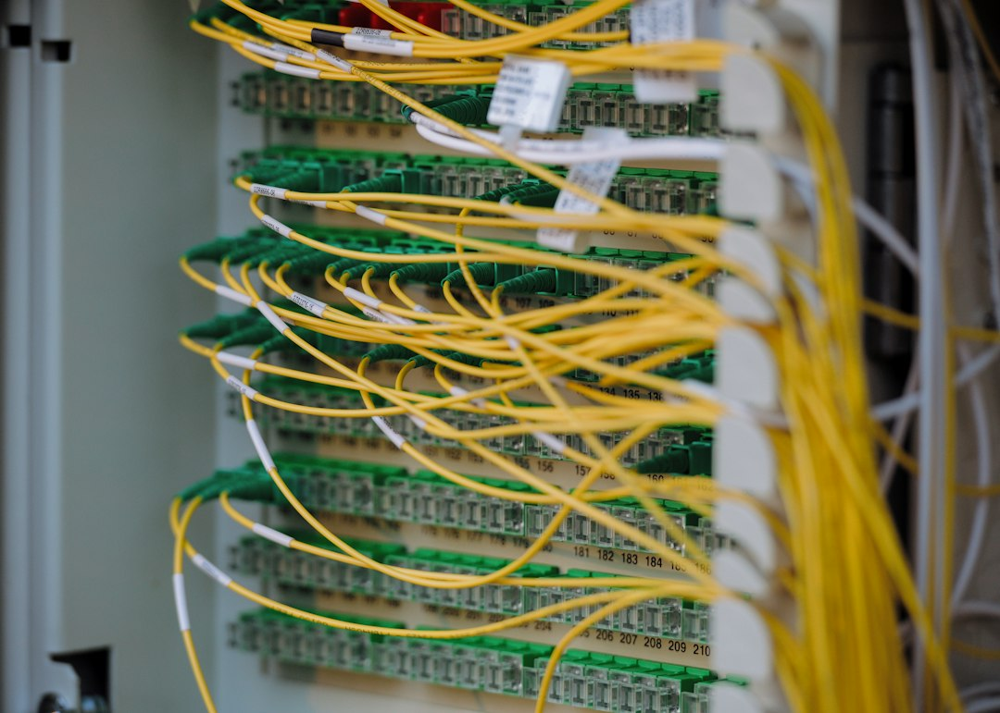
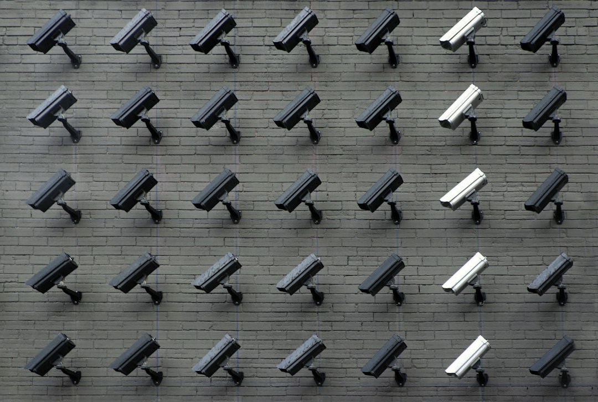

周一清晨，AI圈最耐人寻味的一幕是：OpenAI首席科学家Jakub Pachocki主动晒出了自家的"底牌"——从GPT-3.5到GPT-6 Astra的完整预训练困惑度曲线，并提议把困惑度变成全行业通用的AI发展"测速仪"，给未来可能的限速协议打地基。同一时间，Signal正面硬刚OS级AI监控、Lean社区给黎曼猜想验证正式"结案"、英伟达在财报亮眼与"迎回黄仁勋"请愿的两幅面孔间撕裂。下面进入今日份的AI金融科技全景。

## 一、研究突破

1. **OpenAI首席科学家Pachocki发文《Perplexity and Intelligence》：提议把困惑度变成全行业"统一测速仪"**：Jakub Pachocki 11月22日发表长文，主张用困惑度（perplexity，即交叉熵损失）作为跨模型厂商可比的进度指标，并据此建立共同的AI安全"限速"标准——"要给AI发展设限速，先得统一怎么测速"。他首次公开OpenAI内部预训练困惑度曲线：GPT-3.5约0.99（流畅对话）、GPT-4约0.91（有效思维链）、跌破0.8后网络安全与数学能力涌现（GPT-5.x至GPT-6 Astra一路走低），并坦言公开数据会暴露自家底牌，但建立行业共同安全基础更重要，直接呼应Dario Amodei此前的《We Must Pace the Frontier》。（[OpenAI原文](https://openai.com/index/perplexity-and-intelligence/)、[TechCrunch解读](https://techcrunch.com/2026/11/22/openais-chief-scientist-has-thoughts-on-how-to-limit-ai-development/)）
2. **黎曼猜想机器验证"结案陈词"：Lean与Mathlib社区发布联合声明**：社区正式认证Levent Alpöge 11月20日发布的1700万行Lean证明正确，四项标准全部满足——命题取自Mathlib经专家审核的定义；数十人独立编译复现出相同导出文件；用comparator与con-leche两款独立工具确认所证命题与Mathlib定义完全一致；Lean官方内核及带集合论层面形式证明的con-leche/con-ron检查器全部通过，MIT上线完整验证文件页。戏剧性的是，HN今天又出现了Alessandro Masullo手稿形式化的进展图——数学形式化验证硬是变成了连载剧。（[Lean社区声明](https://leanprover-community.github.io/blog/posts/riemann-hypothesis/)、[MIT验证文件](https://math.mit.edu/~drew/grh/)）
3. **Agent群狼围攻P vs NP**：pequalnp.com上线，展示多个AI agent协同冲击P vs NP问题的尝试——上周黎曼、本周P vs NP，"agent啃千禧难题"正在成为新的内容品类。（[HackerNews](https://news.ycombinator.com/)）
4. **arXiv cs.AI 每日精选（11月23日）**：《Probing the "Conscious" Mind》在视觉-语言模型中探测选择性访问与全局工作空间机制；《The Geometry of Lies》用知识与人格方向检测大模型欺骗行为；《A CPU Inside an LLM》把精确电路零梯度编译进预训练权重；《World Models Favor Learned Priors over Visual Evidence》指出世界模型更信先验不信视觉证据。（[arXiv列表](https://arxiv.org/list/cs.AI/recent)）

## 二、产品发布

1. **AI agent"搬进"短信里：TechCrunch盘点主流短信AI agent**：从客服到个人助理，一批可以直接在iMessage/SMS里使用的AI agent正成为新入口形态——不用装App，一条短信就是一个agent会话。（[TechCrunch](https://techcrunch.com/2026/11/21/all-the-ai-agents-that-can-live-in-your-text-messages/)）
2. **Show HN：一款"你扮演LLM子代理"的游戏**：worker755把AI agent的调用链做成游戏——这次轮到人类体验被主agent调度的感觉，开发者共情训练器。（[GitHub](https://github.com/gulivan/worker755)）
3. **0rwx：用Unix权限模型给AI用法立规矩**：一个受Unix权限位启发的极简AI使用模型，给"agent能读什么、能写什么、能执行什么"提供了一套可组合的词汇表。（[官网](https://0rwx.com/)）

## 三、融资并购

1. **Nscale拟募资350亿美元IPO，上市前夕急踩刹车**：英国AI数据中心运营商Nscale为筹备350亿美元IPO开始放缓招聘、压缩支出，COO奥索夫斯基本月内部邮件告知"未来数月暂停招聘"。这家英伟达投资的初创公司董事会阵容豪华——前Meta高管桑德伯格、英国前副首相克莱格在列，眼下要抉择：今年上市还是推迟到2027。（[36氪](https://36kr.com/newsflashes/4081623368701065?f=rss)）
2. **摩根士丹利基础设施合伙公司宣布出售StraitNZ**：基建资本的新一轮资产腾挪。（[36氪](https://36kr.com/newsflashes/4081608401671041?f=rss)）

## 四、产业应用

1. **把机器人"教"进真实世界：人民日报海外版特写具身智能新职业**："具身智能机器人应用技术员"今年9月正式入编第八批新职业。浙江人形机器人创新中心的训练场里，一个几秒钟的抓取动作背后是几百组遥操作数据采集与清洗标注；其训练的NAVIAI WA2轮臂人形机器人在大型物流企业实现同种料箱抓放成功率99%，并曾在斯图加特物流展连续3天零故障运行。行业调研显示中国具身智能人才缺口已达百万级，工信部专项行动明确年底带动万台级落地能力。（[人民日报海外版/中新网](https://www.chinanews.com.cn/cj/2026/11-23/10736244.shtml)）
2. **达美航空自动化系统故障，亚特兰大全部航班延误**：纽约时报报道，达美一套自动化系统宕机导致经停亚特兰大的所有航班延误——航空业对自动化系统的依赖再次暴露单点脆弱性。（[NYT via HN](https://www.nytimes.com/2026/11/22/us/delta-flight-delays-system-outage.html)）
3. **"零碳暖流"与AI控温：核能供暖走进日常生活**：中新网体验式报道核能供暖+AI智能控温的落地场景；同期智能穿戴设备正从"尝鲜"走向"潮流"，打开消费新空间。（[中新网](https://www.chinanews.com.cn/cj/2026/11-23/10736219.shtml)、[智能穿戴](https://www.chinanews.com.cn/cj/2026/11-22/10736203.shtml)）

## 五、行业动态

1. **微软AI CEO苏莱曼表态：支持OpenAI提高透明度的倡议**：与Pachocki的困惑度公开一脉相承，头部厂商之间的"透明度竞赛"正在形成——先是Anthropic的IPO文件承认灾难性风险，现在OpenAI晒内部曲线、微软隔空声援。（[36氪](https://36kr.com/newsflashes/4081628288881544?f=rss)）
2. **"两个英伟达"：财报亮眼与"迎回黄仁勋"请愿并行**：TechCrunch播客总结本周英伟达的两幅面孔——一方面最新财报营收继续飙升、临时管理层坚称"我们hold得住"、并确认H200彻底退出中国市场；另一方面马斯克等人发起请愿呼吁黄仁勋回归，黄本人表态"准备回来"，而持续下跌的股价说明华尔街并不买账。经济学人的评论更为尖锐：黄仁勋的倒台对硅谷加速主义者是个坏消息。（[TechCrunch](https://techcrunch.com/2026/11/21/a-tale-of-two-nvidias/)、[Economist via HN](https://www.economist.com/business/2026/11/19/jensen-huangs-fall-is-bad-news-for-silicon-valleys-accelerationists)）
3. **数据中心成为Big Tech反噬的风暴眼**：记者Paris Marx新书《Hyperscale》拆解数据中心如何从沉默基建变成政治雷区——美国中期选举的蓝潮背后，数据中心选址争议是重要推手，民主党掌权更多州政府后博弈还将升级。（[TechCrunch](https://techcrunch.com/2026/11/22/why-data-centers-are-at-the-center-of-the-big-tech-backlash/)）
4. **Anthropic的电力账单：2028年87%来自天然气、11%来自煤炭**：监测组织披露Anthropic自建电力结构，AI公司的环保叙事与实际能源结构之间的落差继续被放大检视。（[betterdatacenterproject via HN](https://betterdatacenterproject.com/2026/11/16/how-ai-is-powered-a-breakdown-of-byop-and-g)）

## 六、市场数据

1. **上周ETF资金整体净流入1908.02亿元**：同花顺iFinD数据显示11月16-20日股票型净流入1855.97亿元，前三名为华泰柏瑞沪深300ETF（385.41亿）、嘉实沪深300ETF（337.58亿）、华夏上证50ETF（229.11亿）。（[36氪](https://36kr.com/newsflashes/4081618418865025?f=rss)）
2. **两市融资余额减少417.23亿元**：杠杆资金降温，与交易所新规同向。（[36氪](https://36kr.com/newsflashes/4081630487237507?f=rss)）
3. **沪深北交易所将融资保证金比例下限降至80%**：三大交易所同步调整，融资交易的资金效率上限放宽——一边是融资余额下降，一边是降低保证金门槛，政策信号值得玩味。（[中新网](https://www.chinanews.com.cn/cj/2026/11-22/10736144.shtml)）
4. **券商观点**：银河证券建议耐心等待外部不确定性缓释、市场情绪企稳；中信证券认为银行板块短期仍受资金面影响。（[36氪](https://36kr.com/newsflashes/4081626111054726?f=rss)）

## 七、技术工具

1. **本地AI入门三件套：Inkling+Qwen+Unsloth**：GPU Partner发布新手教程——装Unsloth Desktop、按显存选量化模型、开LAN共享全家使用，全程不碰终端，10-15分钟在Windows上跑起家庭版ChatGPT。配合社区量化编译器，Inkling-2-Mini已被压到5.4GB即可本地运行，"AI在自己家"从极客玩具变成普通人的周末项目。（[教程](https://www.gpupartner.com/blog/beginners-guide-local-ai-inkling-qwen-unsloth)、[量化版Inkling](https://github.com/ShinMegamiBoson/lookatmyquant)）
2. **Localcode：Mac上一条命令的开源agentic coding**：本地运行的编码agent，主打零云依赖、代码不出本机。（[GitHub](https://github.com/mjwsolo/localcode)）
3. **Fast-Anything：别重写整个程序，只重写那5%慢的部分**：对Rust重写教条的工具化回应，定位瓶颈精准提速。（[GitHub](https://github.com/EL4CTEO/fast-anything)）
4. **PcapAnalyzer：自托管流量分析工具，内置27种问题检测器**：网络排障与安全取证的开源新选择。（[GitHub](https://github.com/sebaandrada-cell/PcapAnalyzer)）

## 八、安全与伦理

1. **Signal限制移动端截图，正面硬刚"AI监控的生存威胁"**：Signal总裁Whittaker宣布Android与iOS版新增截图限制（此前Windows版已默认屏蔽），理由是OS级agentic AI让"你的敏感数据被捕获、存储、交由本地数据库或远程服务器处置，完全超出Signal的控制"。她也坦承这是"不完整的方案"，用户仍可手动关闭，但那将"打破我们的隐私保证"。（[TechCrunch](https://techcrunch.com/2026/11/21/signal-restricts-mobile-screenshots-as-it-confronts-existential-threat-of-ai-surveillance/)、[Signal博客](https://signal.org/blog/protecting-your-privacy/)）
2. **OpenRouter披露推理提供商数据事件：下架3家、125个端点移出零保留资格**：安全研究员（Dragos金丝雀令牌方法）发现部分推理提供商未遵守数据政策。OpenRouter已下架三家提供商、将125个端点移出Zero Data Retention资格并通知受影响客户；Together AI承认2026年6-7月请求存在prompt泄漏。AI供应链的数据合规第一次被系统性"抽查"，值得所有走第三方推理通道的团队自查。（[OpenRouter公告](https://openrouter.ai/blog/announcements/data-processing-incidents-on-inference-providers/)）
3. **GL.iNet发布安全公告（2026-11-20）**：路由器厂商GL.iNet披露安全更新，家用网络入口设备的安全维护再度提醒用户及时升级固件。（[官方公告](https://www.gl-inet.com/en-us/blogs/blog/glinet-security-notice-2026-11-20)）
4. **"有意识的AI"是个神话？**：Noema杂志长文剖析当前围绕AI意识的叙事膨胀——在Pachocki主张用困惑度度量智能的同一周，"智能是什么、意识是什么"的边界之争仍在继续。（[Noema via HN](https://www.noemamag.com/the-mythology-of-conscious-ai/)）

---

## 金融科技补充简报（36氪/中国新闻网财经）

- Nscale拟募资350亿美元IPO前夕放缓招聘、缩减开支（36氪）
- 上周ETF资金整体净流入1908亿元（36氪）
- 沪深北交易所降低融资保证金比例下限至80%（中新网）
- 两市融资余额减少417.23亿元（36氪）
- 微软AI CEO苏莱曼支持OpenAI提高透明度倡议（36氪）
- 深交所港股通标的调整，调入东山精密（36氪）
- 摩根士丹利基础设施合伙出售StraitNZ（36氪）
- 把机器人"教"进真实世界：具身智能新职业特写（中新网）
