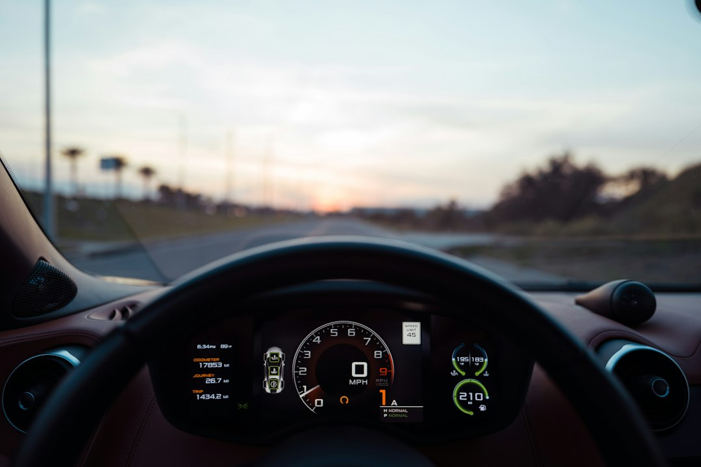

> 11月22日，OpenAI首席科学家Jakub Pachocki发表《Perplexity and Intelligence》，首次公开公司内部预训练困惑度曲线：GPT-3.5约0.99，GPT-4约0.91，跌破0.8后网络安全与数学能力开始涌现。他提议把困惑度变成全行业统一的"测速仪"，为AI限速提供共同刻度。Altman称之为"OpenAI近期最重要的发布"。听起来是透明度的胜利。但仔细打量这台测速仪：它由司机亲手制造，焊死在司机自己的仪表盘里，读数只有司机自己看得见。

## 一、自报车速，限的是谁的速度

困惑度的技术定义并不神秘：模型在一份"从未见过"的held-out数据集上预测下一个token的平均交叉熵。问题恰恰出在这份定义的每一个括号里——数据集是谁挑的，tokenizer长什么样，测的是训练到第几个checkpoint，全部锁在厂商内部。同一台模型，换一份中文语料或代码语料，读数立刻不同；外人拿到的只有一个被反复标定过的最终数字。

Pachocki自己在文章开头就把这层窗户纸捅破了：公开这些内部测量"会让竞争对手更清楚地看到我们的位置"。这句话值得逐字读两遍。它承认了一个事实——这些数字的第一身份是竞争情报，其次才是安全公共品。一家公司愿意把竞争情报捐出来换行业共识，这值得掌声；但掌声过后要想清楚：捐出来的数据不等于可核验的数据。

交通限速为什么有效？不是因为司机道德高尚，而是因为交警能读你的速度表，雷达枪能在路边独立测速，罚单有第三方作证。而困惑度限速方案的结构是：测速仪装在司机车上，数据由司机标定，读数由司机播报。TechCrunch转述的建议是，各家承诺"在理解和监控AI行为达到某个具体里程碑之前，不越过某个困惑度阈值"。里程碑由谁认定？由第一个越过它的那家公司自己宣布。这是整个方案最柔软的腹部：你可以庄严承诺"不到0.8绝不发车"，但没有任何仪器能验证你此刻究竟停在0.81，还是早已在0.79上跑了三个月。

## 二、0.8这条刻度线，是拿后视镜画出来的

Pachocki贴出的那条曲线确实漂亮：GPT-2率先写出连贯段落，GPT-3学会了上下文学习，GPT-3.5在0.99处流畅对话并托起了初代ChatGPT，GPT-4在0.91处高效调用思维链，跌破0.8之后网络安全与数学能力涌现。五个里程碑钉在同一根数轴上，看上去就像一条能力换算表。

但要注意这条曲线是怎么画出来的：每一条能力涌现，都是回头看时才钉上的图钉。GPT-4在0.91的时候，没有任何人知道思维链会在那里冒出来——事后归纳容易，事前预测难，这是深度学习十年历史里被反复验证的老规矩。把一条从事后归纳中得来的曲线当成事前限速的依据，等价于假设"下一个跃迁仍然长上一个的样子"。而涌现从不按上一个模型的剧本出场：它可能来得更早，也可能绕开0.8这条线，从某个没人盯着的角落破门。

更微妙的是，困惑度对"往哪个方向变聪明"完全失明。同样降到0.79，涌现出来的可能是数学证明，也可能是自动化漏洞挖掘——OpenAI自己的措辞是"网络安全与数学"，这两个词恰好是一枚硬币的两面。一个标量数字限得住快慢，限不住方向；而安全治理最该管的恰恰是方向。用一台只显示车速、不显示方向盘转角的仪表来做限速执法，本身就是个结构性错位。

## 三、能被陌生人测速的，只有开源车

这里有个辛辣的讽刺：全世界唯一任何人都能复测困惑度的模型，是开源权重模型——下载权重，自选数据，自己算交叉熵，十行代码的事。开源社区每天就在给彼此的模型"测速"，谁吹牛谁翻车，当场见分晓。而困惑度限速方案真正想管的那些前沿闭源模型，恰好是外人最无法测速的一批。如果行业真把"统一困惑度报告"当执法标准，最先被这套标准捆住的，反而是本来就公开透明的那一方；闭源厂商则永远可以回答"我们还没到0.8"，而没有人有能力证伪这句话。

话说回来，这篇发文依然值得肯定，因为它是一场真实发生的透明度竞赛的最新一棒：Anthropic的IPO文件先白纸黑字承认AI可能构成"灾难性或生存风险"，Amodei随后发文呼吁"给前沿定速"，OpenAI接着交出内部曲线，Altman亲自站台，微软AI CEO苏莱曼隔声援。头部厂商头一回开始比谁交底交得多，而不是比谁的公关稿写得漂亮。真实数字的珍贵之处在于它是可错的——说错会被拆穿，所以开口就等于押上了信用。这个竞赛机制本身，比任何一个具体数字都更有长期价值。

所以判断这台测速仪是真是假，只需要一个可证伪的检验：OpenAI敢不敢让第三方审计机构，在同一份公开的held-out数据集上，复测GPT-6 Astra的困惑度？敢，这就是行业安全基建的第一块砖，曲线从此有了公证人；不敢，那这根曲线再精美，也只是一张画给自己股东的进度条。限速牌可以由司机来立，测速仪必须归交警管。在困惑度可以被独立复测之前，"统一测速仪"四个字，最好读作它的本义——我保证，我没超速。

## 结语

Pachocki交出的不是一台测速仪，而是一份测速仪的设计图纸，外加一段司机亲手抄录的读数。图纸值得收藏，读数值得记录，但执法不能建立在被测对象的自觉上。下一次里程碑出现时，别问那条曲线又降到了多少——先问一句：这次，谁来读表？

📷 <a href="https://unsplash.com/photos/black-car-instrument-panel-cluster-MbiSXN8u8q4?utm_source=toby-blog&utm_medium=referral" target="_blank" rel="noopener">Photo by Dennis Eusebio</a> on <a href="https://unsplash.com?utm_source=toby-blog&utm_medium=referral" target="_blank" rel="noopener">Unsplash</a>

📷 <a href="https://unsplash.com/photos/gloved-hand-holding-laboratory-beaker-cuqp2Jzz_lY?utm_source=toby-blog&utm_medium=referral" target="_blank" rel="noopener">Photo by RephiLe water</a> on <a href="https://unsplash.com?utm_source=toby-blog&utm_medium=referral" target="_blank" rel="noopener">Unsplash</a>

