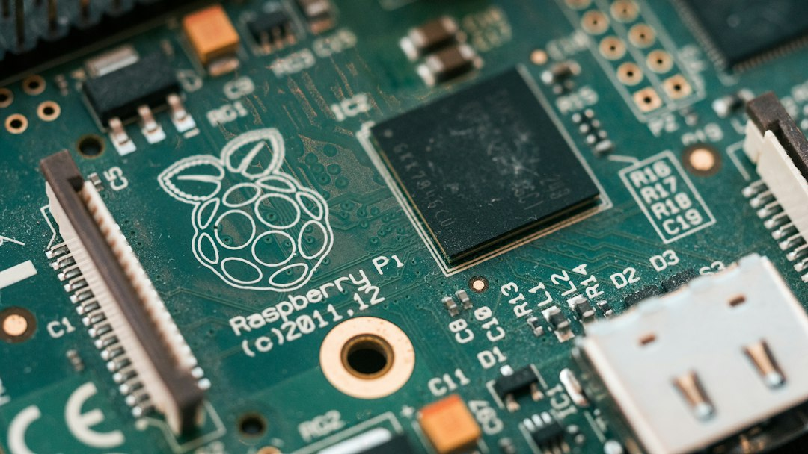

> 「Dario Amodei渲染AI危险，是为了推动开源模型违法、巩固自身控制权。」——Yann LeCun，2026年11月23日，X平台。这条动态在Hacker News上炸出了617条评论，让「AI末日论」从学术分歧正式升级为一场公开的行业内战。

这场架吵得毫无体面，但我认为它比过去一年所有优雅的圆桌论坛加起来都更有信息量——因为两个当事人第一次把牌摊在了桌面上：**AI安全叙事不是科学共识，是一门生意，而且是好生意。**

## 一、掀桌子的两个人，手里都不是空牌

先看清楚吵架双方各自的筹码。LeCun是深度学习三巨头之一，他的学术血统里刻着「开放」二字：从Torch到PyTorch，再到Meta的LLaMA系列把开源权重推向主流，LeCun一生的职业利益都与「权重应该自由流动」绑定。而Amodei这边，Anthropic在11月19日刚刚敲响纳斯达克的钟，上市首日市值突破2万亿美元，TechCrunch随后披露七位创始人在IPO中合计套现近20亿美元。

这组数字放在一起就很微妙了：一边是职业声誉建立在「开源是未来」上的学者，另一边是一家靠「我们最安全」作为核心卖点的上市公司。LeCun的指控未必是恶意的，但它至少提醒了我们一件被长期忽略的事——**「AI可能毁灭人类」这句话，从一个2万亿美元市值公司的创始人嘴里说出来时，本身就是一个资产价格事件。**

聪明如你大概已经发现了问题的形状：当末日预言者和末日保险的卖方是同一个人时，这场对话的交易结构就变了。这不是阴谋论，这是利益披露的基本要求——分析师推荐股票要披露持仓，凭什么预言文明终结的人不用披露市盈率？

## 二、恐惧是最贵的合规壁垒

LeCun指控的实质，用一个行业老词讲就是「监管俘获」的进攻形态：不是去俘获监管者，而是亲手制造监管。

推理链条其实很短。如果「前沿模型存在灭绝级风险」成为立法前提，那么顺着这个前提推下去的政策工具箱里装的是什么？模型注册制、算力申报门槛、权重发布前的强制安全审计、开源发布的刑责风险。每一条都不是小公司玩得起的游戏。一家账上有两万亿市值、法务和合规团队数百人的公司，穿越这些监管丛林的能力，远远强于一个在车库里微调开源权重的学生或者三个人的创业团队。

换句话说，**极端的风险叙事如果被写进法律，效果等价于一道针对开源生态的准入壁垒，而壁垒的最大受益者，恰恰是叙事的发起方。**这在商业史上一点都不新鲜——加密货币监管战、网约车牌照战、医疗设备FDA认证战，全都重复过同一个剧本：当你在产品上打不过免费，就在立法上让免费变贵。

当然，要公平地说一句：Amodei阵营的恐慌论调未必全是算计，真正的信徒和精明的生意人完全可以在同一个人身上共存，这反而是最坚固的商业结构。但「动机纯粹」从来不构成豁免——评估一套主张，看的应该是它结构性上让谁受益，而不是主张者内心是否真诚。617条HN评论吵了几个小时的人格与立场，而真正该吵的结构性问题几乎无人问津。

## 三、10GB的权重文件，禁不住

而这场叙事战争最大的破绽，恰恰藏在同一天新闻流的另一条不起眼的条目里：Nari Labs发布了NariQ量化方案，把Qwen3.8-27B这个270亿参数的模型压进了10GB的文件，并且保持BF16级别的运行质量。

10GB是什么概念？**就是一部1080p电影的下载量。**一杯咖啡的时间，任何一台16GB内存的笔记本就能在本地跑一个270亿参数的语言模型。权重文件一旦小到这个量级，「前沿模型将被立法管住」这个前提就在物理层面瓦解了——文件在千千万万块消费级硬盘上，没有一个边界可供执法。

历史在这里提供了一个不那么体面但极其清晰的先例：DRM版权保护战争的完整周期。上世纪的内容产业也曾坚信「立法+技术封锁」能管住数字文件，二十年后的结论是——文件管不住，被管住的只有合法渠道的质量。落到开源模型上，剧本大概率重演：如果开源权重被定性为违法，消失的不是模型能力，而是**公开渠道的安全评测、已知漏洞披露和社区审计**。黑市里的权重文件没有model card，没有红队测试报告，没有谁为后门负责。到那一天，世界不是更安全了，而是把整个开源安全体系连根拔掉，只留下了能力本身。

这才是LeCun这条推特真正值得被严肃对待的地方。不管他的动机里有几分学术信念几分门户之见，「让开源违法」这个政策方向在2026年的技术现实下已经不可执行，而一个不可执行却仍在被推动的立法方向，唯一确定的功能就是重新分配利益。

## 结语：盯住评测，别盯住预言

普通人能从这场骂战里带走什么？我的建议只有一条：**把注意力从「谁更恐慌」转移到「谁在公开可验证地评测」。**末日预言无法证伪，所以它是完美的营销语言；而能力评测红队报告漏洞披露是可以被第三方复核的，所以它才是真正稀缺的安全证据。

下一个各家发布会的高潮环节，与其听创始人用颤抖的声音描述文明的黄昏，不如直接问一句：贵司最新模型的红队报告，发在哪？可复现吗？让外部研究者跑一遍的脚本在哪个仓库？谁回答得出这个问题，谁才配谈论安全。其余的，都是定价权之争的台词。

*本文观点基于2026年11月24日公开报道：LeCun X平台发文、TechCrunch关于Anthropic IPO的披露、Nari Labs的NariQ量化发布。*

📷 <a href="https://unsplash.com/photos/a-close-up-of-a-microphone-on-a-stand-06GZXvzVIFQ?utm_source=toby-blog&utm_medium=referral" target="_blank" rel="noopener">Photo by Richard Khuptong</a> on <a href="https://unsplash.com?utm_source=toby-blog&utm_medium=referral" target="_blank" rel="noopener">Unsplash</a>

📷 <a href="https://unsplash.com/photos/green-and-black-circuit-board-c3YpscwJb04?utm_source=toby-blog&utm_medium=referral" target="_blank" rel="noopener">Photo by Harrison Broadbent</a> on <a href="https://unsplash.com?utm_source=toby-blog&utm_medium=referral" target="_blank" rel="noopener">Unsplash</a>

