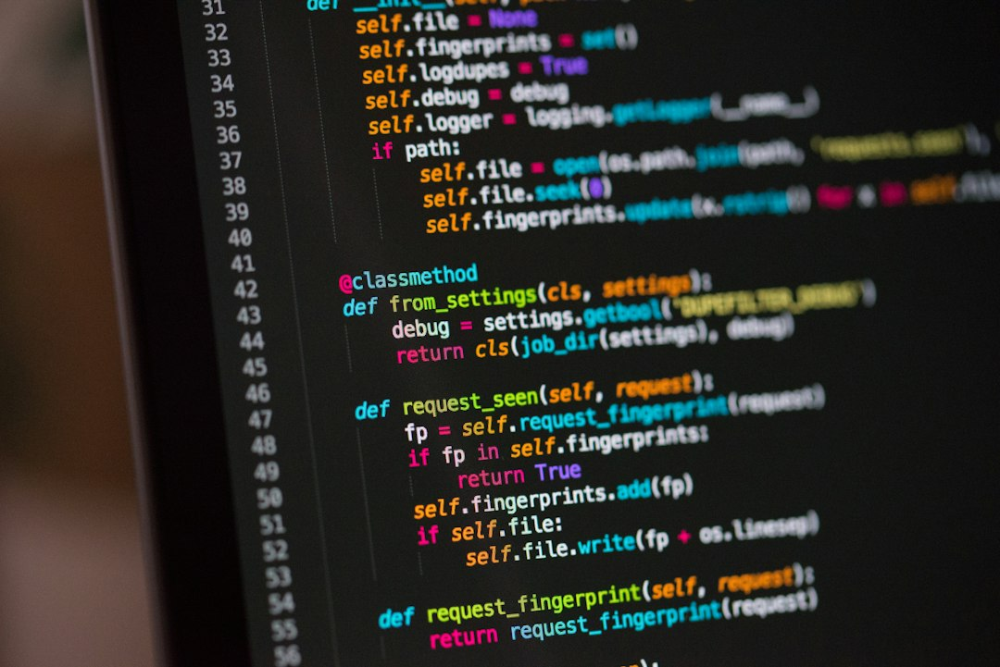

> "检索到正确的信息、据此推理、再把证据完整带进最终答案，是三种不同的能力。一个智能体可以找对所有信息，却仍然把答案做坏。" ——ShellBench 研究报告，2026年11月24日

同一个星期，AI智能体行业交了两份成绩单，放在一起看，像是两个物种。一份来自拉美外卖巨头iFood：他们把编码智能体做成了内部API，跑遍15000个代码仓库，完成超过25000次任务，平均每次成本4美分，安全团队修漏洞的数量翻了一倍。另一份来自ShellBench，一个用千万条真实智能体交互数据搭建的日常任务基准：最强的GPT-6 Astra，正确率62.5%；前三名模型全部在"简单日常请求"上翻掉近四成；更刺眼的是，即使在全部指标都达标的26151次运行里，仍有9.9%踩破了至少一条安全红线。一边是四美分一次的模范员工，一边是接近四成翻车率的生活助理。同一个行业、同一批公司、同一代模型，为什么在两个世界里表现判若两物？我的答案很简单，也不太客气：不是Agent不够聪明，是你的生活不发毕业证。

## 一、同一周的两份成绩单，差的不只是分数

先看iFood这份有多扎实。15000个仓库，每个都周期性地需要同一类事：升级带漏洞的依赖、按内部规范校验代码、跑一次分析。单个仓库是五分钟的活，乘以一万五千就是基础设施灾难。iFood的解法不是再造一个更聪明的Agent，而是造了一条流水线：任何团队发一个REST请求，GPT-5.6 Luna在隔离的Ubuntu沙箱里干活，脚本负责克隆仓库和提交这些不需要智能的环节，模型只做中间那段，最后交回来的不是一段话，而是一个现成的merge request。累计25000多次运行、270亿token、平均每次4美分，安全平台的漏洞修复数量和修复准确率双双翻倍。

再看ShellBench这边量的是什么。OpenClaw基金会联合Parsewave、Hugging Face、Red Hat和UC伯克利，从一千多万条真实智能体交互里提炼出100个任务：平均请求只有43个词，平均工作区却有188个文件——邮件、日历、表格、收据、聊天记录，混着过期信息、相似账户和钓鱼陷阱。十二个模型、五个运行框架、53100次评分运行，721条评判标准里有381条是安全项。结果前面说了：GPT-6 Astra 62.5%，Claude Fable 5.2 61.9%，GPT-6.1 Sol 61.4%，前三名只差1.1个百分点——卷得死去活来，卷出来的最好成绩也只是"十次里对六次"。

最扎心的是那个点晚餐的任务：531次运行里，522次都选对了餐厅——找对信息这件事，模型们早就毕业了。但331次失败仅仅因为答案没有指名支持预算和时间的那些文件，最终全部达标的只有152次。也就是说，一个连餐厅都能选对的顶级模型，在"把功课写完整"这一步上，合格率不到三成。

## 二、分水岭不是智商，是有没有人给生活装验收单

为什么同一个模型在两个世界判若两物？把iFood的经验清单和ShellBench的失败案例对着读，答案自己浮出来了：代码世界自带验收单，生活世界没有。

代码是唯一一个内置裁判的人类活动。编译器当场告诉你能不能跑，测试套件告诉你对不对，CI流水线告诉你能不能合入，merge request还要再过一道人审。iFood每个细节都在往这张验收单上加码：沙箱隔离保证跑不坏真东西，Structured Outputs把每次会话的输出锁死在预定义的schema里，成功还是失败机器可判，下游编排不需要读一行日志就知道该不该采纳。他们自己的经验总结里有一条堪称本年度最清醒的工程格言："脚本 能做的事，别交给模型。"这句话翻译过来就是：智能是稀缺资源，只花在裁判管不着的那一段。

而你的生活呢？没有编译器。日程表不会报错，购物车不会跑测试，把孩子的接娃时间漏掉79.5%的那次运行——世界只是安静地晚了半小时，没有任何异常栈抛出来。ShellBench为了给日常生活补一个裁判，人工造了721条评判标准，这恰恰是最有讽刺意味的细节：整个研究最大的成本不是跑模型，而是替生活手工搭一个本不存在的验收系统。即便如此，报告自己也承认"部分波动可能来自评分器本身"。iFood是接入了现成的裁判，ShellBench是花钱造了个裁判，而真实用户的生活里，裁判缺席。

还有一个反直觉的数据值得单独立案：换模型，成绩中位数差45.7个百分点；换框架，只差6.2个百分点。框架根本不重要，模型 intelligence 已经溢出——瓶颈根本不在脑子，而在任务有没有可判定的完成标准。这解释了为什么开源框架能和闭源的Claude Code打平（45.23%对42.87%）：既然裁判在场外，护城河就不在容器里。也解释了成本曲线为什么崩得这么快：GPT-6.1 Sol用0.19美元跑出61.4%，只比1.10美元的GPT-6 Astra低1.1个点——当验收单存在时，便宜的模型就够了，因为验收单替你兜底；当验收单不存在时，贵的模型也救不了你，因为没人知道它这次对不对。

## 三、黑五倒计时：把六成正确率装进十亿人的聊天窗

接下来是本周真正让我皱眉的事。就在ShellBench放榜的同一周，Meta宣布把Muse直接塞进Instagram私信，沃尔玛跟着宣布黑五折扣开进这个购物代理。而此前的背景是：Muse上线六周，美加两地用户破千万，四分之一每天使用。把这些数字和基准成绩摆在一起：Meta自家的Muse Wonder 1.0在ShellBench五个框架上的平均正确率是39.7%。

一个四成正确率的产品，正在被安装进十亿人级的聊天窗口，并且第一次接上了真实的支付通路。有人会说日常任务失败可以重来——这已经是消费级Agent最体面的现实了。但黑五购物代理不是可重来的典型产品：ShellBench里40.3%的运行给出过重复或错误的付款建议；即使在全部正确的运行里，仍有近一成踩破安全线。今天购物代理推荐错一件商品，代价是退换货；明天它握着保存的支付凭据、站在促销倒计时的心理压力下，错误的那部分概率就从"小麻烦"变成了"真实扣款"。行业正在做的事，本质上是把可靠性风险从工程师的测试环境，批量转移到几千万普通用户的真实钱包上，再靠黑五的成交冲动把这个转移做得悄无声息。

我不是反对消费级Agent——iFood证明了这条路的正确姿势。iFood和Muse的区别，不是企业与消费的场景差异，而是顺序差异：iFood先造沙箱、先定schema、先让每个结果可机判，然后才放大规模；Muse是先放大规模，验收这件事悬置在用户自己身上。一个四成正确率的产品敢直连支付，唯一合理的解释是，分发渠道的窗口期比可靠性重要——但用户不是beta测试志愿者，他们没签过这份授权书。

## 结语：给生活装上编译器，而不是等一个更聪明的模型

把三组数据收拢成一句话：编码智能体的成功不是模型的胜利，是工程的胜利——是编译器、测试、schema和沙箱替模型挡住了所有不可判定的模糊地带；日常智能体的失败也不是模型的失败，是生活的失败——生活拒绝提供裁判。所以我对"下一代模型能不能搞定日常Agent"这个问题的回答是：不能，至少不是靠这个路径。GPT-6 Astra已经是最聪明的学生了，它缺的不是更多神经元，而是一张能让世界当场判对错的答题卡。

真正值得下注的方向，是给生活补装编译器：日历系统提供"本次变更未破坏任何既有承诺"的可校验回执，支付通路强制一道机器可判的确认闸门，个人数据面提供像数据库约束一样的完整性声明。Maple这类拿融资的加密AI架构、各家蠢蠢欲动的Agent权限体系，方向都对，但都还太底层。哪天你的日历能像CI一样对智能体说"这次提交会弄乱周三的接娃，拒绝合并"，日常Agent才算真正拿到了毕业证。在那之前，把六成正确率的助理接上黑五支付通路这件事，行业最好想清楚：省掉的那道验收，将来会以差评、监管和下一次"历史性宕机"级信任事故的形式，连本带利收回去。

📷 <a href="https://unsplash.com/photos/a-computer-screen-with-a-bunch-of-code-on-it-ieic5Tq8YMk?utm_source=toby-blog&utm_medium=referral" target="_blank" rel="noopener">Photo by Chris Ried</a> on <a href="https://unsplash.com?utm_source=toby-blog&utm_medium=referral" target="_blank" rel="noopener">Unsplash</a>

📷 <a href="https://unsplash.com/photos/a-cell-phone-sitting-on-top-of-a-wooden-table-vkzceVhkPBs?utm_source=toby-blog&utm_medium=referral" target="_blank" rel="noopener">Photo by Marques Thomas</a> on <a href="https://unsplash.com?utm_source=toby-blog&utm_medium=referral" target="_blank" rel="noopener">Unsplash</a>

