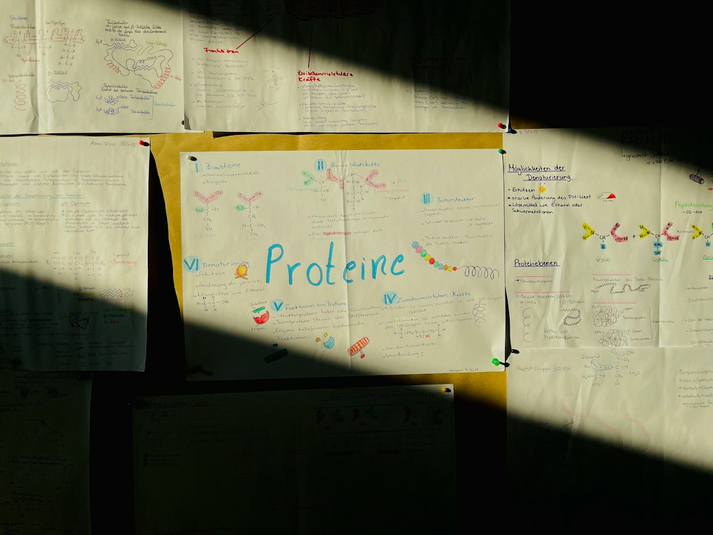

今天的AI世界两条主线同时发威：科学侧，OpenAI的GPT-6展示内在蛋白质设计能力，Anthropic的Claude则接连攻克黑洞物理开放问题，"AI做科研"从口号变成了实验记录；资本与产业侧，黄仁勋在白宫背书下重返英伟达CEO，Anthropic上市一周即跌破发行价，AI板块的估值叙事开始接受市场的第一次压力测试。以下为今日完整日报。

## 研究突破

1. **OpenAI: GPT-6模型展现内在蛋白质设计能力**
   OpenAI发布研究，GPT-6模型无需外部专业工具链即可通过推理与代码直接设计蛋白质结构与序列，实验室测试在五个靶点上观察到结合证据，AI在科学发现中的角色从辅助分析走向独立设计。
   [openai.com](https://openai.com/index/gpt-6-models-demonstrate-intrinsic-protein-design-capabilities/)

2. **Anthropic: Claude接连攻克黑洞物理开放问题**
   Anthropic披露Claude在黑洞物理领域解决两个开放问题，随后又用Claude辅助探测"vault粒子"，基础科学研究正快速成为前沿模型的主战场之一。
   [anthropic.com](https://www.anthropic.com/research/claude-black-hole-physics)

3. **OpenAI: Codex与Astra助业余天文学家寻找系外行星**
   两位业余天文爱好者利用Codex与Astra在NASA开普勒与TESS的公开数据中筛出潜在系外行星，AI工具正把前沿科研的门槛拉到个人玩家层面。
   [openai.com](https://openai.com/index/searching-for-distant-planets-with-astra)

4. **新基准测试显示: 最强的AI智能体也难以可靠完成日常任务**
   随着数百万人开始使用个人AI助手，一项新基准发现最先进的模型在日常任务中仍难以兼顾可靠性、安全性与效率，智能体落地远比演示视频残酷。
   [techcrunch.com](https://techcrunch.com/2026/11/24/even-the-best-ai-agents-struggle-with-everyday-life/)

## 产品发布

1. **Meta把Muse AI助手直接搬进Instagram私信**
   Meta将旗下AI助手Muse集成到Instagram DM中，用户无需在两个应用间来回切换即可唤起AI，社交平台入口之争再进一步。
   [techcrunch.com](https://techcrunch.com/2026/11/24/meta-brings-its-muse-ai-assistant-directly-into-instagram-dms/)

2. **Ternary Bonsai 2.5 27B三元模型发布**
   PrismML发布Ternary Bonsai 2.5 27B，以三元权重路线压缩27B参数模型，登上Hacker News热榜，大模型端侧化与低成本推理的又一注脚。
   [prismml.com](https://prismml.com/news/bonsai-2-5-27b)

3. **Songe开源: 用闲置算力训练你的本地模型**
   开源项目Songe把闲置设备的算力聚合起来，作为本地模型的训练引擎，个人和小团队"攒机器炼小模型"的路线又多了一个工具。
   [github.com](https://github.com/sous-labs/songe)

## 融资并购

1. **Maple获530万美元融资: 加密架构让AI连自己都看不到用户数据**
   该初创公司构建加密AI架构，旨在防止包括公司自身在内的任何一方访问用户隐私数据，隐私优先的AI基础设施开始获得早期资本下注。
   [techcrunch.com](https://techcrunch.com/2026/11/24/maple-raises-5-3m-to-build-ai-products-that-protect-your-data-even-from-itself/)

2. **转转传赴港IPO募资5亿美元**
   FT中文网报道，二手交易平台转转传出赴港上市计划，拟募资约5亿美元，估值成色将取决于盈利能力。
   [ftchinese.com](https://www.ftchinese.com/story/200371cd-a575-440a-85c1-b1a4e6a9e69e)

## 产业应用

1. **沃尔玛联手Meta: 黑五折扣直接开进Muse AI购物代理**
   沃尔玛宣布与Meta合作，用户可以通过AI代理Muse直接逛黑五折扣，电商与AI代理的购物入口之争从聊天延伸到促销季实战。
   [techcrunch.com](https://techcrunch.com/2026/11/24/walmart-teams-up-with-meta-to-bring-black-friday-deals-to-ai-agent-muse/)

2. **OpenAI披露规模化落地案例: iFood用编码智能体覆盖1.5万个仓库**
   外卖平台iFood将编码智能体推广到1.5万个代码仓库，OpenAI同期还披露了Clay用Codex与ChatGPT辅助销售等客户案例，企业级智能体从试点进入规模化运维阶段。
   [openai.com](https://openai.com/business/customer-stories/ifood)

3. **爱丁堡大学: AI可提前数十年检出心脏病与中风风险**
   爱丁堡大学发布研究，AI模型可在症状出现前几十年识别心脏病与中风风险，医疗AI从辅助诊断前移到超早期预测。
   [ed.ac.uk](https://www.ed.ac.uk/news/heart-attack-and-stroke-risk-detectable-decades-in-advance)

4. **波士顿咨询: 中国是亚太AI应用最广泛的市场之一**
   BCG报告指出中国在亚太地区AI应用的广度领先，企业侧与消费侧的渗透率均处于区域第一梯队。
   [chinanews.com.cn](https://www.chinanews.com.cn/cj/2026/11/24/10737195.shtml)

5. **香港推出个人创业培育计划，降低AI创业门槛**
   香港面向个人创业者推出培育计划，重点降低AI方向创业的资源与合规门槛。
   [chinanews.com.cn](https://www.chinanews.com.cn/cj/2026/11/24/10737216.shtml)

## 行业动态

1. **英伟达风波大结局: 黄仁勋在白宫背书下回归CEO**
   黄仁勋在白宫支持下重返英伟达CEO与董事会，全员会上他向员工致歉、感谢白宫并透露自己正在接受心理治疗，同时坚持认为正式接班人计划"制造不必要的层级"，这家两周内经历剧变的公司回归创始人掌舵。
   [techcrunch.com](https://techcrunch.com/2026/11/24/in-all-hands-meeting-jensen-huang-thanks-white-house-and-says-hes-in-therapy/)

2. **微软历史性宕机后续: 内部备忘录宣布进入"Code Red"状态**
   路透社报道，在历史性大规模宕机之后，微软内部备忘录显示公司已宣布"Code Red"级响应，云基础设施可靠性议题持续升温。
   [reuters.com](https://www.reuters.com/business/microsoft-declares-code-red-after-historic-outage-internal-memos-show-2026-11-24/)

3. **英伟达前合作伙伴Megaspeed遭美国商务部出口禁令**
   曾与英伟达合作的Megaspeed被美国商务部列入出口禁令，AI算力出口管制的执行范围继续扩大。
   [upi.com](https://www.upi.com/Top_News/US/2026/11/24/NVIDIA-partner-Megaspeed/1701795520063/)

4. **Ask HN: 被Anthropic指控"蒸馏"的公司如何自证清白**
   一位开发者称公司被Anthropic指控利用其API做模型蒸馏并发函质询，在HN引发对云厂商条款边界与举证责任的激烈讨论。
   [news.ycombinator.com](https://news.ycombinator.com/item?id=50630809)

5. **MIT物理学家Tegmark: Anthropic员工公开谈论"统治世界"**
   Max Tegmark公开声称Anthropic员工曾谈及"接管世界"，该言论再度点燃AI安全阵营与前沿实验室之间的舆论交锋。
   [novaramedia.com](https://novaramedia.com/2026/11/24/anthropic-staff-openly-talk-about-taking-over-the-world-claims-top-mit-physicist/)

6. **FT: 海湾国家"算力美元"生意走到十字路口**
   FT中文网分析指出，石油美元换AI算力的海湾模式正面临回报周期与地缘政治的双重考验。
   [ftchinese.com](https://www.ftchinese.com/story/001112104)

## 市场数据

1. **Anthropic股价跌破IPO发行价，AI初创估值敲响警钟**
   上市刚过一周的Anthropic股价跌破发行价，这波破发可能给整个AI初创板块的估值预期踩下刹车。
   [techcrunch.com](https://techcrunch.com/2026/11/24/anthropic-shares-fall-below-ipo-price-a-worrying-sign-for-ai-startups/)

2. **英伟达B300、GB300订单交期大幅拉长，或挤占消费显卡供货**
   产业链消息称B300与GB300订单交期显著延长，数据中心算力需求继续挤压消费级显卡产能。
   [36kr.com](https://36kr.com/newsflashes/4084458040813959?f=rss)

3. **台积电考虑斥资217亿美元赴得州设先进晶圆厂**
   先进制程产能竞争升级，台积电计划在得州追加217亿美元投资设厂。
   [36kr.com](https://36kr.com/newsflashes/4084470158207364?f=rss)

4. **恒生科技指数大扩容，港股科技资产结构生变**
   恒生科技指数成分扩容，港股科技板块的资金映射结构随之调整。
   [36kr.com](https://36kr.com/newsflashes/4084421721156225?f=rss)

5. **两市融资余额增加2.2亿元**
   A股融资余额小幅回升，杠杆资金情绪平稳。
   [36kr.com](https://36kr.com/newsflashes/4084463277959813?f=rss)

6. **中国央行将同日开展MLF与7天期逆回购操作**
   央行同日滚动MLF与逆回购，维持跨月流动性平稳。
   [chinanews.com.cn](https://www.chinanews.com.cn/cj/2026/11/24/10737160.shtml)

## 技术工具

1. **Simon Willison: 十二个月里的三个LLM拐点**
   Simon Willison整理了AI Engineer Code Summit主题演讲全文，梳理过去12个月LLM与编码智能体能力的三次关键跃迁，是理解本轮能力曲线的最佳复盘之一。
   [simonwillison.net](https://simonwillison.net/2026/Nov/24/llm-inflection-points/)

2. **GPT-6.2 Astra破译历史悬案**
   历史学教授Mark Humphries用极少提示词让GPT-6.2 Astra自动完成历史研究中的档案交叉验证，文科研究工具链正在被重写。
   [simonwillison.net](https://simonwillison.net/2026/Nov/24/astra-historical-mystery/)

3. **datasette-charts 0.2a0与datasette-agent 0.7a1发布**
   Simon Willison连发两个数据工具更新: charting插件接入Datasette Agent实现对话生成图表，agent版则改进了iframe侧面板导航。
   [simonwillison.net](https://simonwillison.net/2026/Nov/24/datasette-charts/)

## 安全与伦理

1. **英国网安机构警告: AI驱动的网络攻击暴露多年安全欠账**
   英国国家网安中心指出，AI黑客工具主要利用长期存在的简单安全缺陷，企业存量系统风险被AI放大。
   [techcrunch.com](https://techcrunch.com/2026/11/24/uk-warns-ai-driven-cyberattacks-are-exposing-years-of-weak-security/)

2. **Tidal将封禁并下架数百万首AI生成歌曲**
   流媒体平台Tidal宣布全面清理纯AI生成曲目，接受AI辅助创作但拒绝全AI成品，AI slop对内容平台的污染进入集中治理期。
   [techcrunch.com](https://techcrunch.com/2026/11/24/tidal-to-ban-and-remove-millions-of-ai-generated-tracks-as-ai-slop-inundates-music-streaming/)

3. **Pinterest让家长限制青少年刷到的AI生成内容**
   与其他平台盯着"青少年与AI聊天"不同，Pinterest选择治理信息流里的AI内容供给，家长控制扩展到AI生成图片。
   [techcrunch.com](https://techcrunch.com/2026/11/24/pinterest-will-now-let-parents-limit-the-ai-generated-content-their-teens-see/)

4. **Check Point安全管理系统遭活跃入侵活动**
   GreyNoise监测到针对Check Point安全管理服务器的活跃入侵活动，安全厂商自身的管理面反而成为攻击目标。
   [greynoise.io](https://www.greynoise.io/blog/check-point-security-management-servers-intrusion-campaign)

5. **Grafana多版本发布安全更新，修复多个CVE**
   Grafana一口气为12.4至13.3五个版本线发布安全补丁，自托管用户需尽快升级。
   [grafana.com](https://grafana.com/grafana/download)

6. **中国牵头推动全球首个生成式AI治理国际标准提案**
   我国牵头向国际标准组织提交全球首个生成式人工智能治理国际标准提案，AI治理规则话语权竞争进入标准制定层面。
   [chinanews.com.cn](https://www.chinanews.com.cn/cj/2026/11/24/10737255.shtml)
