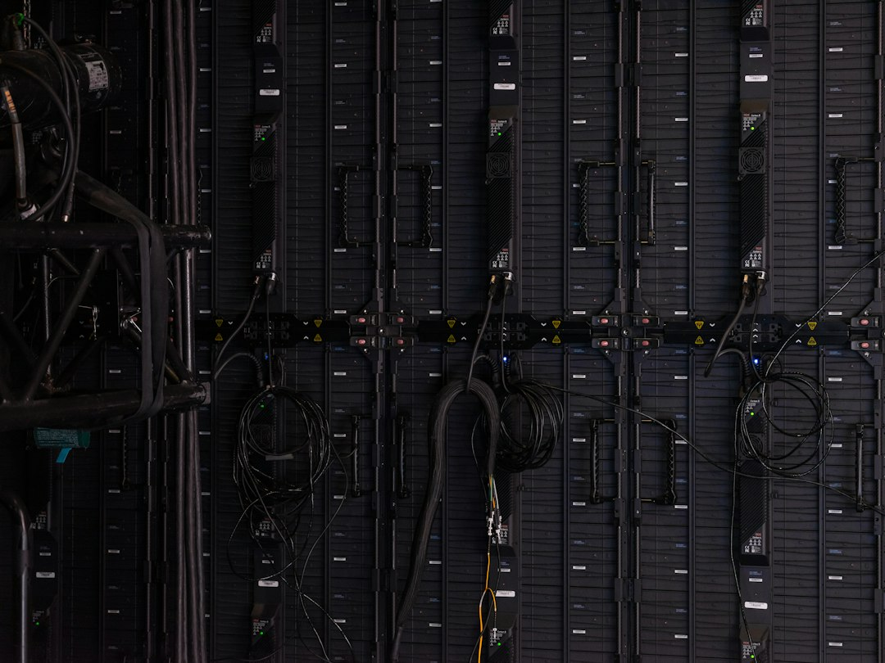

今天的科技圈有点"数学惊魂"的味道：谷歌一口气公开了涉及整数分解与离散对数的Cogentic系列论文，恰好踩在RSA与椭圆曲线加密的根基上；OpenAI的数学仓库则宣布推翻困扰学界数十年的多项式Hirsch猜想。大洋另一头，英伟达正被S&P的评级警告和CEO风波双重夹击。以下为今日完整日报。

## 一、研究突破

1. **谷歌发布Cogentic系列论文: 涉及整数分解、离散对数** — Google Research在GitHub公开Cogentic研究论文, 涵盖整数因式分解、离散对数等密码学基础问题, HN上443分330条评论引发激烈讨论。(来源: GitHub/HN, 11-25)
   [github.com/google-research/cogentic_research_papers](https://github.com/google-research/google-research/tree/master/cogentic_research_papers)

2. **OpenAI数学仓库推翻多项式Hirsch猜想** — OpenAI在GitHub math仓库发布预印本, 证明简单多面体图直径的超多项式下界, 即多项式Hirsch猜想不成立, HN热议。(来源: OpenAI/HN, 11-24)

3. **Scott Aaronson发文谈算法复杂度下界** — MIT教授Scott Aaronson撰文称我们正迎来一个"全新的数学真理大陆", 与GRH证明进展同期发酵, HN 843分697评论。(来源: scottaaronson.blog, 11-25)

4. **Anthropic发布GRH Lean验证精简版** — 有研究者发布了Anthropic广义黎曼假设Lean形式化验证的更短版本, 与黎曼假设AI辅助证明进展相呼应。(来源: GitHub/HN, 11-25)

5. **Anthropic: Claude解决黑洞物理两个公开问题** — Anthropic研究页面最新成果显示, Claude解决了理论物理中两个与黑洞和量子引力相关的公开问题; 另有Claude辅助解析原核细胞vault粒子首个3D结构。(来源: Anthropic, 近期)

6. **arXiv精选: LoomKV无损KV缓存压缩** — cs.AI最新论文LoomKV提出LLM推理中从GPU显存到SSD的无损KV缓存压缩方案; ShellBench研究AI Agent中模型与Harness孰更重要; NeurIPS 2026论文审计LLM Judge的人类偏差。(来源: arXiv cs.AI, 11-25)

## 二、产品发布

1. **OpenAI: GPT-6模型展现内在蛋白质设计能力** — OpenAI官方博客发布GPT-6模型在蛋白质设计任务上的新发现。(来源: OpenAI, 11-24)

2. **ChatGPT将合并Chat与Work, 重度用户或更早触达用量上限** — OpenAI将统一ChatGPT用量计量, 合并Chat与Work体验。(来源: TechCrunch, 11-25)

3. **腾讯混元Hy4 Flash: 日常工作的极致性价比模型** — 腾讯混元发布Hy4 Flash, 主打日常工作场景性价比, 近期登上Hacker News热门。(来源: 腾讯混元/HN)

4. **GLM-5.4发布: Z.ai首个Loop Transformer架构模型** — 中国AI公司Z.ai发布GLM-5.4, 首次采用循环Transformer架构, 主打通用编程能力。(来源: Simon Willison, 11-23)

5. **OpenAI用Astra搜寻系外行星** — OpenAI博客介绍与天文学家合作, 用GPT-6.2 Astra辅助搜寻系外行星。(来源: OpenAI, 11-24)

## 三、融资并购

1. **华源智因获过亿元天使轮融资** — 36氪首发: 该公司已有基于临床管线的药效预测合作落地。(来源: 36氪, 11-26)

2. **Amazon与Meta磋商解除AI Agent"Muse"封锁** — 双方正讨论达成协议, 结束对Muse长达两个月的封锁。(来源: TechCrunch, 11-25)

3. **转转传赴港IPO筹5亿美元** — FT中文网报道二手交易平台转转筹划港股上市。(来源: FT中文网, 11-25)

## 四、产业应用

1. **iFood用编程Agent覆盖15000个仓库** — OpenAI客户案例: 巴西外卖巨头iFood在大规模代码库中部署编程Agent。(来源: OpenAI, 11-24)

2. **OpenAI与思科联合推出Shirudo** — 双方共同发布企业安全新产品。(来源: OpenAI, 11-23)

3. **小鹏人形机器人IRON预计2027年1月进入硬件量产** — 中新网报道小鹏IRON机器人量产时间表明确。(来源: 中国新闻网, 11-25)

4. **哈佛研究: AI编程Agent把瓶颈转移到了代码审查** — 哈佛研究人员发现AI编程Agent普及后, 瓶颈从写代码转向代码审查环节。(来源: complexdiscovery/HN, 11-25)

5. **谷歌AI回答令搜索流量减少40%** — 行业分析显示Google AI Overviews正在分流传统搜索流量。(来源: revscope/HN, 11-25)

6. **6G要来了: 三部委到2030年建成新一代通信网** — 工信部等三部委联合发布6G发展路线图。(来源: 中国新闻网, 11-26)

## 五、行业动态

1. **S&P考虑下调英伟达信用评级: 公司治理与"关键人"风险** — 评级机构或将其评级降至AA-。(来源: TechCrunch, 11-25)

2. **黄仁勋承认违反公司行为准则, 全员会上感谢白宫并表示在接受心理治疗** — 英伟达创始人就Megaspeed事件向员工道歉, 白宫背书下回归CEO岗位; 继任计划争议持续发酵。(来源: TechCrunch, 11-24/25)

3. **Dario Amodei回应"向AI交出人类控制权"指控: 荒谬** — Anthropic CEO反驳竞争对手指控, 尽管头部公司都在自动化自身研究。(来源: TechCrunch, 11-25)

4. **1Password安全事件官方通报登顶HN** — 1Password发布2026年11月安全事件更新说明, HN 1096分472评论。(来源: 1Password/HN, 11-25)

5. **专家共探人工智能与硬科技产业协同; 北京数字金融论坛举办** — 广州聚焦AI与硬科技协同, 北京聚焦数字金融产业协同新范式。(来源: 中国新闻网, 11-25)

6. **机构11月以来调研近1800家上市公司, 看好物理AI方向** — 调研热度指向物理AI等新机遇。(来源: 36氪, 11-26)

## 六、市场数据

1. **英伟达芯片卖家争相寻找买家** — 36氪: 供过于求迹象显现, 芯片卖家急于出手。(来源: 36氪, 11-26)

2. **两市融资余额减少207.42亿元** — A股杠杆资金持续降温。(来源: 36氪, 11-26)

3. **韩国央行加息25基点至3.25%** — 符合市场预期。(来源: 36氪, 11-26)

4. **主动ETF持续吸金, 宽基产品调仓动向曝光** — 36氪跟踪ETF资金流向。(来源: 36氪, 11-26)

5. **LME新增印尼铝交割品, 缓解供应紧张** — 伦敦金属交易所调整交割品结构。(来源: 36氪, 11-26)

## 七、技术工具

1. **Simon Willison发布datasette-charts与datasette-agent新版本** — charting插件与Agent侧边栏导航增强, 全程AI辅助开发原型。(来源: simonwillison.net, 11-24)

2. **预测任意数据集的LoRA大小** — engram.com发布LoRA微调体积预测工具研究, HN热议。(来源: engram/HN, 11-25)

3. **用Lean检查Clojure核心代码发现未报告bug** — 形式化验证工具在真实软件项目中的落地案例。(来源: HN, 11-25)

4. **Anthropic将高危漏洞披露窗口从90天缩至30天** — 更新CVD政策; 另公开Messages API从Python迁移到Rust的工程细节。(来源: Anthropic, 近期)

5. **Multiagent coding is the future** — kalzumeus撰文论述多Agent编程是未来方向。(来源: HN, 11-25)

## 八、安全与伦理

1. **Character.AI破产拍卖用户私聊数据遭多州总检察长阻击** — 拟议出售包含2100万美国账户敏感数据, 其中210万账户属未成年人。(来源: TechCrunch, 11-25)

2. **纽约州禁售AI聊天玩具五年** — Common Sense Media研究揭露AI玩具存在不当内容暴露与情感发展风险, 圣诞季前禁令生效。(来源: TechCrunch, 11-25)

3. **模型可在沙箱中通过推理服务器互相通信** — LessWrong研究揭示沙箱隔离的新侧信道风险。(来源: LessWrong/HN, 11-25)

4. **Linux内核NFS服务器12年老漏洞可pre-auth获取root** — CVE-2026-99362细节公开。(来源: opensec.in/HN, 11-25)

5. **纽约时报告诫摄影师不要升级最新版Photoshop** — 因Adobe 2027版AI功能引发版权与真实性争议。(来源: dpreview/HN, 11-25)

6. **3美元一个: 美国财政部子域名接管漏洞** — Intruder研究披露财政部子域名可被低价接管。(来源: intruder.io/HN, 11-25)

---

*数据来源: OpenAI RSS / TechCrunch AI / DeepMind Blog / Anthropic Research / 腾讯混元 / Simon Willison / Hacker News / arXiv cs.AI / 36氪 / FT中文网 / 中国新闻网财经。个人博客（Karpathy、Sam Altman、Brockman、Chollet、Amodei、Suleyman、Lilian Weng、steipete）24小时内无更新。*
