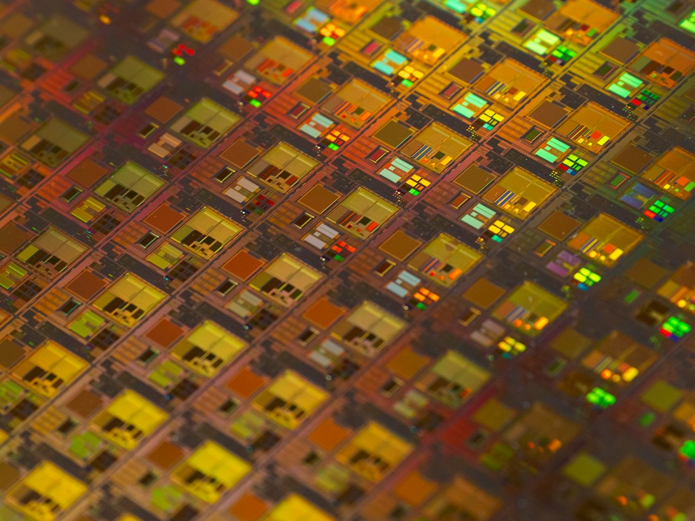

今天的主角有两个：一个终于走向了资本市场，一个被资本市场重新审视。Anthropic正式挂牌上市，TechCrunch把它的IPO与同日成为史上最成功娱乐发布之一的纯人工打造GTA VI放在同一篇文章里对照；另一边，英伟达因美国收紧出口管制暂停向东南亚四个国家出货AI芯片，S&P还酝酿将其评级下调至AA-。OpenAI则悄悄合并了ChatGPT的Chat与Work体验，纽约州干脆把儿童AI聊天玩具禁了五年。资本、芯片、监管三线齐发，以下为今日完整日报。

## 一、研究突破

1. **arXiv: 用局部延续学摘要实现Agent长程自我改进** — 论文提出推理模型随上下文增长而退化, 通过从局部延续中学习摘要来延长有效推理链, 为长程Agent训练提供新路径。(来源: arXiv cs.AI, 11-26)
   [arxiv.org/abs/2611.31621](https://arxiv.org/abs/2611.31621)

2. **arXiv: Wavefront低秩草稿推测解码** — 提出低秩草稿加并行因果精炼的推测解码框架, 用廉价起草器加速LLM推理验证。(来源: arXiv cs.AI, 11-26)
   [arxiv.org/abs/2611.31638](https://arxiv.org/abs/2611.31638)

3. **arXiv: 后前沿时代的可监控架构设计** — 针对前沿模型大量推理不再经过可监控思维链的趋势, 提出基于分区化的by-design可监控架构。(来源: arXiv cs.AI, 11-26)
   [arxiv.org/abs/2611.31610](https://arxiv.org/abs/2611.31610)

4. **arXiv: Agent评测的Null Proportion视角与Taxi大规模调试系统** — 两篇论文分别提出无真值条件下的Agent行为评测方法, 以及对生产环境Agent进行调试、聚类与监控的规模化系统。(来源: arXiv cs.AI, 11-26)
   [arxiv.org/abs/2611.31539](https://arxiv.org/abs/2611.31539)

5. **Anthropic: Claude解决黑洞物理两个公开问题** — Anthropic研究页展示Claude解决理论物理中与黑洞和量子引力相关的两个公开问题, 另有Claude辅助解析vault粒子结构等科研进展。(来源: Anthropic, 近期)
   [anthropic.com/research/claude-black-hole-physics](https://www.anthropic.com/research/claude-black-hole-physics)

## 二、产品发布

1. **OpenAI合并ChatGPT的Chat与Work体验, 统一用量计量** — OpenAI将引入跨ChatGPT的单一用量仪表, 合并Chat与Work两套体验, 重度用户将更早触达用量上限。(来源: TechCrunch, 11-25)
   [techcrunch.com](https://techcrunch.com/2026/11/25/openai-says-heavy-chatgpt-users-may-hit-limits-sooner-as-it-merges-chat-and-work/)

2. **Google将让AI代理接入其MCP服务器** — Google计划让Workspace AI代理使用官方MCP服务器, 但首批Gmail MCP不支持发信, 生态整合与能力边界引发讨论。(来源: HN/techstackups, 11-26)
   [techstackups.com](https://techstackups.com/articles/google-workspace-ai-agents-mcp/)

3. **Moat: 定位为OpenRouter替代品的模型路由方案** — HN上线Moat, 主打多模型统一路由与OpenRouter替代。(来源: HN, 11-26)
   [commandcode.ai/moat](https://commandcode.ai/moat)

4. **AMD专属fork版llama.cpp** — 社区发布针对AMD硬件优化的llama.cpp分支, 补足ROCm生态推理工具链。(来源: HN, 11-26)
   [devnull.land](https://devnull.land/amd-specific-llama-cpp)

## 三、融资并购

1. **Anthropic正式挂牌上市** — TechCrunch专栏以"Anthropic IPO当日, 纯人工打造的游戏大作GTA VI成为史上最成功娱乐发布之一"为题, 探讨AI效率叙事与人类创作的价值对照。(来源: TechCrunch, 11-26)
   [techcrunch.com](https://techcrunch.com/2026/11/26/as-anthropic-ipos-grand-theft-auto-vi-proves-why-efficiency-isnt-a-virtue/)

2. **美国AI投资热潮下家族办公室与基金会现分歧** — FT中文网报道知名家族办公室与基金会围绕AI资产的风险与回报之争, 配置思路明显分化。(来源: FT中文网, 11-26)
   [ftchinese.com](https://www.ftchinese.com/story/bb7b5b53-8141-4d99-9a84-e48f0cf8dbdd)

## 四、产业应用

1. **AI代理接管DeepMind部分Gemini实验算力** — the-decoder报道AI代理现已控制DeepMind用于Gemini实验的部分算力, 递归自我改进的可能性再引争论, HN热议。(来源: the-decoder/HN, 11-26)
   [the-decoder.com](https://the-decoder.com/ai-agents-now-control-part-of-deepminds-compute-for-gemini-experiments-but-recursive-self-improvement-is-still-elusive/)

2. **王兴兴: 5到10年内中国机器人产量有望超过汽车** — 宇树科技王兴兴在36氪早报中给出产量时间表, 同日深圳机器人开放创新中心揭牌, 北京手术机器人注册证数量居全国首位。(来源: 36氪/中国新闻网, 11-27)
   [36kr.com](https://36kr.com/p/4087256294160773?f=rss)

3. **Anthropic: AI for科学发现成为主线应用** — Anthropic发布研究者使用Claude开展科研的画像, 覆盖蛋白质设计、药物研发加速与科学模型构建等方向。(来源: Anthropic, 近期)
   [anthropic.com/research/how-researchers-use-claude](https://www.anthropic.com/research/how-researchers-use-claude)

## 五、行业动态

1. **英伟达暂停向东南亚出货AI芯片** — 英伟达通知制造伙伴暂停向马来西亚、新加坡、泰国、印尼的服务器出货, 配合美国收紧AI芯片出口管制的最新行动。(来源: TechCrunch, 11-26)
   [techcrunch.com](https://techcrunch.com/2026/11/26/nvidia-hits-pause-on-chip-shipments-to-southeast-asia/)

2. **黄仁勋违反英伟达行为准则风波发酵** — TechCrunch分析黄仁勋触碰自家行为准则一事对内部文化的潜在影响, 员工情绪或成隐患。(来源: TechCrunch, 11-25)
   [techcrunch.com](https://techcrunch.com/2026/11/25/jensen-huang-broke-nvidias-code-of-conduct-and-his-employees-may-not-forget-it/)

3. **AI数据中心越建越难, neocloud承压** — 英伟达明确不为未接近可运行的AI数据中心兜底, 新兴云厂商融资与建设瓶颈同步显现。(来源: TechCrunch, 11-25)
   [techcrunch.com](https://techcrunch.com/podcast/ai-data-centers-are-becoming-harder-to-build-and-neoclouds-are-feeling-it/)

4. **HN热议: OpenAI或已进入成本控制模式** — 博客分析OpenAI近期产品与计费动向显示其转向成本控制, 与Chat/Work合并统一用量的动作相互印证。(来源: HN/micjm, 11-26)
   [micjm.com](https://micjm.com/blog/openai-is-in-cost-control-mode/)

5. **Simon Willison: AI带来的"去个体化"** — 引述Jack Despain Zhou观点: 打开视频听到的是Claude的声音, 会议演讲里是AI的腔调, AI正在抹平内容中的个人印记。(来源: simonwillison.net, 11-26)
   [simonwillison.net](https://simonwillison.net/2026/Nov/26/jack-despain-zhou/)

6. **四家美国大厂高被引AI科学家对比** — HN上线可视化对比OpenAI/Anthropic/Google/DeepMind等四家公司高被引AI科学家的构成。(来源: HN, 11-26)
   [topcitedscientists.com](https://topcitedscientists.com/figures/ai-at-four-us-companies/)

7. **6G产业推进提速, 4只概念股获机构净买入超10亿元** — 36氪早报关注6G产业链资金动向。(来源: 36氪, 11-27)
   [36kr.com](https://36kr.com/newsflashes/4087249741019776?f=rss)

## 六、市场数据

1. **S&P考虑下调英伟达信用评级** — 因治理问题与"关键人物"风险, 标普或将其评级降至AA-, 市场对AI龙头集中度风险定价升温。(来源: TechCrunch, 11-25)
   [techcrunch.com](https://techcrunch.com/2026/11/25/sp-considers-nvidia-credit-downgrade-over-governance-and-key-man-risks/)

2. **四大行签订股票回购增持贷款合同超6000亿元** — 中国新闻网财经报道国有大行支持上市公司回购增持的贷款规模。(来源: 中国新闻网财经, 11-26)
   [chinanews.com.cn](https://www.chinanews.com.cn/cj/2026/11-26/10738467.shtml)

3. **韩国据悉评估扩大股市稳定基金规模** — 36氪快讯: 韩国监管方研究加码平准基金应对市场波动。(来源: 36氪, 11-27)
   [36kr.com](https://36kr.com/newsflashes/4087268463311236?f=rss)

4. **德意志银行预计2027年德国股市将再创新高** — 36氪快讯转载德银2027年展望。(来源: 36氪, 11-27)
   [36kr.com](https://36kr.com/newsflashes/4087231493044871?f=rss)

5. **百只上市公募REITs首发规模合计超2500亿元** — 中国REITs市场规模里程碑。(来源: 36氪, 11-27)
   [36kr.com](https://36kr.com/newsflashes/4087233646295687?f=rss)

6. **特朗普质疑三季度GDP大幅修正, 要求立即调查** — 美国经济数据可信度争议再起。(来源: 36氪, 11-27)
   [36kr.com](https://36kr.com/newsflashes/4087223687002501?f=rss)

7. **市场调整私募密集发声, 看好A股中长期价值** — 36氪早报汇总私募机构观点。(来源: 36氪, 11-27)
   [36kr.com](https://36kr.com/newsflashes/4087219084982656?f=rss)

## 七、技术工具

1. **sqlite3_rsync: SQLite官方数据库远程拷贝工具** — Simon Willison梳理SQLite 3.47起以实验身份加入的sqlite3_rsync, 远程同步数据库的新原生方案。(来源: simonwillison.net, 11-26)
   [simonwillison.net](https://simonwillison.net/2026/Nov/26/sqlite3-rsync/)

2. **在浏览器标签页里同时跑三个Linux虚拟机** — HN项目SideBySide在单个浏览器页面并排运行三个不同浏览器的Linux VM, WebAssembly能力再刷新认知。(来源: HN, 11-26)
   [michidk.github.io/sidebyside](https://michidk.github.io/sidebyside/)

3. **AI让自托管重新变得有趣** — HN热帖: 开发者借助AI配置家庭服务器与自托管服务, 运维门槛显著下降。(来源: HN, 11-26)
   [janlukas.blog](https://janlukas.blog/posts/ai-self-hosting)

## 八、安全与伦理

1. **纽约州禁止儿童AI聊天玩具, 为期五年** — 在Common Sense Media披露AI玩具存在不当内容暴露等安全失败后, 纽约州立法禁止AI聊天玩具五年, 圣诞季生效。(来源: TechCrunch, 11-25)
   [techcrunch.com](https://techcrunch.com/2026/11/25/want-to-buy-your-kid-an-ai-toy-this-christmas-not-in-new-york/)

2. **Character.AI破产出售拟拍卖用户私聊, 遭多州总检察长挑战** — 拟出售资产含2100万美国账户敏感数据, 其中210万为未成年人注册, 州总检察长联合叫停。(来源: TechCrunch, 11-25)
   [techcrunch.com](https://techcrunch.com/2026/11/25/state-ags-fight-character-ais-plan-to-auction-off-users-private-chats/)

3. **纽约时报警告摄影师勿升级Photoshop** — 因新版Photoshop内置AI功能引发版权与真实性顾虑, 纽约时报建议摄影团队暂缓升级, HN讨论热烈。(来源: HN/simonwillison.net, 11-26)
   [simonwillison.net](https://simonwillison.net/2026/Nov/26/hn-50651685/)

4. **Dario Amodei驳斥"向AI交出人类控制权"指控: 荒谬** — Anthropic CEO回应竞对指控, 强调在AI自主性提升的同时保持人类能动性, 各家实验室自主化趋势却在加剧。(来源: TechCrunch, 11-25)
   [techcrunch.com](https://techcrunch.com/2026/11/25/anthropics-dario-amodei-calls-accusations-of-surrendering-human-control-to-ai-absurd/)

5. **arXiv: ContextLure利用良性对话历史实施间接提示注入** — 论文展示Agent长对话记忆可被用作注入载体, 提示注入面随交互变长而扩大。(来源: arXiv cs.AI, 11-26)
   [arxiv.org/abs/2611.31424](https://arxiv.org/abs/2611.31424)

6. **arXiv: MOZAIC音视频深伪基准** — 面向音视频同步深伪的评测基准, 要求模型不仅判真伪还要指出伪造对象, 直指当前深伪检测短板。(来源: arXiv cs.AI, 11-26)
   [arxiv.org/abs/2611.31301](https://arxiv.org/abs/2611.31301)

7. **FT中文网: AI泡沫最大的陷阱是看对了未来却买错了股票** — FT专栏提醒AI长期叙事正确不等于个股投资正确, 泡沫期选股风险高于方向判断。(来源: FT中文网, 11-26)
   [ftchinese.com](https://www.ftchinese.com/story/9105c0b9-d097-4b46-ba48-ed546e09e1f3)

---

今日一句话总结: Anthropic上市让AI叙事第一次完整接受公开市场定价, 而英伟达的东南亚停摆与评级警告提醒所有人——这条产业链的地缘与治理风险, 同样在给故事重新标价。
